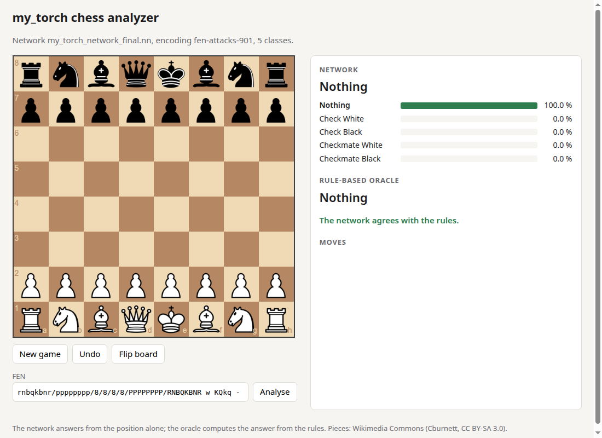
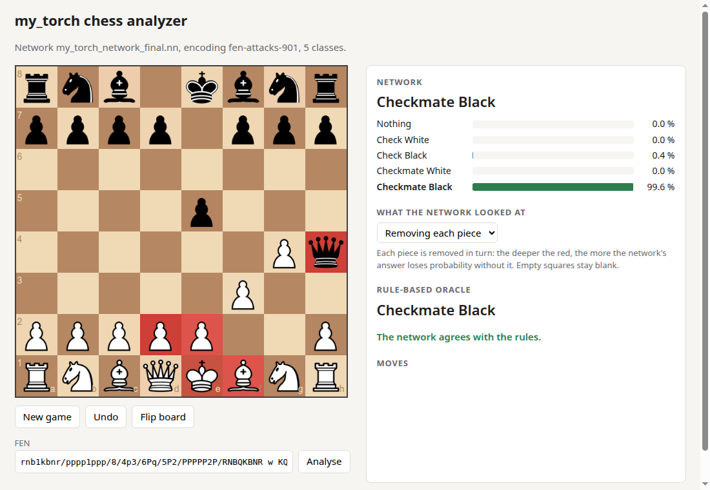

# my_torch: a neural-network library from scratch, and a chess position classifier

A neural-network library written from scratch in **C++20**, with no neural-network or
linear-algebra library: matrices, layers, backpropagation, optimizers, training loop and file
format are all hand-written and checked by finite differences. On top of it,
**`my_torch_analyzer`** reads chess positions in FEN notation and predicts the state of the game
(`Checkmate`, `Check` or `Nothing`, with the side), by supervised learning.

> **Context**: school project (Epitech, 3rd year), built by a team of two and published with
> authorization. What the specification required and what we added beyond it:
> [docs/scope.md](docs/scope.md).
>
> Core constraint: no neural-network library (PyTorch, TensorFlow, Keras, scikit-learn, JAX…) and
> no automatic differentiation. Everything is implemented from scratch
> ([ADR-0002](docs/adr/0002-cpp-language.md), [ADR-0003](docs/adr/0003-in-house-linear-algebra.md)).



## What is implemented

| Area | Content (`include/my_torch/`, `src/my_torch/`) |
| --- | --- |
| Linear algebra | Own `Matrix` class; blocked, multi-threaded matrix product, 4.2 to 4.7× faster on one thread and up to 23× on 12 ([12-matmul.md](docs/performance/12-matmul.md)) |
| Layers | `Dense`; activations ReLU, LeakyReLU, Sigmoid, Tanh, Softmax; `Dropout`; `BatchNorm`, `LayerNorm` |
| Convolution | `ToPlanes`, `Conv2D`, `MaxPool2D`, `AvgPool2D`, `GlobalAvgPool` |
| Containers | `Residual` and `Concat` blocks ([ADR-0046](docs/adr/0046-residual-blocks.md)) |
| Attention | Mini transformer: `ToTokens`, `TokenDense`, `Positional`, multi-head `SelfAttention`, `TokenNorm` ([ADR-0047](docs/adr/0047-attention-layers.md)) |
| Losses | MSE, MAE, Huber, binary and softmax cross-entropy |
| Optimizers | SGD (momentum, Nesterov), Adam, AdamW, RMSProp, Adagrad; schedulers constant, step, exponential, cosine, warmup |
| Training | Mini-batches, seeded shuffling, L1/L2, early stopping, gradient clipping, checkpoints with identical resumption, data sources encoded batch by batch |
| Evaluation | Classification metrics, stratified k-fold cross-validation, grid and random hyperparameter search, MC dropout, ensembles |
| File format | Binary network file with signature, version and checksum ([ADR-0042](docs/adr/0042-binary-network-file-format.md)) |

The chess side (`src/analyzer/`) has a validating FEN parser, several input encodings
(one-hot 768/773, signed 385, attack maps 901) and board-symmetry data augmentation.

## Results

All numbers are measured, on a test split never used for any choice
([docs/performance/](docs/performance/README.md)):

| Model | Test accuracy |
| --- | --- |
| Pushed dense network `my_torch_network_final.nn` (fen-attacks-901 → 256 → 128 → 5) | **96.2 %** on 71,555 unseen positions ([10](docs/performance/10-final-network.md)) |
| Our CNN | **98.07 %** ([20](docs/performance/20-cnn.md), [26](docs/performance/26-comparison.md)) |
| Stacked ensemble dense + CNN | **98.26 %** ([27](docs/performance/27-ensembles.md)) |
| Baselines on the same split: logistic regression / random forest / scikit-learn MLP / LightGBM | 65 % / 77 % / 91.7 % / 96.75 % ([23](docs/performance/23-baselines.md)) |
| Mini transformer, 1 / 2 blocks (10 % of the data, 10 epochs) | 91.67 % / 91.80 %, against 94.17 % for the CNN on the same budget ([29](docs/performance/29-attention.md)) |

Against PyTorch with the same architectures, weights and batches: same results, 3 to 6 times slower
to train, 2 to 3 times less memory ([22](docs/performance/22-pytorch-reference.md),
[26](docs/performance/26-comparison.md)). The main weakness: 91 % of the remaining errors of the
dense network are check against checkmate of the same side.

## Build and usage

Requirements: g++ (C++20) and make; [Criterion](https://github.com/Snaipe/Criterion) for the tests.

```bash
make                    # my_torch_analyzer and my_torch_generator
./my_torch_analyzer --predict my_torch_network_final.nn chessboards.txt
./my_torch_analyzer --train [--save NEW.nn] NETWORK.nn chessboards.txt
./my_torch_generator configs/basic_network.conf 3   # writes basic_network_1.nn to _3.nn
```

On error, the message goes to standard error and the program exits with code 84. Step by step:
[docs/usage.md](docs/usage.md); configuration format: [docs/configuration.md](docs/configuration.md).

| Rule | Effect |
| --- | --- |
| `make` | Builds with `-O2` |
| `make debug` | Rebuilds with AddressSanitizer and UBSan |
| `make tests_run` | Builds and runs the Criterion tests (with coverage) |
| `make clean` / `fclean` / `re` | Cleaning and rebuilding |
| `make -C bonus` | Oracle, stalemate generator, GUI, network dump, ensembles |

A demo that needs no dataset: `sh scripts/demo.sh` ([docs/demo.md](docs/demo.md)).

### Chess GUI

```bash
cd bonus && make my_torch_gui && ./my_torch_gui ../my_torch_network_final.nn   # http://localhost:8080
```

Each move is analysed by the network and by a rule-based oracle, with a saliency map of the squares
that decide the answer ([docs/gui.md](docs/gui.md)):



### Dataset

Dataset: `dataset.zip` (723,019 labelled positions, provided by Epitech, redistributed with
authorization). Extract it at the repository root: `unzip dataset.zip` → `dataset/` (the default
`DATASET` of the scripts; set `DATASET=path` otherwise). One folder per class (`check/`,
`checkmate/`, `nothing/`), each with `10_pieces.txt`, `20_pieces.txt` and `many_pieces.txt`: one
FEN position followed by its label per line ([docs/reading-a-fen.md](docs/reading-a-fen.md)).

## Scope: required minimum and additions

| Required by the specification | Status |
| --- | --- |
| Neural-network library from scratch, no NN library, no autodiff | Done |
| `my_torch_analyzer --train / --predict`, FEN → `Checkmate` / `Check` / `Nothing` (+ side) | Done |
| `my_torch_generator` creating blank networks from configuration files | Done |
| Pushed pre-trained network `my_torch_network*` | Done, 96.2 % on unseen positions |
| Errors on stderr, exit code 84; reproducible training; Makefile `re`/`clean`/`fclean`; bonuses in `bonus/` | Done |

Beyond it: CNN, attention / mini transformer, residual blocks, BatchNorm/LayerNorm, five
optimizers and schedulers, cross-validation, MC dropout, ensembles, binary file format, threaded
matrix product, rule-based oracle, stalemate class, GUI with saliency, Python bindings (pybind11),
comparison with PyTorch and classical models, unattended AWS training. Full table with the reason
and the evidence for each: [docs/scope.md](docs/scope.md).

## Repository layout

| Path | Content |
| --- | --- |
| `include/my_torch/`, `src/my_torch/` | The library, compiled into `build/libmy_torch.a` |
| `src/analyzer/`, `src/generator/` | The analyzer (FEN, encodings, CLI) and the network generator |
| `tests/`, `bonus/tests/` | Criterion tests, with finite-difference gradient checks |
| `configs/` | Network configurations of every experiment |
| `scripts/` | Training, benchmarks and graphs to reproduce every result |
| `bonus/` | Oracle, stalemate positions, GUI, Python bindings, comparison with PyTorch and classical models (isolated in `bonus/comparaison/`) |
| `docs/` | Project file, see below |

## Documentation

| Document | Content |
| --- | --- |
| [docs/README.md](docs/README.md) | Map of the whole project file |
| [docs/scope.md](docs/scope.md) | Required minimum against what we added |
| [docs/adr/](docs/adr/README.md) | Architecture Decision Records, one per decision, with options and trade-offs |
| [docs/architecture.md](docs/architecture.md), [docs/library.md](docs/library.md) | Architecture and library reference |
| [docs/performance/](docs/performance/README.md) | Every benchmark: method, machine, data, graphs, script |
| [docs/legal/](docs/legal/README.md) | Risk analysis, licenses, privacy, terms of use |
| [docs/business/](docs/business/README.md) | Business plan and costs |
| [docs/retrospective/](docs/retrospective/README.md) | What we would do differently |

## Team

Built by a team of two.

**My contribution (Ridwane777):** the core of the library (public API, `Matrix` and its blocked,
threaded product, dense layer and gradient checks, training loop, regularization, dropout, early
stopping, metrics, network file format then its binary version, checkpoints, gradient clipping,
hyperparameter search, residual and concat blocks, ensembles), the generator, the FEN parser and the
analyzer command line, the final pre-trained network, the bonuses (rule-based oracle, stalemate
generator, chess GUI with saliency, network inspection, MC dropout, Python bindings, classical
baselines), and most ADRs and performance reports for these parts.

**Meric Gbemetonou ([@Meric-BG](https://github.com/Meric-BG)):** losses, optimizers and schedulers,
weight initialisation, convolutional layers and the CNN, the attention layers and mini transformer,
the input encodings, data augmentation, class imbalance, dataset statistics and split,
cross-validation, the PyTorch reference, unattended training on AWS, and the matching benchmarks.

Rights: all rights reserved ([ADR-0025](docs/adr/0025-project-license.md)).
