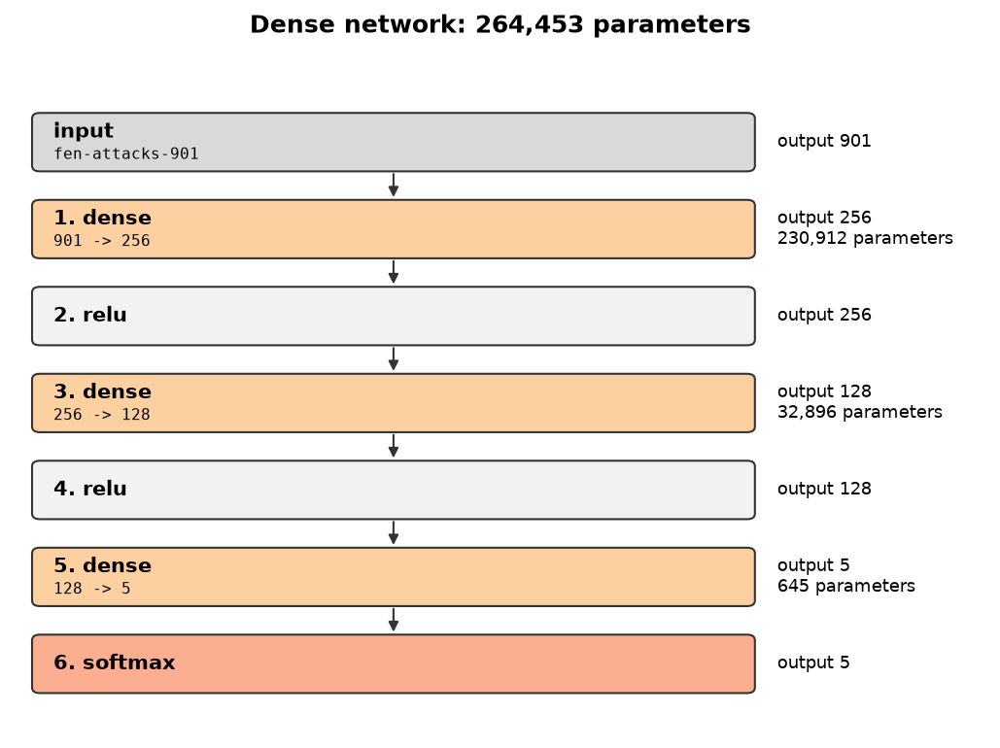
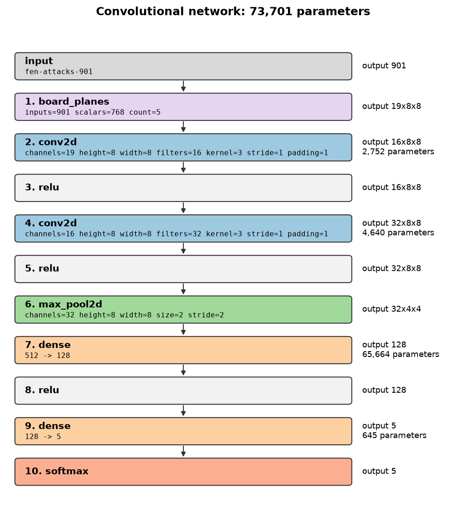

# ADR-0037: Convolutional layers and CNN for the chessboard

- **Status**: Proposed
- **Date**: 2026-10-29
- **Deciders**: to be decided by the pair (issue #29)

> Numbering: ADR-0036 (comparison framework) exists on the unmerged branch
> `docs/comparison-framework`; this ADR was written from `main`, where 0036 is free. The number may
> need to be changed, or the index line moved, when the two branches are merged.

## Context
Issue #29 asks for convolutional layers (Conv2D, pooling) and a CNN for the chessboard, compared
with the dense network. A board is naturally a stack of planes of 8 × 8 squares, and "is the king
attacked, and by what" is a local pattern: a convolution reuses the same detector on every square.
The library only had dense layers; the network file, the generator and the analyzer work on rows
of numbers. The encoding is `fen-attacks-901` (ADR-0016) and the pushed network is dense
(ADR-0023); a convolutional network must load in the same analyzer and train with the same
pipeline (`scripts/train_final.sh`), on the same data and split, to be comparable.

The 901 inputs are not 19 planes: they are 12 piece planes (index `plane·64 + square`), 5
game-state scalars (columns 768 to 772), then the white and black attack planes (columns 773 to
900), so 14 planes of 64 squares with the scalars in the middle.

## Options considered
| Option | Pros | Cons |
| --- | --- | --- |
| **Parameter-free `board_planes` layer: the 14 square planes plus one constant plane per scalar, 19 × 8 × 8 (chosen)** | Keeps the encoding, the data and the pushed network untouched; one layer, no format change; the scalars (side to move, castling, en passant) reach every convolution | A scalar broadcast on 64 squares is a shortcut: 5 of the 19 channels carry one number each |
| A parallel dense path for the scalars, merged after the convolutions | Scalars are not repeated 64 times | Needs a branching container layer and a change of the network file format; close to the graph architectures of #31 |
| A new 8 × 8 × 19 encoding written by the analyzer | The input is the image the convolution wants | A new encoding to measure against the others (ADR-0016), a new input width, and the data pipeline changes |
| **Conv2D by im2col and one product (chosen)** | Reuses the blocked, threaded `Matrix` product (ADR-0024) for forward and for both backward products; each product is checked by the same finite differences | The patch matrix repeats every input value k² times: memory, bounded here by handling at most 256 samples at a time |
| Direct convolution loops | No patch matrix | Several nested loops, none of the cache blocking and threading of ADR-0024; slower to write and to check |
| Layers keep their geometry in the file (`conv2d channels=… height=…`) (chosen) | Nothing is inferred: a mismatch is an error with a line, at load time | The configuration repeats the sizes the previous layer already knows |
| Infer the geometry from the previous layer | Shorter configurations | The row width does not say if 1024 is 64 × 4 × 4 or 16 × 8 × 8: guessing; wrong shapes would train silently |

## Decision
Five layers in a new `include/my_torch/Convolution.hpp`: `BoardPlanes`, `Conv2D`, `MaxPool2D`,
`AvgPool2D` and `GlobalAvgPool`. A matrix row is one sample, flattened channel-major
(`channels × height × width`). `Conv2D` takes weights `filters × (channels·k·k)` (He normal by
default, seeded like `Dense`), stride, zero padding; forward builds the patch matrix of each block
of 256 samples (im2col), does one product with the transposed weights and puts the result back in
channel-major order; backward does `dW = dZᵀ·patches`, `dPatches = dZ·W` and adds the patches back
to the input (col2im). Pooling has no padding, rounds the output size down and rejects zero sizes;
`MaxPool2D` keeps the argmax and sends the gradient to the first maximum. `BoardPlanes inputs=901
scalars=768 count=5` copies the 14 square planes and appends the 5 scalar planes; in backward a
scalar receives the sum of the gradients of its plane.

**Contract change** (`include/my_torch/`, which both work packages include; this ADR must be
reviewed by both members): `Layer` gets `virtual std::size_t outputWidth(std::size_t inputWidth)
const`, identity by default. `Dense`, the convolution and pooling layers and `BoardPlanes` override
it and throw `my_torch::Error` ("expects N inputs but receives M") when the width is not the one
they need. The validation of a network file and `modelSummary` follow the widths through it
instead of looking at `Dense` layers only; the BatchNorm and LayerNorm checks are unchanged.
Existing layers, files and configurations are unaffected (the full test suite passes, and the pushed network re-scored on the full test split gives the
same accuracy and macro F1 as before, `docs/performance/20-cnn.md`). The network file
format keeps its version: the five new lines (`conv2d channels=… filters=… kernel=… stride=…
padding=…` followed by the weights and biases, the others parameter-free) are new layer types, as
`batch_norm` was.

The comparison network, `configs/cnn_network.conf`: `board_planes`, `conv2d` 19 → 16, ReLU,
`conv2d` 16 → 32, ReLU, `max_pool2d` 2/2 (32 × 4 × 4), `dense 512 128`, ReLU, `dense 128 5`,
softmax, with the input, labels, loss, optimizer and train line of `final_network.conf`. The
planned 32 and 64 filters were measured too slow on a pilot and reduced to 16 and 32
(`docs/performance/20-cnn.md`, which also explains why the pilot timings varied between sessions).

Both architectures, drawn from their configuration files by `sh scripts/architecture.sh`, with the
output shape and the parameter count of each layer
([dense, 264,453 parameters](../performance/data/architecture_dense.png),
[CNN, 73,701 parameters](../performance/data/architecture_cnn.png)):

## Consequences
- ✅ Every layer is covered by hand-computed forward values (which catch layout errors that a
  gradient check cannot, such as a transposed kernel or a mixed channel order) and by finite
  differences of the input, the weights and the biases, including a stride of 2 with padding 1 and
  several channels; a CNN saves and loads with bit-identical predictions and is refused with the
  layer index when widths do not chain.
- ✅ The geometry is explicit in files and configurations, and the architecture diagram
  (`scripts/architecture.sh`) is generated from the same `outputWidth` and `parameters()` code as
  `modelSummary`.
- ❌ A change in `include/my_torch/Layer.hpp`, the contract between the two work packages: any
  layer written elsewhere keeps working (identity default) but does not get its input width checked.
- ❌ Convolution is slow here: the product of ADR-0024 reaches about 7 GFLOPS in double precision,
  and the patch matrix repeats the input nine times (measured below: time per epoch against the
  dense network).
- ❌ The scalars as constant planes are a shortcut: the network has to learn that five of its
  channels are constant.
- ❌ One geometry only: square kernels, symmetric padding, no dilation, no padding in pooling, and
  no residual connection (#31).
- ✅ Measured outcome (`docs/performance/20-cnn.md`, 10 % of the data, same split and settings,
  one seed): the CNN (73,701 parameters, 1.5 MB) scores 0.9684 accuracy and 0.9561 macro F1 on 7,155
  test positions, the dense network (264,453 parameters, 5.6 MB) 0.8577 and 0.8302; all the CNN's
  226 errors are check against checkmate of the same side. That dense baseline overfits at 10 % of
  the data (best validation loss at epoch 6, then it rises): it is a data-starved reference, not
  the dense network's best. The pushed dense network (all the data), scored on the same 7,155
  positions with this branch, gives 0.9589 and 0.9459, so the 10 % CNN is about 1 point above it,
  with one seed each; on the whole test split it still gives 0.9615 and 0.9478, unchanged.
- ❌ The CNN is slower: 58 s against 28 s per epoch and 0.87 s against 0.24 s to predict the test
  split in the same session. A first pair of full-data trainings was lost and not relaunched, so
  the CNN has **not** been measured on all the data, and a time per full epoch (about 10 minutes)
  is an extrapolation.
- **Should the CNN replace the pushed network?** Not yet, and not decided here: the evidence is a
  10 % data run on a 7,155-position subset of the test split, where the CNN is about 1 point above
  the pushed dense network scored on the same positions (0.9684 against 0.9589 accuracy), one seed
  each: a small gap, and the full-data CNN is unmeasured. `my_torch_network_final.nn` stays the
  dense network.
  The pair decides after `sh scripts/train_final.sh configs/cnn_network.conf runs/cnn` and
  `sh scripts/bench_cnn.sh` against a full dense run on the same machine.
- Follow-up: that full run; the status moves to Accepted when the pair has reviewed the
  `Layer::outputWidth` contract change and decided on the network; a saliency map for the CNN
  (ADR-0035); other geometries (more filters, a third convolution) and a hyperparameter search for
  it; the renumbering of this ADR at merge with `docs/comparison-framework`.
