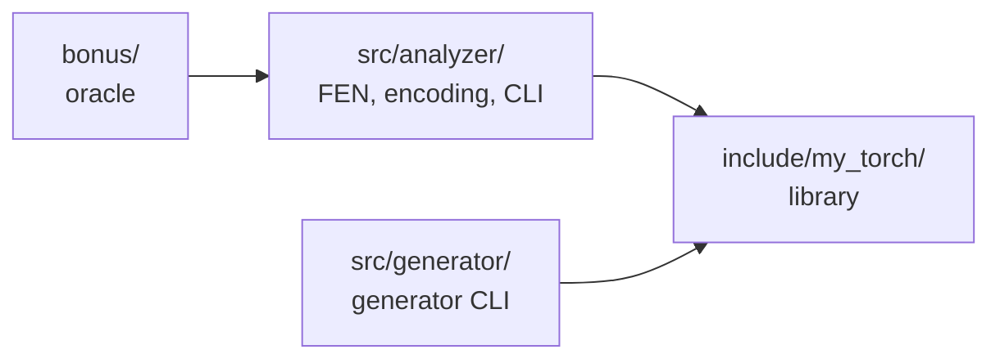
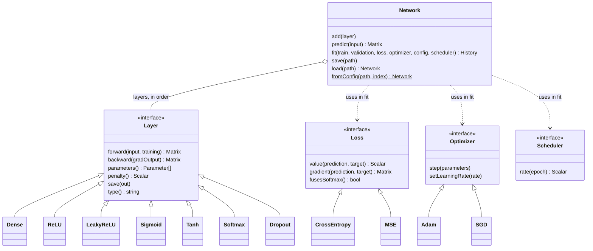
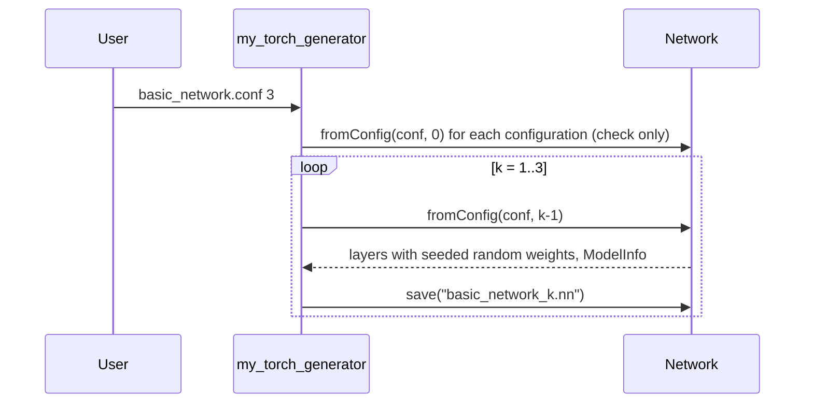
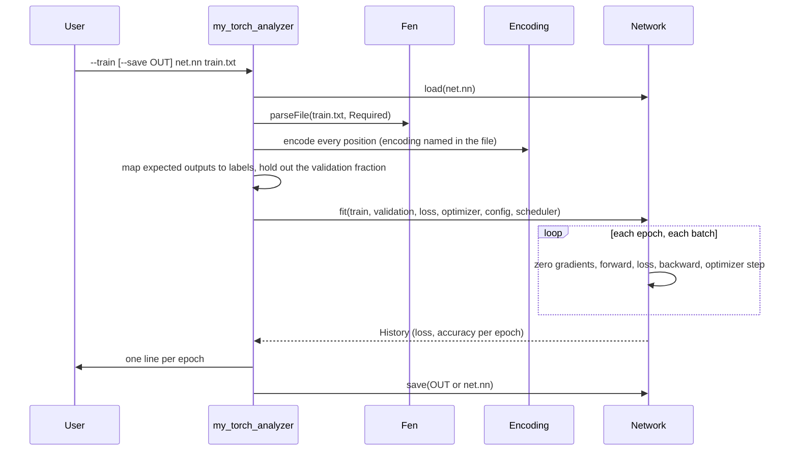
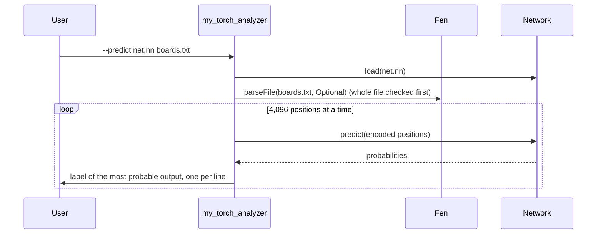

# Architecture

How the project is organized and how data flows through it, without reading the code. The reasons
behind each choice are in the [ADRs](adr/README.md); this page describes what exists.

## 1. Four parts and one dependency rule

| Part | Where | Role |
| --- | --- | --- |
| **`my_torch` library** | `include/my_torch/`, `src/my_torch/` → `build/libmy_torch.a` | A generic neural-network library: matrices, layers, losses, optimizers, training loop, metrics, network file. Knows nothing about chess |
| **Analyzer** | `src/analyzer/` → `my_torch_analyzer` | Reads FEN positions, encodes them, trains or queries a network (`--train`, `--predict`) |
| **Generator** | `src/generator/` → `my_torch_generator` | Writes untrained networks from configuration files |
| **Bonus** | `bonus/` → `bonus/my_torch_oracle` (own Makefile) | A rule-based chess oracle, used to check data, never to answer for the network |

Arrows point from a part to what it uses. The library depends on nothing but the C++ standard
library; the analyzer and the generator only include the public headers of `include/my_torch/`
(the contract between the two work packages, ADR-0004); `bonus/` reuses the analyzer's FEN parser,
and the main code never includes `bonus/`.

## 2. Module map

### Library (`include/my_torch/`, `src/my_torch/`)

| Module | Content | Decision |
| --- | --- | --- |
| `Matrix` | Dense row-major matrix of `double` (`Scalar`): product, transpose, element-wise operations, bias broadcast, row sums | ADR-0003 |
| `Error` | `my_torch::Error`, the only exception type thrown by the project | ADR-0004 |
| `Layer`, `Dense`, `Activations`, `Dropout` | The `Layer` interface (`forward`, `backward`, `parameters`, `penalty`, `save`, `type`) and its layers: `Dense` (with L1/L2), `ReLU`, `LeakyReLU`, `Sigmoid`, `Tanh`, `Softmax`, `Dropout` | ADR-0004, ADR-0010 |
| `Loss`, `Losses` | The `Loss` interface (`value`, `gradient`, `fusesSoftmax`) and `MSE`, `MAE`, `Huber`, `BinaryCrossEntropy`, `CrossEntropy` | ADR-0007 |
| `Optimizer`, `Optimizers` | The `Optimizer` interface (`step`, `setLearningRate`) and `SGD` (momentum, Nesterov), `Adam`, `AdamW`, `RMSProp`, `Adagrad` | ADR-0008 |
| `Schedulers` | `ConstantRate`, `StepDecay`, `ExponentialDecay`, `CosineAnnealing`, `Warmup` | ADR-0008 |
| `Network` | A sequence of layers: `add`, `forward`, `predict`, `fit`, `parameters`, `save`, `load`, `fromConfig`; `ModelInfo` (encoding, labels, training settings) | ADR-0004, ADR-0009 |
| `Metrics` | Confusion matrix, accuracy, precision, recall, F1, log-loss, top-k, ROC AUC, calibration, CSV/JSON export | ADR-0011 |
| `Factory` | `makeLoss`, `makeOptimizer`, `makeScheduler`: build the training objects from their description in a file | ADR-0012 |
| `Serialization.cpp` | Reader and writer of network files and configuration files | ADR-0012, ADR-0013 |

### Analyzer (`src/analyzer/`)

| Module | Content | Decision |
| --- | --- | --- |
| `Fen` | `parseFen`, `parseLine`, `parseFile`: a FEN line into a `Position` (64 squares, side to move, castling, en passant, counters) and an optional `Label` | ADR-0005 |
| `Encoding` | The `Encoding` interface, the table of encodings looked up by name, and `fen-onehot-768` | ADR-0014 |
| `Cli` | `analyzer::run`: argument parsing, `--predict`, `--train`, `--save` | ADR-0014 |
| `main.cpp` | Calls `run`, turns any exception into a message on standard error and exit code 84 | ADR-0004 |

### Generator (`src/generator/`) and bonus (`bonus/`)

| Module | Content | Decision |
| --- | --- | --- |
| `Generator` | `generator::run`: checks every configuration, then writes `<name>_1.nn` to `<name>_N.nn` | ADR-0013 |
| `bonus/oracle/Oracle` | `isAttacked`, `legalMoves`, `play`, `classify` (check, checkmate, stalemate, illegal), `perft` | ADR-0006 |

## 3. Main classes

Only the main subclasses are drawn. Activations and dropout are layers without parameters
(ADR-0004), so a network is a plain list of layers. A `Parameter` pairs a weight matrix with its
gradient, which is how the optimizer reaches the weights without knowing the layers.

## 4. Flows

### Generate: configuration → untrained network

### Train: network file + labeled positions → trained network file

Inside `fit`, a batch goes forward through the layers, the loss gives the first gradient, and each
layer's `backward` returns the gradient of the layer before it (the final Softmax is skipped when
the loss fuses it, ADR-0007); the optimizer then updates every `Parameter`.

### Predict: network file + positions → one label per line

## 5. The network file

A network lives in one text file (ADR-0012), written by the generator, read and rewritten by the
analyzer, and pushed as `my_torch_network_*.nn` for the autograder. It holds the input encoding
name, the labels in order, the training settings and every layer with its weights, and ends with a
checksum. A configuration file (ADR-0013) uses the same syntax without the weights.

## 6. Errors

Every error is a `my_torch::Error` with a message naming the file and, when it applies, the line.
It travels up to `main`, which prints `my_torch_analyzer: <message>` (or `my_torch_generator: …`) on
standard error and returns 84. The analyzer and the generator check every input before writing or
printing anything, so an error never leaves a partial output.

## 7. Tests

| Kind | What it guarantees |
| --- | --- |
| Finite differences (`tests/my_torch/gradient_check.hpp`) | Every backward pass, loss gradient, penalty and full-network gradient matches the numerical slope to 1e-6 |
| Hand-computed cases | Layers, metrics and the FEN parser reproduce values worked out by hand |
| Mutation checks | Some tests were run against code broken on purpose (wrong derivative, missing Softmax skip, 15 digits instead of 17, swapped precision and recall) to prove they catch the error |
| End-to-end | The generator and the analyzer are run like the real programs, output compared line by line, every error case exits 84 |
| perft and dataset check | The oracle's move generator matches published move counts; the oracle agrees with all 723,019 dataset labels |

`make tests_run` runs the main suite and `make -C bonus tests_run` the bonus one; `make debug`
rebuilds with AddressSanitizer and UndefinedBehaviorSanitizer.
