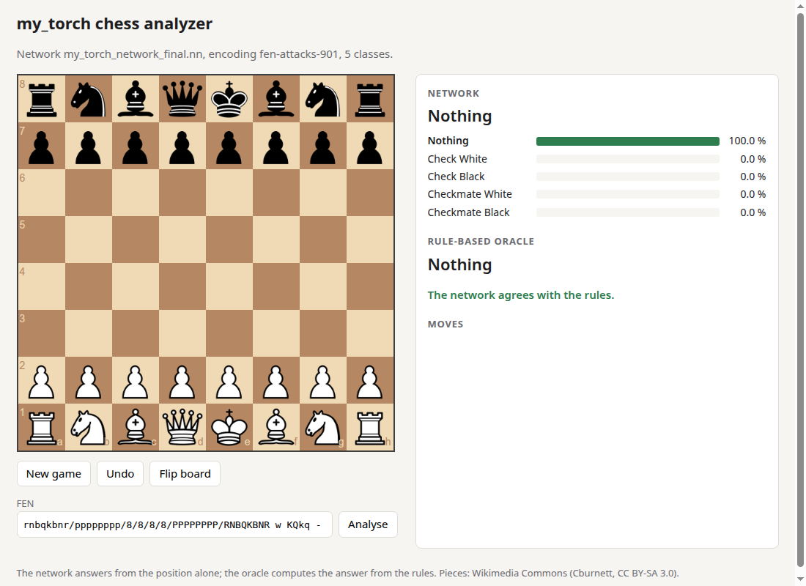
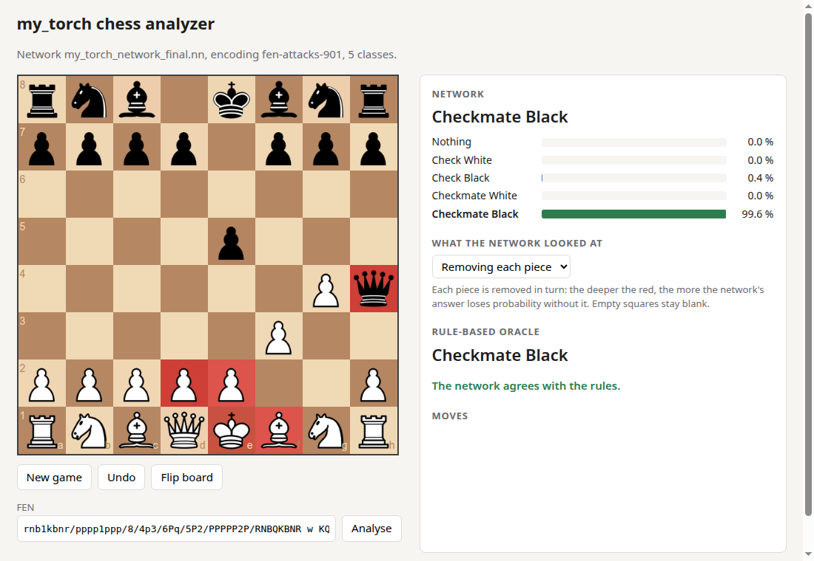

# Chess GUI (bonus)

A board to play moves on, analysed after each move by the network and by the rule-based oracle.
Decision: [ADR-0029](adr/0029-chess-gui.md).



## Start it

```sh
cd bonus
make my_torch_gui                              # builds ../build/libmy_torch.a first if needed
./my_torch_gui ../my_torch_network_final.nn    # optional: a port (default 8080)
```

Then open <http://localhost:8080>. The server listens on 127.0.0.1 only; Ctrl+C stops it. Any
network file works: the page shows the labels the network was trained with.

## What the page shows

- **The board**: drag a piece to play a legal move (rules from chess.js; a pawn always promotes to a
  queen). *New game*, *Undo* and *Flip board* below it.
- **FEN**: the current position; paste another one and press *Analyse*. A position that chess.js
  refuses is still analysed, but cannot be played from.
- **Network**: the predicted class and the probability of each class.
- **Rule-based oracle**: the verdict computed from the rules (`bonus/oracle/`), then whether the
  network agrees. `Illegal` means the side not to move is in check.
- **What the network looked at** (ADR-0035): the squares that made the network give its answer,
  coloured over the board, red where a square supports the answer and blue where it goes against
  it. *Removing each piece* (occlusion, the default) shows how much probability the answer loses
  when the piece of the square is taken off; *Gradient × input* shows the gradient of that
  probability on the square's inputs. On a confident answer the gradient is nearly flat (the
  softmax saturates), so occlusion is the more readable map
  ([19-inspection.md](performance/19-inspection.md)).
- **Moves**: the game so far.
- **A link to a position**: `http://127.0.0.1:8080/?fen=…` opens the page on that FEN.



## How it works

| Part | File | Role |
| --- | --- | --- |
| Server | `bonus/gui/main.cpp` | Loads the network once, serves `bonus/gui/web/`, answers the API |
| Analysis | `bonus/gui/Analysis.cpp` | FEN → encoding of the network → probabilities; FEN → oracle verdict; JSON |
| Saliency | `bonus/gui/Saliency.cpp` | Importance of each square by occlusion and by gradient × input (also used by `scripts/inspect.cpp`) |
| Page | `bonus/gui/web/` | `index.html`, `app.js`, `style.css`; `vendor/` holds chess.js, chessboard.js, jQuery and the piece images |

API, GET only:

- `/api/analyze?fen=FEN` →
  `{"fen": …, "prediction": "Checkmate Black", "probabilities": [{"label": "Nothing", "p": 0.0}, …], "oracle": "Checkmate Black", "gradient": [64 numbers], "occlusion": [64 numbers]}`
  (squares a8 to h1);
  an invalid FEN gives status 400 and `{"error": …}`.
- `/api/info` → the network's file name, encoding and labels.

Tests: `cd bonus && make tests_run` (`bonus/tests/test_gui.cpp`).

## Limits

- One request at a time, no TLS: a local demonstration tool, not a server to expose.
- Analysis only: playing against an AI is issue #27.
