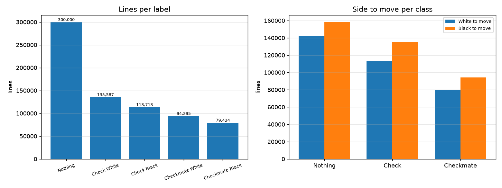
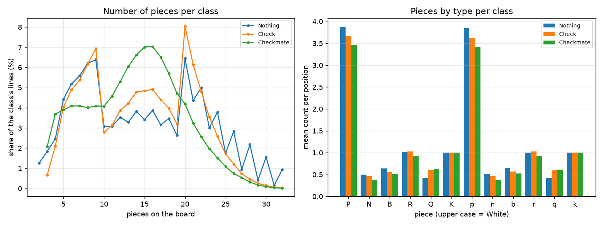
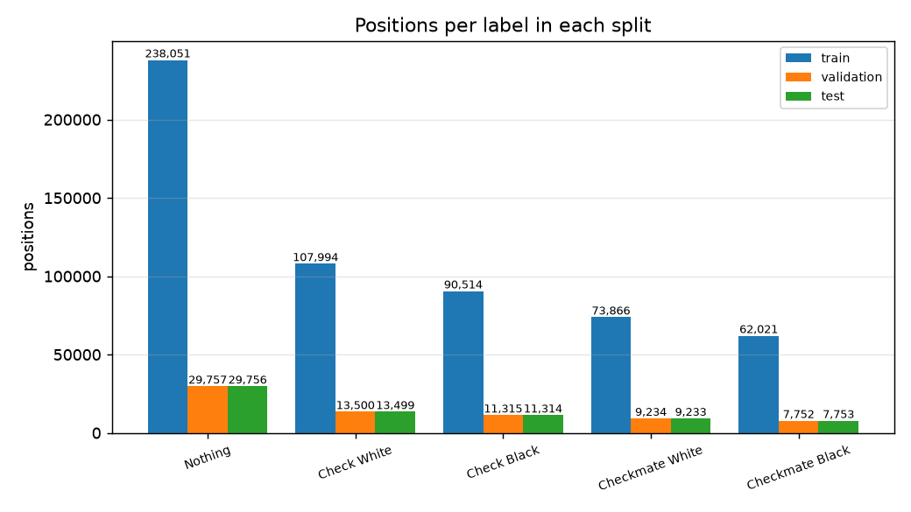

# Dataset analysis and train/validation/test split

Analysis for issue #12: what does the dataset contain, and how is it cut into sets that never
share a position? Related decision: [ADR-0017](../adr/0017-dataset-split.md).

**Status: measured** on the real dataset (723,019 positions, `dataset.zip` given by the school, not pushed),
2026-10-26.

## Method

1. **Reading** (`scripts/dataset_split.py`): every `dataset/*/*.txt` in sorted path order, one
   position per line (`<board> <side> <castling> <ep> <halfmove> <fullmove> <label>`; the label is
   `Nothing`, `Check White|Black` or `Checkmate White|Black`). Blank lines are ignored. A line with
   fewer than 7 fields or an unknown label stops the script with `file:line` on stderr and a
   non-zero exit status.
2. **Position key**: the first four fields (board, side to move, castling, en passant). The clocks
   are ignored because the network input does not use them: the same position with other clocks is
   the same input.
3. **Statistics** (over every valid line, duplicates included): lines per label, colour (suffix of
   the label), side to move per class, distribution of the total number of pieces per class and of
   the count of each piece letter (`PNBRQKpnbrqk`) per class, number of lines, unique keys,
   duplicate lines and contradictory keys.
4. **Split** (stratified, dedupe-aware):
   - lines with the same key and the same label keep one line (the first read);
   - a key with several labels is *contradictory*: it is excluded from all sets and written to
     `contradictions.txt`;
   - for each of the five labels, the sorted keys are shuffled with `random.Random(seed)` and cut
     80 % / 10 % / 10 % (rounded to whole positions); a key goes to exactly one set; each file is
     then shuffled so the labels are mixed.
5. **Outputs**: `train.txt`, `validation.txt`, `test.txt`, `contradictions.txt` and
   `split_manifest.txt` (seed, ratios, count per set and label, SHA-256 of each file) in
   `build/dataset_split/` (ignored by Git, never committed); the CSV files below in
   `docs/performance/data/`, and the charts drawn from them by `scripts/plot_dataset.py` (Python 3
   standard library for the split; matplotlib only for the charts).

- **Reproduce**: `sh scripts/dataset_split.sh` (environment: `DATASET`, `OUT`, `SEED`; options of
  the script: `--seed`, `--train`, `--validation`, `--test`). The same dataset and seed give
  byte-identical files; compare the SHA-256 lines of `split_manifest.txt` to check two runs or two
  machines.
- **Machine and duration**: Intel Core i5-12450H, 15 GB RAM, Linux 6.8, Python 3.12.3; the whole
  command (statistics, split and charts) takes 12.6 s.

## Results (2026-10-26)

The line counts match the figures stated in issue #12 (723,019 lines; 300,000 `Nothing`; 249,300
`Check`; 173,719 `Checkmate`).

| Label | Lines | Kept after dedupe | Lost |
| --- | --- | --- | --- |
| Nothing | 300,000 | 297,564 | 2,436 (0.81 %) |
| Check White | 135,587 | 134,993 | 594 (0.44 %) |
| Check Black | 113,713 | 113,143 | 570 (0.50 %) |
| Checkmate White | 94,295 | 92,333 | 1,962 (2.08 %) |
| Checkmate Black | 79,424 | 77,526 | 1,898 (2.39 %) |
| **Total** | **723,019** | **715,559** | **7,460 (1.03 %)** |

- **Duplicates**: 7,460 lines (1.03 %) repeat a position already present (same board, side, castling
  and en passant, other clocks or another file). Duplicates are concentrated in `Checkmate`
  (about 2 % of its lines against 0.4 % to 0.8 % elsewhere).
- **Contradictions**: 0 positions carry two different labels; nothing is excluded for that reason
  (`contradictions.txt` is empty).
- **Split** (seed 42): train 572,446, validation 71,558, test 71,555 positions; per label the three
  sets are within one position of 80 / 10 / 10 (`data/dataset_split.csv`, SHA-256 in
  `split_manifest.txt`).
- **Imbalance**: `Nothing` is 41.5 % of the lines and `Checkmate Black` 11.0 %, a ratio of 3.8 to 1.
- **Side to move determines the colour of a check**: every `Check White` / `Checkmate White` line
  has Black to move, and every `... Black` line has White to move (135,587 and 94,295 against the
  label counts, 113,713 and 79,424 for White to move). A network that knows the side to move
  therefore knows which of the two colours is possible; this is consistent with the gain of the
  side-to-move inputs in [03-encodings.md](03-encodings.md).
- **Pieces per board** (mean): `Nothing` 14.9, `Check` 14.6, `Checkmate` 13.8. The distribution is
  irregular (peaks at 9 and 20 pieces for `Check`, a regular cycle for `Nothing`), which suggests
  the files are made of different generators (`10_pieces`, `20_pieces`, `many_pieces`).
  Verified since in [02-eda.md](02-eda.md): about 6.5, 14.6 and 23 pieces on average per file group.

Raw data: [`data/dataset_labels.csv`](data/dataset_labels.csv),
[`data/dataset_pieces.csv`](data/dataset_pieces.csv),
[`data/dataset_duplicates.csv`](data/dataset_duplicates.csv),
[`data/dataset_split.csv`](data/dataset_split.csv).

## Limits

- One seed (42) and one dataset were measured; the split is deterministic but another seed gives
  other sets (ADR-0017, accepted).
- Position equality is the key (board, side, castling, en passant). Two boards that are the same
  position written differently are not detected, and the same key may come from different games;
  that is intended.
- Contradictory positions are excluded, which can hide label noise from the test score; their
  number is in `dataset_duplicates.csv`.
- Small strata are cut by rounding, so the ratios are not exact; the split balances the five
  labels, not the number of pieces inside a label.
- The statistics count every line, duplicates included, so they describe the dataset as given, not
  the sets that will be trained on (those are counted in `dataset_split.csv`).
- The contradiction handling was only exercised on a small synthetic dataset, since the real one
  has none.
