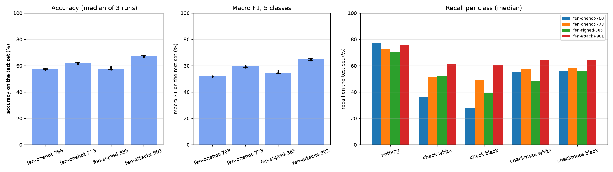
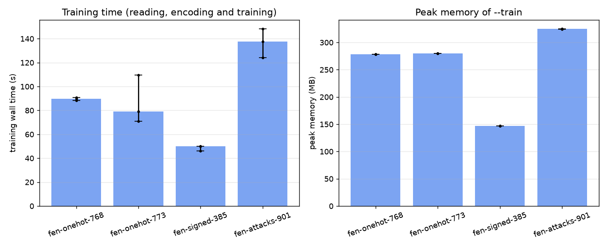

# Input encodings of a FEN position

Measurement for issue #14: how much does the way a position is turned into numbers change what a
small network learns? Related decision: [ADR-0016](../adr/0016-input-encoding.md).

## Method

- **Encodings** (`src/analyzer/Encoding.cpp`): `fen-onehot-768` (12 piece planes × 64 squares),
  `fen-onehot-773` (the same plus side to move and 4 castling rights), `fen-signed-385` (one signed
  value per square plus the side to move), `fen-attacks-901` (the 773 inputs plus 128 attack-map
  values).
- **Network**: identical for the four, `width → 128 → 5` (ReLU, Softmax), cross-entropy, Adam
  `lr=0.001`, L2 `0.0003` on the first layer, batch 64, at most 20 epochs, early stopping with
  patience 5 on a 10 % hold-out. Only the input width differs (`configs/encodings/*.conf`).
- **Data**: 20,000 positions drawn at random (fixed seed) from the 723,019 of the provided dataset
  to train, and 5,000 other positions to score, never trained on. The same positions for the four
  encodings.
- **Repetitions**: 3 networks per encoding, differing only by their initial weights
  (`init seed` 1, 2, 3). The tables give the median and the range (min–max) of the three.
- **Machine**: Intel Core i5-12450H, 15 GB RAM, Linux 6.8, g++ 13.3.0, matplotlib 3.11.0, Python 3.12.3.
  The machine was shared with other work, which probably explains the time spread.
- **Second machine check** (2026-10-26, Intel Core i7-1355U, g++ 15.2.0): a rerun of the script gave
  the same epochs, accuracy, macro F1 and per-class recall in all 12 runs, and byte-identical
  training logs. Only the times differ (62 to 98 s instead of 50 to 138 s): quality figures are
  reproducible, times depend on the machine.
- **Reproduce**: `sh scripts/bench_encodings.sh` (dataset extracted in `dataset/`). Raw data:
  [`data/encodings_runs.csv`](data/encodings_runs.csv), training logs in `data/encodings_logs/`.

## Results (2026-10-26)

| Encoding | Inputs | Accuracy | Macro F1 | Training time | Peak memory |
| --- | --- | --- | --- | --- | --- |
| fen-onehot-768 | 768 | 57.2 % (56.9–57.7) | 0.520 (0.515–0.521) | 89.6 s (88.4–90.9) | 278 MB |
| fen-onehot-773 | 773 | 62.0 % (61.4–62.4) | 0.594 (0.585–0.598) | 79.1 s (70.9–109.7) | 280 MB |
| fen-signed-385 | 385 | 57.6 % (57.2–59.1) | 0.546 (0.542–0.560) | 50.1 s (46.1–50.1) | 147 MB |
| fen-attacks-901 | 901 | 67.2 % (66.9–67.9) | 0.651 (0.639–0.654) | 137.7 s (124.2–148.2) | 325 MB |

What the measurements show:

- **The attack map is the best encoding by a wide margin**: +10 points of accuracy over
  `fen-onehot-768` and +5 over `fen-onehot-773`. The ranges of the three runs of each encoding do not
  overlap with the next one for these two, so the order attacks > 773 is not a seed effect.
- **Side to move matters**: the 5 extra inputs of `fen-onehot-773` give +4.8 points of accuracy and
  raise the recall of both `Check` classes from 28–37 % to 49–52 %. Without knowing who is to move,
  a check position of White and of Black are nearly indistinguishable.
- **The signed encoding halves the cost but not the quality**: it is on par with `fen-onehot-768` in
  accuracy (the ranges overlap) with half the training time and memory, and it has the weakest
  recall on `Checkmate White` (48 %).
- Cost grows with the width: attacks cost 1.5 times the time of `fen-onehot-768` for a gain of 10
  points.

## Limits

- The training times compare networks that stopped at different epochs (13 to 19, early stopping),
  so they mix cost per epoch and number of epochs. Run 2 of `fen-onehot-773` (109.7 s, 16 epochs)
  shows how noisy the times are on a shared machine.
- Three runs per encoding give a range, not a confidence interval: differences below about one
  point (768 against signed-385) are not established.
- Every network overfits strongly: the training accuracy reaches 94 % for 69 % on the hold-out
  (log `encodings_logs/attacks901_1.log`). The ranking is that of a 20,000-position training set
  with this regularisation; with the full dataset the gaps could shrink.
- The attack map encodes sliding attacks without pins; it is a heuristic, not the full rules.
- A single network size (128 hidden units) and a single learning rate were tried.
