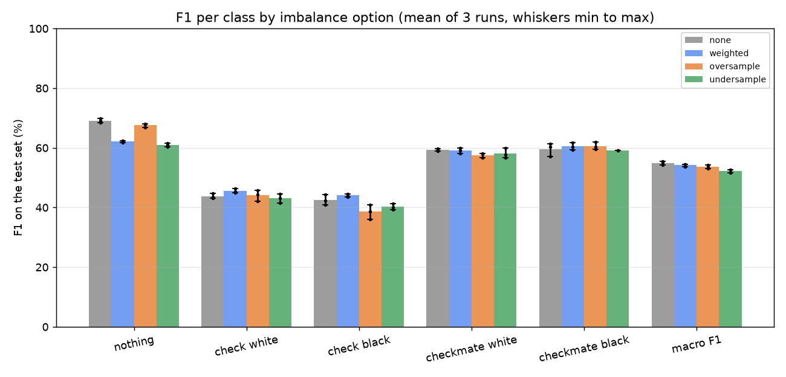
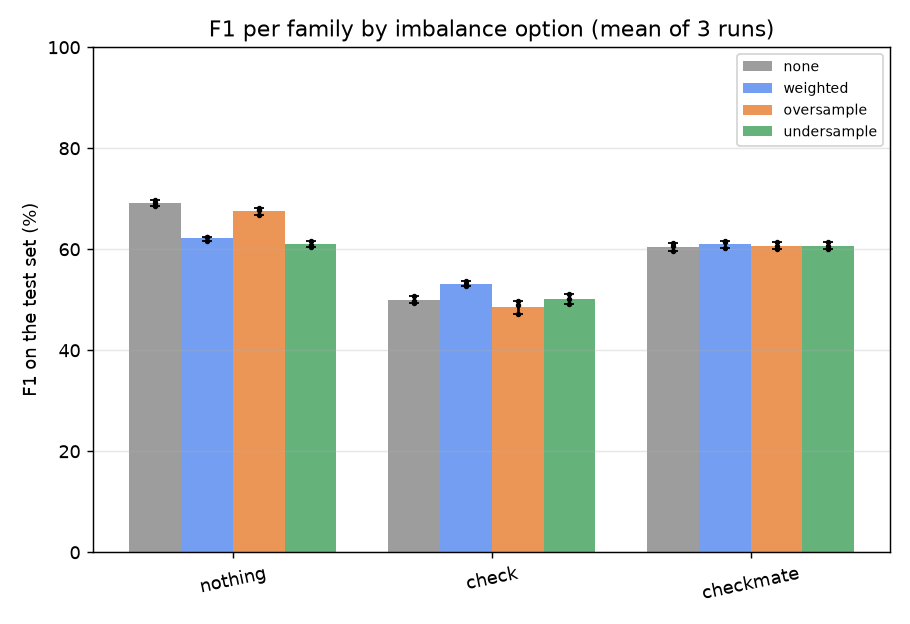

# Class imbalance: none, weighting, oversampling, undersampling

Measurement for issue #16: which way of handling the imbalance of the dataset gives the best F1 per
class? Related decision: [ADR-0018](../adr/0018-class-imbalance.md) (Proposed).

**Status: measured** on the real dataset, 2026-10-26.

## Method

1. **One seeded sample** of `TRAIN + TEST` positions (default 20,000 + 5,000) drawn without
   replacement from the three dataset folders with Python's `random.Random(SEED).sample`.
2. **Test set** = the last `TEST` positions, **in their natural distribution and never resampled**,
   identical for the four options. The first `TRAIN` positions are the training sample.
3. **Four training files / losses**, derived from the training sample by
   `scripts/resample_imbalance.py`:

   | Option | Training file | Loss |
   | --- | --- | --- |
   | `none` | the sample unchanged | cross-entropy |
   | `weighted` | the sample unchanged | cross-entropy with `weights=` inverse class frequency, normalised to mean 1, in the order of the labels of the configuration |
   | `oversample` | minority classes duplicated with replacement up to the majority count | cross-entropy |
   | `undersample` | every class drawn without replacement down to the minority count | cross-entropy |

   The class counts before and after are written to `imbalance_logs/<option>_resample.log`, the
   weights to `imbalance_logs/weighted_resample.log`.
4. **Network and training** (`configs/imbalance/*.conf`, the same for the four options): one-hot 768
   → 128 → 5, ReLU, Softmax, cross-entropy, Adam 0.001, L2 0.0003, 20 epochs, batches of 64,
   shuffling seed 42, **`validation=0 patience=0`** (no early stopping: a validation split of an
   oversampled file would hold duplicates of training positions, see the ADR).
5. **Three networks per option**, from three different initial weights (`init seed` 1 to 3, the
   same for every option), trained with `my_torch_analyzer --train`, timed with `/usr/bin/time`
   (wall time, peak memory).
6. **Scoring** (`scripts/score_imbalance.py`) on the test set: F1 of each of the five labels, F1 of
   the three families (`Nothing`, `Check` = both colours, `Checkmate` = both colours), macro F1
   over the five labels, accuracy. A class never predicted gets an F1 of 0. The metrics are computed by `scripts/score.cpp`, which calls `my_torch::report` (ADR-0026, since 2026-10-27; the formulas are unchanged).
7. **Graphs** (`scripts/plot_imbalance.py`): mean of the three runs with the minimum-maximum range
   and the individual runs.

- **Machine**: Intel Core i5-12450H, 15 GB RAM, Linux 6.8, g++ 13.3.0, matplotlib 3.11.0, Python 3.12.3.
- **Second machine check** (2026-10-26, Intel Core i7-1355U, g++ 15.2.0): a rerun of the script gave
  the same scores in all 12 runs and byte-identical resampling logs; only the times differ.
- **Dependencies**: Python 3 with matplotlib for the graphs; `/usr/bin/time`.
- **Environment variables** of the script: `DATASET` (default `dataset`), `TRAIN` (20000), `TEST`
  (5000), `SEED` (1: the draw and the resampling), `EPOCHS` (default: the 20 of the
  configurations; a smaller value is for a quick check only).

## Reproduce

With the dataset extracted at the root of the repository:

```sh
sh scripts/bench_imbalance.sh
```

An optional argument gives the output directory (default `docs/performance/data`). Without the
dataset the script prints an explanation on stderr and exits with status 1.

| Output | Content |
| --- | --- |
| `data/imbalance_runs.csv` | one row per network: option, init seed, training size, accuracy, macro F1, F1 of the five labels, F1 of the three families, training seconds, peak memory (KB) |
| `data/imbalance_f1.png` | F1 per class and macro F1, for each option |
| `data/imbalance_family_f1.png` | F1 per family, for each option |
| `data/imbalance_logs/` | training logs, class counts before and after resampling, weights, test class counts |

## Results (2026-10-26)

Sample of 20,000 training positions (8,228 `Nothing`, 3,851 `Check White`, 3,122 `Check Black`, 2,570
`Checkmate White`, 2,229 `Checkmate Black`) and 5,000 test positions; weights `0.395, 0.844, 1.040,
1.264, 1.457` in the order of the labels. Per-class F1 on the test set, % (mean, min–max of 3 runs):

| Option | F1 Nothing | F1 Check White | F1 Check Black | F1 Checkmate White | F1 Checkmate Black | Macro F1 | Accuracy |
| --- | --- | --- | --- | --- | --- | --- | --- |
| None | 69.1 (68.5–69.8) | 43.8 (43.0–44.8) | 42.6 (41.0–44.4) | 59.4 (58.9–59.8) | 59.6 (57.2–61.4) | 54.9 (54.2–55.5) | 58.3 (57.7–58.9) |
| Loss weighting | 62.2 (61.7–62.4) | 45.5 (45.0–46.4) | 44.1 (43.5–44.6) | 59.0 (58.1–59.9) | 60.5 (59.4–61.9) | 54.3 (53.8–54.5) | 54.8 (54.3–55.0) |
| Oversampling | 67.6 (66.8–68.1) | 44.1 (42.1–45.8) | 38.6 (36.1–40.8) | 57.6 (56.6–58.1) | 60.6 (59.5–62.0) | 53.7 (53.0–54.3) | 57.0 (56.2–57.5) |
| Undersampling | 61.0 (60.4–61.6) | 43.1 (41.4–44.6) | 40.3 (39.3–41.3) | 58.1 (56.6–60.0) | 59.1 (59.1–59.2) | 52.3 (51.7–52.6) | 53.5 (53.0–53.9) |

| Option | Training size | Training time | Peak memory |
| --- | --- | --- | --- |
| None | 20,000 | 121 s | 253 MB |
| Loss weighting | 20,000 | 117 s | 253 MB |
| Oversampling | 41,140 | 237 s | 504 MB |
| Undersampling | 11,145 | 64 s | 147 MB |





What the measurements show (F1 in %, mean and min–max of three runs):

- **No option clearly beats doing nothing.** Macro F1 is 54.9 for `none` and 54.3 for weighting
  (the ranges, 54.2–55.5 and 53.8–54.5, overlap); oversampling (53.7) and undersampling (52.3) are
  lower.
- **`Checkmate Black`, the rarest label, does not gain a measurable amount**: 59.6 (57.2–61.4)
  without handling, 60.5 with weighting, 60.6 with oversampling. The ranges overlap, so a gain of
  about one point is not established.
- **Weighting trades the majority class for the Check classes**: `Nothing` drops from 69.1 to 62.2
  and accuracy from 58.3 to 54.8, while `Check White` and `Check Black` gain about 2 points each
  (45.5 and 44.1 against 43.8 and 42.6; the ranges barely separate).
- **Oversampling doubles the cost for no gain**: 237 s and 504 MB against 121 s and 253 MB, and
  `Check Black` falls to 38.6, probably from memorising the duplicated positions (not tested).
- **Undersampling is the cheapest** (64 s, 147 MB, 11,145 positions) but has the lowest macro F1 and
  accuracy, since it discards most of the 8,228 `Nothing` positions.

Raw data: [`data/imbalance_runs.csv`](data/imbalance_runs.csv).

## Limits

- One sample and three initial weights: no confidence interval; the draw can be changed with
  `SEED`. Differences of about one point are within the spread of the runs.
- The networks are small (128 hidden units), trained on 20,000 positions and without early stopping;
  all of them overfit, so an imbalance remedy may matter more, or less, on the full training set.
- No early stopping in the comparison (ADR-0018); the training sample is 20,000 positions because
  `--train` keeps every encoded position in memory.
- Resampling is done by the script, not by the network file: a network trained on a resampled file
  is reproduced only with `scripts/bench_imbalance.sh` (or `resample_imbalance.py`).
- One-hot 768 encoding, the one the analyzer knows; another encoding changes the numbers.
- Only F1 is reported per class: precision and recall (ADR-0011) and a confusion matrix are not, so
  F1 does not show whether a remedy trades precision for recall on the rare classes.
