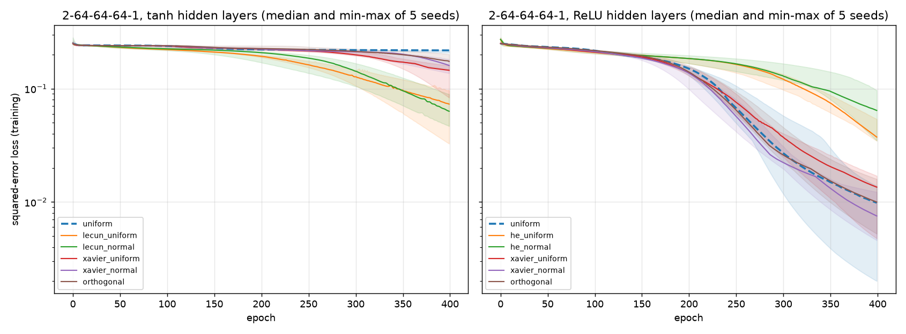
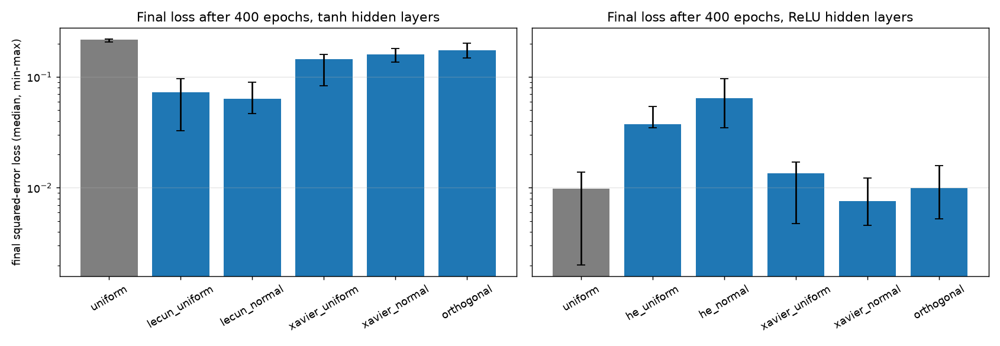

# Weight initialisation

Measurement for issue #6: does the way `Dense` draws its starting weights change how fast a deeper
network learns? Related decision: [ADR-0020](../adr/0020-weight-initialisation.md). The available
names are listed in [configuration.md](../configuration.md#weight-initialisation-initname).

## Method

- **Problem**: two interleaved spirals (200 points, 2 classes, Gaussian noise with standard
  deviation 0.05), the same generator as the [optimizer benchmark](07-optimizers.md). **This is a
  synthetic test problem, not the chess dataset**: nothing here predicts what the FEN positions
  will give.
- **Network**: 2 → 64 → 64 → 64 → 1 (four `Dense` layers, so three hidden layers), sigmoid output,
  squared-error loss, full batch (200 examples per step), 400 epochs. Deeper than the 2 → 32 → 32 → 1
  network of the optimizer benchmark, because the effect of an initialisation builds up with depth.
- **Two families**, each with the activation its initialisations are meant for: `tanh` hidden
  layers against `uniform`, `lecun_uniform`, `lecun_normal`, `xavier_uniform`, `xavier_normal`,
  `orthogonal`; `ReLU` hidden layers against `uniform`, `he_uniform`, `he_normal`, `xavier_uniform`,
  `xavier_normal`, `orthogonal`. `uniform` is the original default, U(±√(1 / fan_in)).
- **Fixed optimizer**: Adam, learning rate 0.001 (β = (0.9, 0.999), ε = 1e-8), no scheduler, the same
  for every run. The rate is **not** tuned per initialisation: only the initialisation changes.
- **Protocol**: 5 seeds. Seed *s* fixes the data noise and the weight seed of every layer, and is
  shared by all initialisations, so the comparison is paired. We report the median over seeds and
  the min – max range. A run that diverges (NaN) would count as a loss of 1 (none did).
- **Machine**: Intel Core i5-12450H (12 threads), 15 GB RAM, Linux 6.8.0-90-generic, g++ 13.3.0
  `-O2`. The 5 seeds run in parallel; the whole benchmark takes 72 s (3 min 57 s of CPU time).
- **Reproduce**: `sh scripts/bench_init.sh` (graphs use matplotlib 3.11.0, Python 3.12.3). The result
  is the same on every run (checked twice). Raw data: [`data/init_curves.csv`](data/init_curves.csv)
  (median and min – max loss at each epoch), [`data/init_summary.csv`](data/init_summary.csv).

## Results

Training loss, median over 5 seeds; "first epoch" is the loss of the freshly initialised network,
before any update.

### `tanh` hidden layers

| Initialisation | Loss, first epoch | Loss, epoch 10 | Median final loss | Min – max | Median accuracy |
| --- | --- | --- | --- | --- | --- |
| `uniform` (default) | 0.25 | 0.241 | 0.218 | 0.207 – 0.219 | 63.5 % |
| `lecun_uniform` | 0.252 | 0.242 | 0.0731 | 0.0327 – 0.0963 | 96.5 % |
| `lecun_normal` | 0.254 | 0.242 | 0.0632 | 0.0467 – 0.0894 | 96.5 % |
| `xavier_uniform` | 0.251 | 0.241 | 0.145 | 0.0833 – 0.16 | 81.5 % |
| `xavier_normal` | 0.253 | 0.241 | 0.16 | 0.137 – 0.181 | 80.0 % |
| `orthogonal` | 0.249 | 0.24 | 0.174 | 0.148 – 0.201 | 76.5 % |

### `ReLU` hidden layers

| Initialisation | Loss, first epoch | Loss, epoch 10 | Median final loss | Min – max | Median accuracy |
| --- | --- | --- | --- | --- | --- |
| `uniform` (default) | 0.25 | 0.246 | 0.00985 | 0.00201 – 0.0139 | 99.5 % |
| `he_uniform` | 0.272 | 0.238 | 0.0374 | 0.0347 – 0.0538 | 97.0 % |
| `he_normal` | 0.272 | 0.24 | 0.0642 | 0.0347 – 0.0968 | 94.5 % |
| `xavier_uniform` | 0.25 | 0.243 | 0.0135 | 0.00477 – 0.017 | 99.5 % |
| `xavier_normal` | 0.251 | 0.244 | 0.00754 | 0.00459 – 0.0123 | 99.5 % |
| `orthogonal` | 0.25 | 0.246 | 0.00999 | 0.00525 – 0.0159 | 99.5 % |

What the measurements show:

- **At the first epoch nothing distinguishes the initialisations**: all start near 0.25, the loss of
  a network that answers about 0.5 everywhere. The differences appear in how quickly a run leaves
  that plateau. The only visible gap at the start is He on ReLU (0.272 against 0.25).
- **`tanh`: the default is the slowest, by a wide margin.** After 400 epochs it is still at 0.218
  (63.5 % accuracy) and its seeds are tightly grouped (0.207 – 0.219): it has barely left the plateau.
  Every other initialisation has a maximum (at most 0.201) below the default's minimum
  (0.207). `lecun_normal` (0.0632) and `lecun_uniform` (0.0731) are the best, at 96.5 % accuracy.
  Their ranges overlap the one of `xavier_uniform` (0.0833 – 0.16), so with 5 seeds we cannot say
  that LeCun beats Xavier-uniform; `xavier_normal` (0.16) and `orthogonal` (0.174) are slower than
  both LeCun forms.
- **`ReLU`: no initialisation beats the default.** `uniform` (0.00985), `xavier_uniform`,
  `xavier_normal` and `orthogonal` have overlapping ranges (0.002 – 0.017): we **cannot rank them**.
  `he_uniform` (0.0374) and `he_normal` (0.0642) are **slower** than the default: their minima
  (0.0347 in both cases) are above the default's maximum (0.0139). This goes against the usual
  advice to use He with ReLU; we did not investigate why. A hypothesis, not tested: the larger He
  weights push the sigmoid output away from 0.5 from the start (first-epoch loss 0.272), which
  costs time with a squared-error loss.
- The **normal** forms are not systematically better or worse than the **uniform** forms of the
  same variance: the normal form ends lower for LeCun on `tanh` and Xavier on ReLU, higher for
  Xavier on `tanh` and He on ReLU, and the ranges overlap each time.

## Limits (read before quoting these numbers)

- **Synthetic spirals, not chess.** The initialisation to use on the 768 chess inputs has to be
  measured on the real dataset (#17, #18); these results say nothing about it.
- **Speed of learning, not quality of the result**: we compare the training loss after 400 epochs,
  not the loss a run would reach if it were trained to convergence. The `tanh` default may well
  catch up with more epochs (not measured). No validation set.
- **One fixed optimizer and rate** (Adam, 0.001). A larger rate, or SGD, could reduce or increase
  the gaps; the initialisation interacts with the optimizer. 5 seeds only, and a squared-error
  loss with a sigmoid output, which learns slowly.
- **Depth 4 and width 64**: the gap between initialisations generally grows with depth, and this
  network is still small.
- The `orthogonal` initialisation uses gain 1, whatever the activation; a gain of √2 is often used
  with ReLU and was not tried.

## Next

- Repeat on the chess dataset with a validation set once the network is trained (#17, #18), and
  pick the `init` of `configs/basic_network.conf` from that measurement.
- Try other optimizers and rates, and other gains for `orthogonal`.
