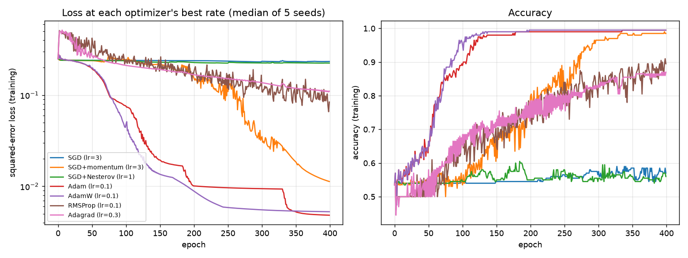
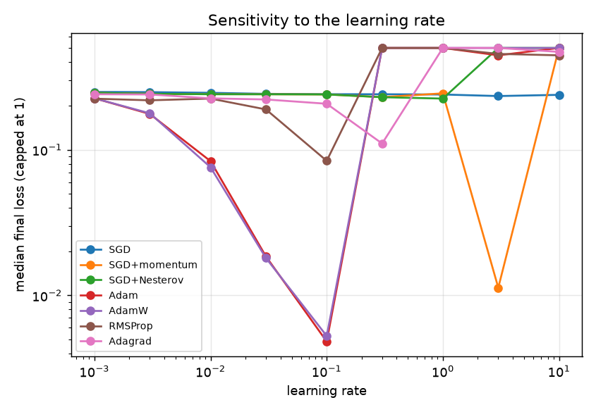
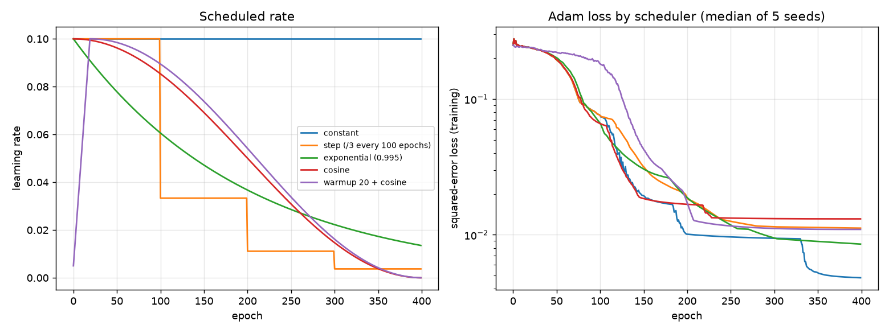

# Optimizers and learning-rate schedulers

Measurement for issue #5: which `my_torch` optimizer and which scheduler learn fastest on the same
problem? Related decisions: [ADR-0008](../adr/0008-optimizers-and-schedulers.md).

## Method

- **Problem**: two interleaved spirals (200 points, 2 classes, Gaussian noise with standard
  deviation 0.05). Not linearly separable, so a real network is needed. This is **not** the chess
  problem: it is a fast, unambiguous test bench, not a forecast of what the FEN positions will give.
- **Network**: 2 → 32 → 32 → 1, tanh then sigmoid, squared-error loss, full batch (200 examples per
  step), 400 epochs. Provisional `Dense` initialisation (ADR-0004).
- **Protocol**: 5 seeds (both the data noise and the weight initialisation change). For each
  optimizer, 9 learning rates: 0.001, 0.003, 0.01, 0.03, 0.1, 0.3, 1, 3, 10. The best rate is the one
  with the **lowest median final training loss**. A run that diverges (NaN) counts as a loss of 1.
  Other hyperparameters are fixed: momentum 0.9, Adam β = (0.9, 0.999) and ε = 1e-8, AdamW weight
  decay 0.01, RMSProp decay 0.9.
- **Machine**: Intel Core i5-12450H (12 threads), 15 GB RAM, Linux 6.8, g++ 13.3.0 `-O2`. The 5 seeds
  run in parallel; the whole benchmark takes 71 s (4 min 25 s of CPU time).
- **Reproduce**: `sh scripts/bench_optimizers.sh` (graphs use matplotlib 3.11.0, Python 3.12.3).
  Raw data: [`data/optimizer_grid.csv`](data/optimizer_grid.csv),
  [`data/optimizers.csv`](data/optimizers.csv), [`data/schedulers.csv`](data/schedulers.csv).

## Results: optimizers

Best rate of each optimizer (**training** loss after 400 epochs; median over 5 seeds, then
min – max):

| Optimizer | Best rate | Median final loss | Min – max | Median accuracy |
| --- | --- | --- | --- | --- |
| SGD | 3 | 0.2337 | 0.2240 – 0.2457 | 57.0 % |
| SGD+momentum | 3 | 0.0113 | 0.00351 – 0.0158 | 98.5 % |
| SGD+Nesterov | 1 | 0.2245 | 0.2139 – 0.2298 | 56.0 % |
| Adam | 0.1 | 0.00482 | 0.00339 – 0.0151 | 99.5 % |
| AdamW | 0.1 | 0.00527 | 0.00063 – 0.0106 | 99.5 % |
| RMSProp | 0.1 | 0.0839 | 0.0588 – 0.1105 | 89.5 % |
| Adagrad | 0.3 | 0.1103 | 0.0784 – 0.1981 | 87.0 % |

What the measurements show:

- **Adam and AdamW** are the fastest and the most consistent: both reach 99.5 % training accuracy at
  `lr = 0.1`. At `lr = 0.01` Adam's median loss (0.0835) is already far below plain SGD's at the same rate
  (0.2459). At `lr = 0.3` they diverge (median loss 0.5000, the value of a network that
  answers 0.5 everywhere), so the best rate is only a factor 3 from divergence.
- **SGD with momentum** ends well (loss 0.0113, 98.5 % accuracy) but **only at `lr = 3`**: at `lr = 1` it
  stays stuck (0.2440) and at `lr = 10` it diverges (0.5000). It is slower than Adam: the median
  loss first drops to 0.0113 at epoch 193 for Adam against epoch 399 for momentum, and it is much more
  sensitive to the rate.
- **Plain SGD** and **SGD with Nesterov** did not learn this problem in 400 epochs (accuracy 57 % and
  56 %, chance is 50 %). Nesterov at rate 3 diverges on at least three of the five seeds (median
  0.5000, minimum 0.0849), which is why its best rate came out at 1: this test says **nothing** about
  Nesterov against plain momentum, only that both are unstable near their limit.
- **RMSProp** (0.0839) and **Adagrad** (0.1103) learn, but more slowly than Adam, with a narrow best rate
  (RMSProp: 0.0839 at 0.1, 0.1892 at 0.03, divergence at 0.3).

## Results: schedulers

Adam starting from rate 0.1 (the best constant rate above), 400 epochs, median over 5 seeds:

| Scheduler | Rate at the last epoch | Median final loss | Median accuracy |
| --- | --- | --- | --- |
| constant | 0.10000 | 0.00482 | 99.5 % |
| step (/3 every 100 epochs) | 0.00370 | 0.0112 | 99.0 % |
| exponential (0.995) | 0.01353 | 0.00854 | 99.0 % |
| cosine | 0.00000 | 0.0131 | 98.5 % |
| warmup 20 + cosine | 0.00000 | 0.0110 | 98.5 % |

**No scheduler improves the training loss here**: the constant rate is best on the median, and the gaps
between schedulers (0.0048 against 0.0085 to 0.0131) are of the same order as the spread between
seeds for Adam alone at `lr = 0.1` (min – max: 0.00339 – 0.0151). We therefore **cannot** conclude that
one of these schedulers is better or worse than another on this measure.

## Limits (read before quoting these numbers)

- **Training loss only**, no validation set: a decaying rate mostly helps generalisation and
  oscillation, which this measurement does not look at.
- **One problem, a small network, 400 full-batch epochs**: no mini-batches, no gradient noise, not
  the 768 chess inputs. Rankings may change on the real dataset; repeat with `Network::fit` (#4) and
  the encoded positions (#14, #17).
- **Coarse grid** (a factor 3 between two rates) and **5 seeds**: the "best rate" is approximate, and
  it is chosen on the very loss that is reported (a slight favourable bias).
- Hyperparameters other than the rate were not tuned (momentum, β, decay).
- SGD with a squared-error loss and a sigmoid output learns slowly; longer runs were not measured, so
  "did not learn in 400 epochs" does not mean "does not learn".

## Next

- Repeat on the real dataset with a validation set once `Network::fit` is available.
- Validation-driven schedulers (reduce on plateau), one-cycle and warm restarts: not done (ADR-0008).
