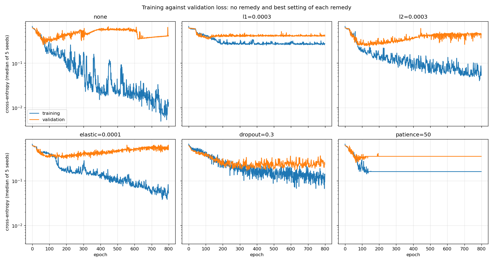
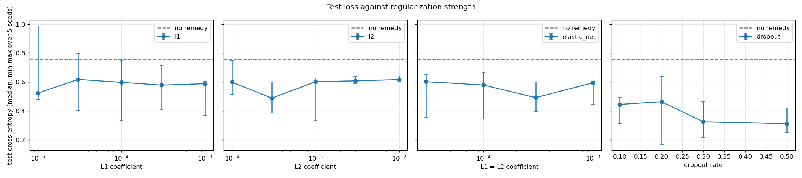

# Overfitting and its remedies

Measurement for issue #7: does the network overfit, and what do L1, L2 and elastic-net
regularization, dropout and early stopping change? Related decision: [ADR-0010](../adr/0010-overfitting-remedies.md).

## Method

- **Problem**: two interleaved spirals (one turn, Gaussian noise with standard deviation 0.1).
  **Chosen to show overfitting**: only 80 training points for a network much larger than needed, so
  it can memorize them. This is **not** the chess problem, which is not encoded yet (#14); the
  numbers below do not predict what the chess network will need.
- **Three sets per seed**: training (80 points), validation (500 points), test (500 points). The
  validation set picks the regularization coefficients, the dropout rate and the early-stopping
  epoch. The test
  set is **never** used for a choice; it is the one reported, so the comparison is not biased toward
  the settings it selected.
- **Network**: 2 → 64 → 64 → 2, tanh, Softmax + cross-entropy, Adam with rate 0.01, batches of 10,
  800 epochs. Dropout, when used, follows each tanh. L1/L2, when used, apply to the three `Dense`
  layers (weights only).
- **Settings** (21): none; L1 with λ in {1e-5, 3e-5, 1e-4, 3e-4, 1e-3}; L2 with λ in {1e-4, 3e-4,
  1e-3, 3e-3, 1e-2}; elastic net (same λ for L1 and L2) in {3e-5, 1e-4, 3e-4, 1e-3}; dropout with
  rate in {0.1, 0.2, 0.3, 0.5}; early stopping with patience 20 and 50 (restoring the best epoch).
- **Seeds**: 5 (data, weight initialisation, shuffling and dropout masks all change). Medians over
  seeds, with the min-max range of the test loss.
- **Machine**: Intel Core i7-1355U (13th generation, 12 threads), 14 GB RAM, Linux 7.0, g++ 15.2.0
  `-O2`. The 5 seeds of a setting run in parallel; the whole benchmark takes 135 s (535 s of CPU
  time).
- **Reproduce**: `sh scripts/bench_overfitting.sh` (graphs use matplotlib 3.10.7, Python 3.14.4).
  Raw data: [`data/overfitting_grid.csv`](data/overfitting_grid.csv),
  [`data/overfitting_curves.csv`](data/overfitting_curves.csv). Running it twice gives the same
  numbers to the last digit.

## Results

Test cross-entropy and accuracy after training (median over 5 seeds):

| Setting | Test loss | Min – max | Test accuracy | Epochs run |
| --- | --- | --- | --- | --- |
| No remedy | 0.758 | 0.353 – 0.988 | 91.4 % | 800 |
| L1 λ = 0.0003 (best L1 on validation) | 0.579 | 0.409 – 0.716 | 83.0 % | 800 |
| L1 λ = 0.00001 | 0.523 | 0.478 – 0.989 | 89.2 % | 800 |
| L2 λ = 0.0003 (best L2 on validation) | 0.488 | 0.384 – 0.602 | 89.6 % | 800 |
| L2 λ = 0.001 | 0.602 | 0.335 – 0.628 | 60.0 % | 800 |
| Elastic net λ = 0.0001 (best on validation) | 0.580 | 0.343 – 0.667 | 89.0 % | 800 |
| Dropout 0.3 (best dropout on validation) | 0.325 | 0.219 – 0.466 | 91.0 % | 800 |
| Dropout 0.5 | 0.311 | 0.250 – 0.421 | 89.8 % | 800 |
| Early stopping, patience 50 (best overall on validation) | **0.267** | 0.246 – 0.526 | 90.8 % | 138 |
| Early stopping, patience 20 | 0.276 | 0.256 – 0.526 | 89.6 % | 87 |

What the measurements show:

- **The network overfits without a remedy.** Its median training loss falls to 0.013 at the last
  epoch while the validation loss, after a minimum of about 0.33 around epoch 100, climbs back to
  0.42 (top-left graph). The gap between the two curves is the memorization.
- **Every remedy lowers the test loss** compared with no remedy (0.758): early stopping to 0.267,
  dropout 0.3 to 0.325, L2 to 0.488, L1 to 0.579, elastic net to 0.580. Early stopping is the best
  here and also the cheapest: it ran 138 epochs instead of 800.
- **Accuracy barely moves** (about 90 % to 91 % for the good settings). On this problem the remedies
  mainly make the network **less overconfident**: without them it keeps the right answer but with
  extreme probabilities, and its few mistakes cost a lot in cross-entropy. Accuracy alone would
  have hidden the overfitting.
- **Too much L2 makes the network underfit**: from λ = 0.001 the test accuracy drops to about 60 %
  and the loss stays near 0.6 (close to log 2 = 0.69, the loss of a network answering 50 / 50). The
  usable range of λ is narrow, about one factor of 3 around 0.0003.
- Dropout is less sensitive to its rate: from 0.1 to 0.5 it always beats no remedy.
- **L1 closes the gap the most but costs accuracy.** With λ = 0.0003 the training and validation
  curves stay close (about 0.27 against 0.40, top-middle graph): the network can no longer memorize.
  But its test accuracy drops to 83 %, and from λ = 0.001 to 65 %. L1 pushes many weights to
  exactly 0, which removes capacity the spirals need. L1 is meant for inputs that carry nothing;
  here both inputs matter.
- **Selection on the validation set is noisy for L1**: the setting it picked (λ = 0.0003, test loss
  0.579) is not the best on the test set (λ = 0.00001, 0.523), and the min-max ranges overlap
  across all L1 values. With 5 seeds, the differences between L1 strengths are not significant.
- **Elastic net** sits between L1 and L2 (test loss 0.580, accuracy 89 %) and does not beat L2
  alone here.

## Limits

- Toy problem with 2 inputs. The best values (λ = 0.0003, dropout 0.3, patience 50) will **not**
  transfer to the chess network; they must be measured again on the real dataset (#17).
- After an early stop, the graph carries the last measured value of each run to the end, which
  draws the flat lines of the bottom-right panel; those epochs were not trained.
- With Adam, L2 is divided by the adaptive step like the rest of the gradient; AdamW's decoupled
  weight decay (#5) does not have this effect. The two are not compared here.
- Elastic net is measured with the same coefficient for L1 and L2 only, not a full grid of pairs.
- Only one remedy at a time. Combinations (dropout and early stopping together, for instance) are
  not measured.
