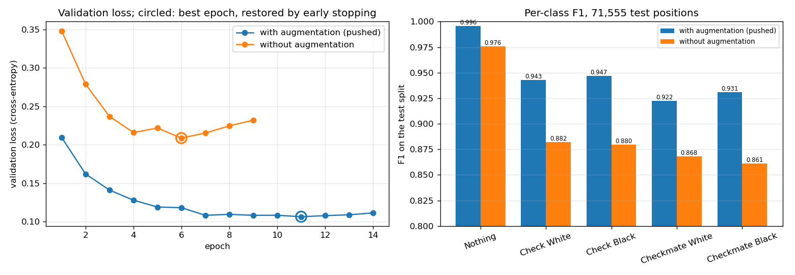
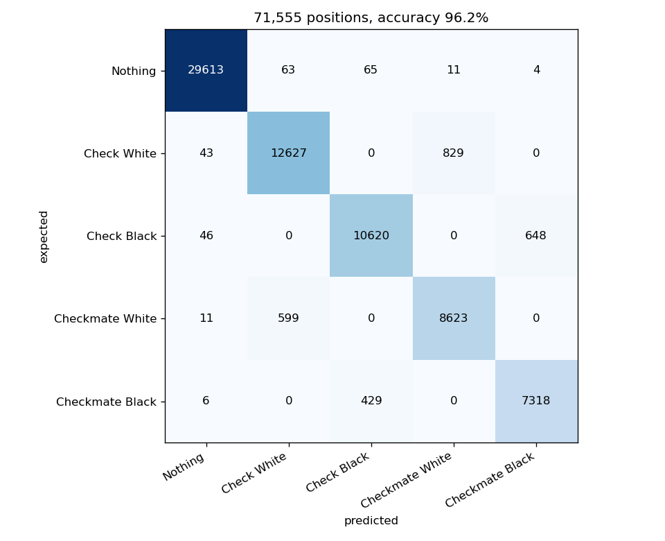

# Final network (issue #17)

**Question**: how well does the pushed network, `my_torch_network_final.nn`, classify positions it
has never seen, and what does the symmetry augmentation bring?

## Method
- Network: `configs/final_network.conf`, fen-attacks-901 → 256 → 128 → 5, ReLU, softmax,
  cross-entropy, Adam lr 0.001, batch 64, at most 30 epochs, early stopping with patience 3 on the
  validation loss and the best epoch's weights restored (ADR-0010, ADR-0016, ADR-0023).
- Data: the whole dataset (715,559 positions after the split's deduplication), split with seed 42
  into training (572,446), validation (71,558) and test (71,555) (ADR-0017). The training split is
  augmented with the two label-preserving symmetries (ADR-0019), 2,289,784 lines; validation and
  test are never augmented. The validation lines sit untouched at the end of the training file
  (ADR-0022).
- Command, one per run (`scripts/train_final.sh` writes everything, including `run.txt`):
  ```bash
  sh scripts/train_final.sh configs/final_network.conf runs/final                 # pushed network
  AUGMENT=0 sh scripts/train_final.sh configs/final_network.conf runs/final_noaug # comparison
  ```
- Run files copied to [`data/final-network/`](data/final-network/) (`run.txt`, `scores.txt`,
  `curve.csv`, `confusion.csv`), graphs by `scripts/plot_final_network.py`.
- Machines, 2026-10-27, commit b6b5404:
  - augmented run: laptop, Intel Core i7-1355U, 12 threads (ADR-0024), g++ 15.2;
  - non-augmented run: shared VPS, 8-core AMD EPYC, g++ 13.3. Results are bit-identical across the
    two machines (checked during the trial runs, docs/performance/09-trials.md), but the VPS is shared
    with other users, so **its time is not comparable** with the laptop's.
- The test split was used **only to measure** these two networks. Every choice (encoding,
  architecture, augmentation, initialisation) was made earlier on the validation split.

## Results



| Run | Epochs run (best) | Training time | Peak memory | Test accuracy | Test macro F1 |
| --- | --- | --- | --- | --- | --- |
| **With augmentation (pushed)** | 14 (11) | 6,285 s (1 h 45), laptop | 430 MB | **0.9615** | **0.9478** |
| Without augmentation | 9 (6) | 4,109 s, shared VPS | 221 MB | 0.9162 | 0.8934 |

Per class, on the 71,555 test positions, for the pushed network:

| Class | Precision | Recall | F1 | Positions |
| --- | --- | --- | --- | --- |
| Nothing | 0.9964 | 0.9952 | 0.9958 | 29,756 |
| Check White | 0.9502 | 0.9354 | 0.9427 | 13,499 |
| Check Black | 0.9556 | 0.9387 | 0.9470 | 11,314 |
| Checkmate White | 0.9112 | 0.9339 | 0.9224 | 9,233 |
| Checkmate Black | 0.9182 | 0.9439 | 0.9309 | 7,753 |



Predicting the whole test split takes 2.8 s (peak 148 MB) on the laptop.

## Reading
- **The augmentation is worth 4.5 points of accuracy and 5.4 of macro F1** on the same test
  positions, and every class gains. It also delays overfitting: without it, the validation loss
  rises again after epoch 6; with it, it keeps improving until epoch 11.
- **The colour is never wrong**: no check of one side is predicted as a check or a mate of the other
  side (zeros in the matrix).
- **Most errors are check against checkmate of the same side**: 2,505 of the 2,754 errors (91 %).
  Telling them apart needs to know whether the side in check has a legal move: a global property
  of the position (every escape square, block and capture) that the encoding gives only partly
  (attacked squares, ADR-0016). Without augmentation that share was 76 % (4,545 of 5,993 errors):
  the augmentation mostly removed the other errors.
- **"Nothing" is almost perfect** (F1 0.996): the attack planes show directly whether a king is
  attacked.
- The gap between the training loss (0.072 at epoch 11) and the validation loss (0.107) shows some
  overfitting, held back by early stopping.

## Limits and next steps
- One seed per run: the seed spread measured in the trials (±0.3 to ±0.6 points of macro F1,
  docs/performance/09-trials.md) is small next to the 5.4 points of the augmentation, but the third
  decimal of these scores is not significant.
- Check against checkmate is the remaining weakness. Candidates, not measured: an input feature for
  the number of legal king moves, or more mates in the training data (the classes are kept at their
  natural distribution, ADR-0018).
