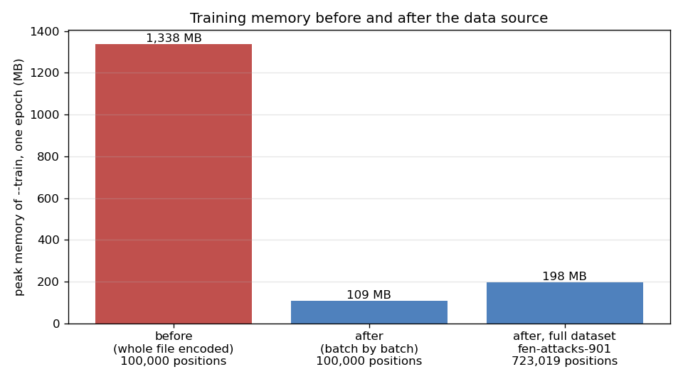

# Training memory: whole file encoded against batch by batch

Measurement for the first step of issue #17: can `my_torch_analyzer --train` take the whole dataset?
Related decision: [ADR-0021](../adr/0021-training-data-source.md).

## Method

- **Before**: the analyzer of commit `d2aae89`, which encoded every position of the training file
  into one matrix, then copied the training and validation parts into two more.
- **After**: the analyzer of this change, which keeps the parsed positions and encodes only the rows
  of each batch (`PositionSource`, a `DataSource` given to `fit`).
- **Run**: `--train` for one epoch, network 768 → 128 → 5 (ReLU, Softmax), Adam 0.001, batches of
  64, 10 % held out for validation. Peak memory (maximum resident set size) and time from
  `/usr/bin/time`.
  - Before against after: the same 100,000 positions drawn from the dataset with a fixed seed, the
    same network file.
  - After only: the whole dataset (723,019 lines) with `fen-attacks-901`, the encoding chosen for
    the final network (ADR-0016), network 901 → 128 → 5.
- **Machine**: Intel Core i7-1355U, 14 GB RAM, Linux 7.0, g++ 15.2.0 `-O2`.
- **Reproduce**: `sh scripts/bench_training_memory.sh` (4.5 minutes; it builds the "before"
  analyzer from its commit). Raw data: [`data/training_memory.csv`](data/training_memory.csv),
  [`data/training_memory.txt`](data/training_memory.txt).

## Results (2026-10-26)

| Run | Positions | Peak memory | Time, one epoch |
| --- | --- | --- | --- |
| Before, `fen-onehot-768` | 100,000 | **1,338 MB** | 22.7 s |
| After, `fen-onehot-768` | 100,000 | **109 MB** | 21.4 s |
| After, `fen-attacks-901`, whole dataset | 723,019 | **198 MB** | **180 s** |

- **Memory is divided by 12** on 100,000 positions, and the time does not grow: encoding a batch
  when it is needed costs no more than copying it from a big matrix.
- **The two trained networks are byte-identical** (`training_memory.txt`): the change does not
  alter what is learned.
- **The whole dataset now trains in 198 MB**, with the widest encoding. Before, the same run would
  have needed about 10.4 GB for the inputs alone: 723,019 × 901 numbers × 8 bytes = 5.2 GB, held
  twice (the whole matrix, then its training and validation copies). This figure is **computed**,
  not measured: the run was not attempted on a 14 GB machine.
- **One epoch of the final configuration takes 3 minutes**, measured. An earlier estimate of about
  17 minutes, extrapolated from total training times that covered several epochs, was wrong.
- After that single epoch, the validation accuracy is already 82.5 % (`training_memory.txt`), far
  above the 57 % to 67 % measured on 20,000 positions in the earlier benchmarks: the amount of data
  matters a lot.

## Limits

- One run per configuration: the times vary from run to run on a laptop; the memory figures are
  stable.
- Validation sets above 4,096 positions are now evaluated in chunks of 4,096, so their reported loss
  can differ from the old single-block computation in the last bits (ADR-0021). Here the validation
  part holds 10,000 positions; the trained networks are still byte-identical because without early
  stopping the validation loss is only reported, never used to train. With early stopping, a
  difference in the last bit could in principle change the stopping epoch.
- The augmented training set of #38 (4 times the positions) is not measured here; positions take
  about 90 bytes each, so it adds a few hundred megabytes.
