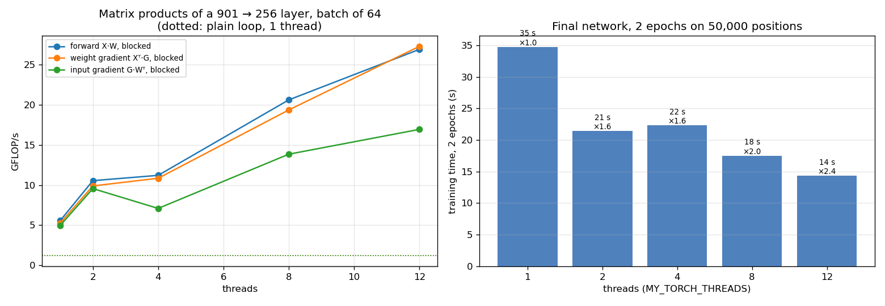

# Parallel and blocked matrix product (issues #25, #33, ADR-0024)

**Question**: how much faster are the matrix products, and the training of the final network, with
cache blocking and threads, and does the trained network stay exactly the same?

## Method
- Script: `sh scripts/bench_matmul.sh` (sources `scripts/bench_matmul.cpp`, graphs by
  `scripts/plot_matmul.py`), data in `data/matmul.csv`, `data/matmul_training.csv`,
  `data/matmul_training.txt`.
- Products: the three products of a `Dense` 901 → 256 layer on a batch of 64 (the first layer of the
  final network), median of 7 timings each repeated for at least 0.2 s. "Plain loop" is the triple
  loop used before ADR-0024, on one thread, with the transposed copy for the backward products.
- Training: the final network configuration, 2 epochs, no early stopping, on 50,000 dataset
  positions drawn with a fixed seed, `MY_TORCH_THREADS` = 1, 2, 4, 8, 12; time and peak memory by
  `/usr/bin/time`, then the trained network files are compared byte by byte.
- Machine: laptop, Intel Core i7-1355U (2 performance cores with 2 threads each and 8 efficiency
  cores, 12 threads), g++ `-O2`, 2026-10-27. A laptop throttles: the numbers are one run, not a
  controlled lab measurement.

## Results

| Product (901 → 256, batch 64) | Plain loop | Blocked, 1 thread | Blocked, 12 threads |
| --- | --- | --- | --- |
| forward X·W | 1.18 GFLOP/s | 5.57 (×4.7) | 26.9 (×22.8) |
| weight gradient Xᵀ·G | 1.18 | 5.26 (×4.5) | 27.3 (×23.1) |
| input gradient G·Wᵀ | 1.21 | 4.96 (×4.1) | 16.9 (×14.0) |

| Threads | 1 | 2 | 4 | 8 | 12 |
| --- | --- | --- | --- | --- | --- |
| Training, 2 epochs (s) | 34.8 | 21.4 | 22.3 | 17.5 | 14.4 |
| Speed-up | ×1.0 | ×1.6 | ×1.6 | ×2.0 | ×2.4 |
| Peak memory (MB) | 34.4 | 34.4 | 34.4 | 34.7 | 34.7 |

The trained networks are **byte-identical for every thread count** (`data/matmul_training.txt`).
Against the code before ADR-0024, the 1 % pipeline (`FRACTION=0.01 sh scripts/train_final.sh
configs/trials/a128_uniform.conf`) went from 62.4 s to 18.4 s of training with the same network file
(one run each, same machine).

## Reading
- Blocking alone gives ×4 to ×5 on one thread: the inner loop now walks contiguous memory and the
  blocks of `W` stay in cache.
- Threads scale well on the products (×5 from 1 to 12 threads) but much less on the training (×2.4):
  the rest of an epoch (FEN encoding, activations, Adam) is still single-threaded, and the dip at 4
  threads comes from the hybrid CPU: past the 2 performance cores, work lands on slower efficiency
  cores, and every thread waits for the slowest range.
- `G·Wᵀ` scales worse: it is a dot-product kernel whose output (64 × 901) has short rows.

## Limits and next steps
- Encoding the positions in parallel would attack the single-threaded part of the epoch.
- Ranges of equal size suit identical cores; on a hybrid CPU, smaller ranges handed out dynamically
  would balance better without breaking determinism (each element is still computed by one thread).
