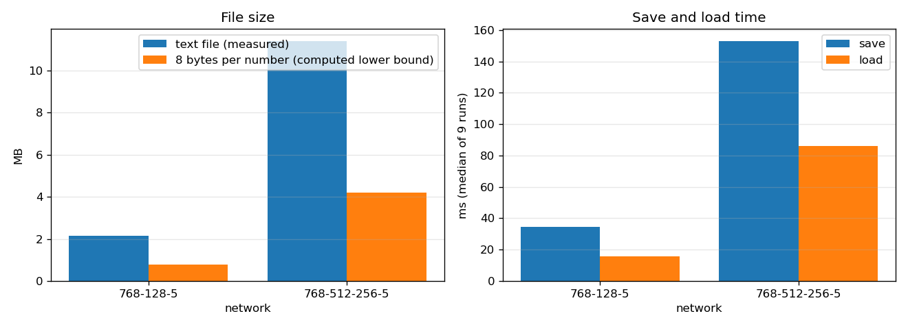

# Network file: size and save/load time

Measurement for issue #8: what does the text format of ADR-0012 cost compared with a binary one?
Related decision: [ADR-0012](../adr/0012-network-file-format.md).

## Method

- **Networks**: 768 → 128 → 5 (ReLU, Softmax), the size planned for the chess network, and
  768 → 512 → 256 → 5, a larger one, to see how the cost grows.
- **Measured**: the size of the file written by `Network::save`, and the time of `save` and `load`,
  median of 9 runs each, on a warm disk cache.
- **Compared with**: the size of a raw binary format, 8 bytes per number without any header. This
  value is **computed** (parameters × 8), not written: it is the lower bound of any binary format.
- **Machine**: Intel Core i7-1355U, 14 GB RAM, Linux 7.0, g++ 15.2.0 `-O2`, local SSD.
- **Reproduce**: `sh scripts/bench_serialization.sh` (graph with matplotlib 3.10.7, Python 3.14.4).
  Raw data: [`data/serialization.csv`](data/serialization.csv).

## Results (2026-10-24)

| Network | Parameters | Text file | Binary lower bound | Ratio | Save | Load |
| --- | --- | --- | --- | --- | --- | --- |
| 768-128-5 | 99,077 | 2.15 MB | 0.79 MB | 2.7 | 35 ms | 16 ms |
| 768-512-256-5 | 526,341 | 11.4 MB | 4.21 MB | 2.7 | 153 ms | 86 ms |

What the measurements show:

- The text file is **2.7 times** the binary lower bound, about 21.7 bytes per number (17 significant
  digits, a sign, a decimal point, an exponent and a separator).
- For the planned network, loading takes **16 ms** and the file is **2.15 MB**: negligible next to
  the prediction of a dataset, and far below GitHub's 100 MB limit for a pushed file.
- Cost grows linearly with the number of parameters (5.3 times the parameters, 5.3 times the
  size).
- File sizes are identical from one run to the next; times vary by about 10 % between two runs.

## Limits

- The binary size is a computed bound, not a written file: a real binary format would add a header
  and the architecture.
- Times are measured with the file in the disk cache; a first read from a cold disk is slower.
- A network ten times larger than the second one (about 5 million parameters) would give a file of
  about 110 MB, over GitHub's limit. That is the threshold where a binary format becomes necessary.
