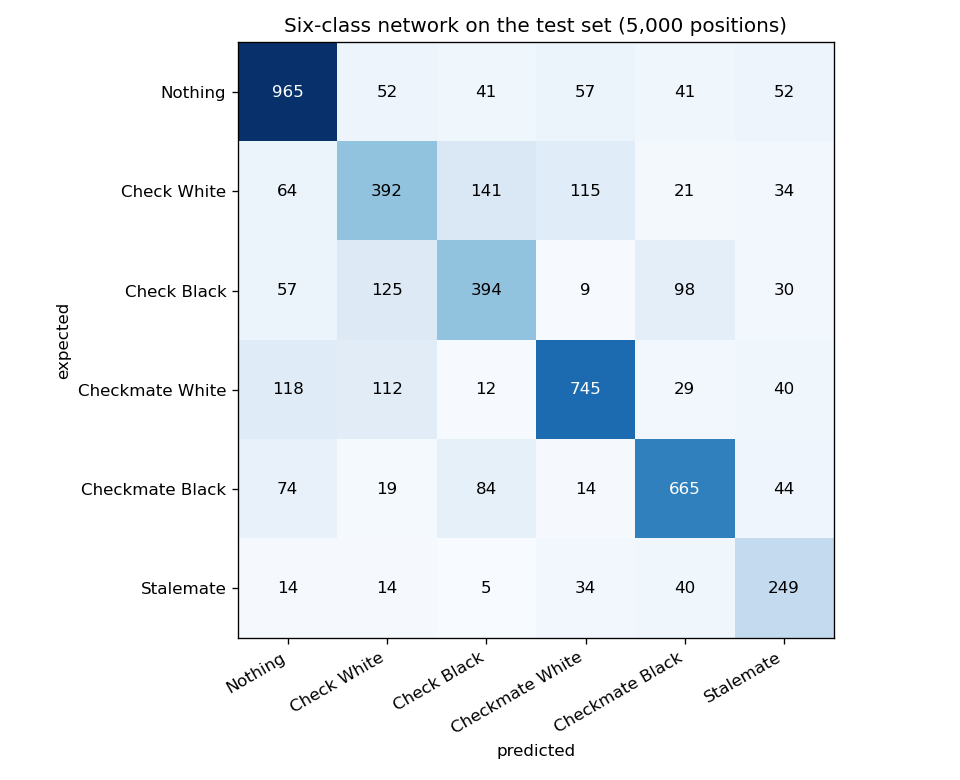

# Stalemate bonus: generated positions and a six-class network

Measurement for issue #24: the dataset contains no stalemate, so can a network learn a
`Stalemate` class from generated positions? Related decision:
[ADR-0015](../adr/0015-stalemate-positions.md).

## Method

1. **Generation** (`bonus/my_torch_positions 5000 1 0.5`): sparse random boards (two kings and 1 to
   6 other pieces, no pawn on the first or last rank, random side to move), kept when the oracle
   finds them legal and labeled by the oracle. Half of the 5,000 kept positions are stalemates; the
   other half are sparse positions of any other class, drawn the same way, so that "few pieces"
   does not mean "stalemate".
2. **Dataset sample**: 20,000 positions drawn from the 723,019 with a fixed seed.
3. **Split**: the 25,000 positions shuffled with a fixed seed; 20,000 to train (of which the network
   file holds out 10 % for early stopping), 5,000 to test, never trained on.
4. **Network** (`bonus/configs/stalemate_network.conf`): 768 → 128 → 6, ReLU, Softmax,
   cross-entropy, Adam 0.001, batches of 64, up to 30 epochs with early stopping (patience 5),
   baseline encoding `fen-onehot-768`.
5. **Scoring** (`bonus/scripts/score_predictions.py`): precision and recall per class on the test
   set, overall and separately for dataset and generated positions.

- **Machine**: Intel Core i7-1355U, 14 GB RAM, Linux 7.0, g++ 15.2.0 `-O2`.
- **Reproduce**: `sh bonus/scripts/stalemate_experiment.sh` (72 s in total, measured). Two runs gave the
  same scores to the last digit. Raw data: [`data/stalemate_scores.csv`](data/stalemate_scores.csv),
  [`data/stalemate_training.log`](data/stalemate_training.log),
  [`data/stalemate_run.txt`](data/stalemate_run.txt).

## Results (2026-10-24)

**Generation**: 3,525,325 boards drawn, 2,412,327 legal, of which **2,500 stalemates (0.10 %)**.
Stalemates are rare even among sparse boards; the generator draws until it has enough.

**Training**: early stopping after 13 epochs, 41 s and 45 s on two runs, 286 MB peak memory.

Test set (5,000 positions):

| Class | Precision | Recall | Test positions |
| --- | --- | --- | --- |
| Nothing | 74.7 % | 79.9 % | 1,208 |
| Check White | 54.9 % | 51.1 % | 767 |
| Check Black | 58.2 % | 55.3 % | 713 |
| Checkmate White | 76.5 % | 70.6 % | 1,056 |
| Checkmate Black | 74.4 % | 73.9 % | 900 |
| **Stalemate** | **55.5 %** | **69.9 %** | 356 |
| Accuracy | | 68.2 % | 5,000 |

What the measurements show:

- **The class can be learned**: 249 of the 356 test stalemates (69.9 %) are recognized, by a
  network that never saw them; among generated positions, a predicted stalemate is right 77.3 % of
  the time.
- **But the network also calls 200 other positions stalemates** (the last column), 127 of them from
  the dataset, which contains none: precision falls to 55.5 % overall. The generated positions are
  sparse, and the network partly associates sparse boards with stalemate despite the generated
  non-stalemates.
- The other classes are weak (68.2 % accuracy), as expected from 20,000 training positions and a
  baseline encoding; this experiment tests feasibility, not the final network.

## Limits

- **The baseline encoding has no side to move**, yet a stalemate exists only for the side to move:
  the same board can be a stalemate with White to move and not with Black to move. An encoding with
  the side to move (#14) should help; to measure again then.
- Generated stalemates come from sparse random boards, not from games; real stalemates (often with
  more pieces and pawn blocks) may be harder.
- 20,000 dataset positions only, because `--train` keeps every encoded position in memory (#17).
- One seed and one split: no confidence interval yet.
