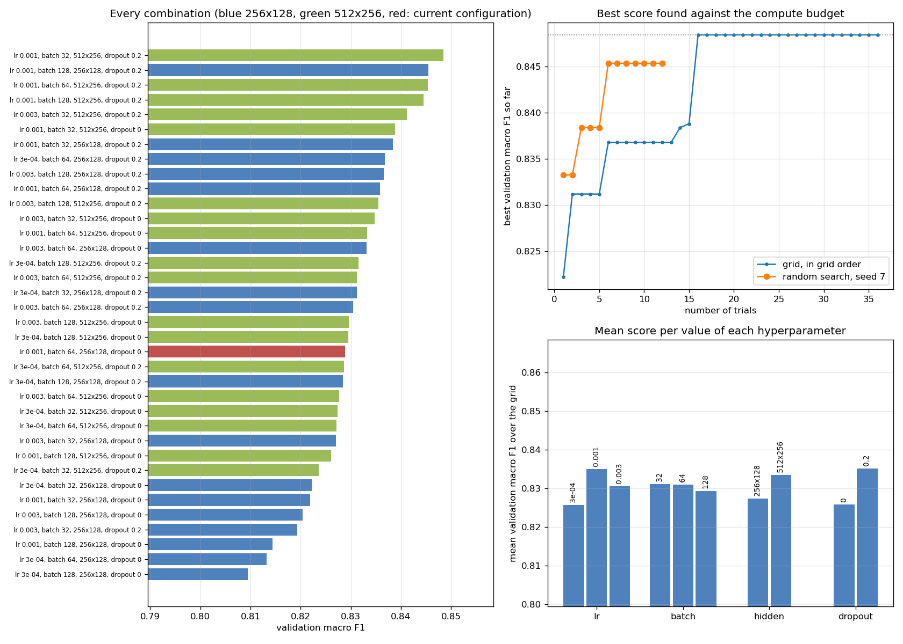
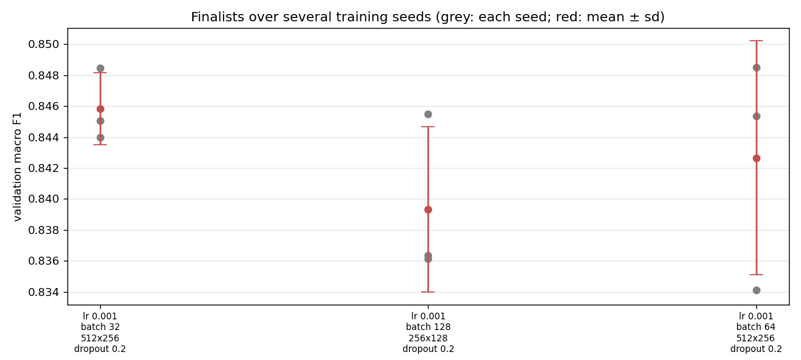

# Hyperparameter search: learning rate, batch size, hidden layers and dropout

Measurement for issue #10: are the hand-picked hyperparameters of the final network (Adam 0.001,
batches of 64, hidden layers 256 → 128, no dropout) the best of a wider space, and does a random
search find as good a combination as the full grid with a third of the trials? Related decisions:
[ADR-0028](../adr/0028-hyperparameter-search-api.md) (the search module),
[ADR-0023](../adr/0023-final-architecture.md) (the current architecture).

## Method

- **Search module**: `my_torch/Search.hpp` (ADR-0028). The chess objective,
  `scripts/hyperparam_search.cpp`, writes a configuration from `configs/final_network.conf` with the
  trial's values, builds it with `Network::fromConfig`, trains it with `Network::fit` on a
  `PositionSource` (the same path as `my_torch_analyzer --train`), and returns the **macro F1 on the
  validation split**, computed by `my_torch::report` (ADR-0026).
- **Data**: as for the trial runs ([09-trials.md](09-trials.md)): the dataset split with seed 42
  (ADR-0017), the first 10 % of the training and validation parts, the training part augmented
  (ADR-0019): **228,976 training positions, 7,155 validation positions**, prepared once for every
  trial. **The test split is never read.**
- **Space**, 3 × 3 × 2 × 2 = **36 combinations**:

  | Hyperparameter | Values | Current value |
  | --- | --- | --- |
  | Adam learning rate | 0.0003, 0.001, 0.003 | 0.001 |
  | Batch size | 32, 64, 128 | 64 |
  | Hidden layers | 256 → 128, 512 → 256 | 256 → 128 |
  | Dropout after each hidden ReLU | 0, 0.2 | 0 |

  The current configuration is combination 16 of the grid.
- **Fixed settings**: encoding `fen-attacks-901` (ADR-0016), cross-entropy with the natural class
  distribution (ADR-0018), no learning-rate schedule, default initialisation (ADR-0023), at most 30
  epochs with early stopping (patience 3, best weights restored).
- **Three steps**, run by `scripts/hyperparam_search.sh`:
  1. **Grid search**: the 36 combinations, training seed 1 (`init seed=1`, batch order `seed=42`).
  2. **Random search**: 12 combinations drawn with seed 7. It reads its scores from the grid's log,
     so it trains nothing; it answers how close a third of the budget gets to the grid's best.
  3. **Seed check**: the 3 best combinations of the grid trained again with seeds 2 and 3 (initial
     weights and batch order change, data unchanged), so that a winner by luck is not retained.
- **Timing**: wall time of each trial (`steady_clock`), written to `details.csv` with the number of
  epochs and the validation accuracy. The search runs under
  `systemd-inhibit --what=sleep:handle-lid-switch`: a first probe showed that a suspended laptop
  pauses `steady_clock` but not the elapsed time, which made a 333 s trial last 2,883 s.
- **Machine**: development laptop, Intel Core i7-1355U (10 cores, 12 threads), 14 GB RAM,
  Ubuntu 26.04.1, g++ 15.2.0 `-O2`, matrix product on every thread (ADR-0024). The laptop stayed
  usable during the search, so **times are indicative**; the scores are deterministic.
- **Reproduce**: `sh scripts/hyperparam_search.sh` (resumable: rerun it after a stop), which writes
  the CSV files and graphs to [`data/hyperparameters/`](data/hyperparameters/) through
  `scripts/plot_hyperparameters.py`.

## Results

Run of 2026-10-28, commit `7624bad`
([`run.txt`](data/hyperparameters/run.txt), [`grid.csv`](data/hyperparameters/grid.csv),
[`random_7.csv`](data/hyperparameters/random_7.csv), [`seeds.csv`](data/hyperparameters/seeds.csv),
[`details.csv`](data/hyperparameters/details.csv)).

### Grid search

| Rank | Combination | Learning rate | Batch | Hidden layers | Dropout | Validation macro F1 |
| --- | --- | --- | --- | --- | --- | --- |
| 1 | 15 | 0.001 | 32 | 512 → 256 | 0.2 | **0.8485** |
| 2 | 21 | 0.001 | 128 | 256 → 128 | 0.2 | 0.8455 |
| 3 | 19 | 0.001 | 64 | 512 → 256 | 0.2 | 0.8454 |
| 4 | 23 | 0.001 | 128 | 512 → 256 | 0.2 | 0.8445 |
| 5 | 27 | 0.003 | 32 | 512 → 256 | 0.2 | 0.8412 |
| 21 | 16 (current) | 0.001 | 64 | 256 → 128 | 0 | 0.8289 |

Mean score of each value over the 36 combinations:

| Hyperparameter | Mean macro F1 per value |
| --- | --- |
| Learning rate | 0.0003: 0.8258, **0.001: 0.8351**, 0.003: 0.8306 |
| Batch size | 32: 0.8312, 64: 0.8310, 128: 0.8293 |
| Hidden layers | 256 → 128: 0.8274, **512 → 256: 0.8336** |
| Dropout | 0: 0.8258, **0.2: 0.8352** |

- **Dropout 0.2 and a learning rate of 0.001** matter most: the top 4 combinations all have both.
  The batch size barely changes the mean (0.002 between values).
- **The current configuration ranks 21st of 36**, 0.020 below the best. Its validation accuracy is
  0.859 against 0.880 for combination 15.
- These scores are lower than the final network's because the networks see 10 % of the data; the
  ranking between combinations is what this measurement compares.

### Grid against random search

The random search (seed 7) drew combinations 18, 0, 13, 1, 22, **19**, 16, 12, 28, 10, 11, 23. Its
best, combination 19 (0.8454), came at its 6th trial and is 0.003 below the grid's best, found at the
grid's 16th trial; with 12 trials it cost a third of the grid. The gap is below the seed-to-seed
spread measured next, so on this space **the random search found an equivalent combination for a
third of the compute**.

### Seed check

| Combination | Seed 1 | Seed 2 | Seed 3 | Mean |
| --- | --- | --- | --- | --- |
| 15 (lr 0.001, batch 32, 512 → 256, dropout 0.2) | 0.8485 | 0.8451 | 0.8440 | **0.8459** |
| 19 (lr 0.001, batch 64, 512 → 256, dropout 0.2) | 0.8454 | 0.8485 | 0.8341 | 0.8427 |
| 21 (lr 0.001, batch 128, 256 → 128, dropout 0.2) | 0.8455 | 0.8362 | 0.8364 | 0.8393 |

Combination 15 has the best mean and the smallest spread (0.0045); combination 21's second place in
the grid came from a favourable seed. Combination 15 is retained as the candidate configuration
([ADR-0030](../adr/0030-hyperparameter-search-result.md)).

### Timing

The 42 trainings took 11.5 h of trial time (9.7 h for the grid), from 210 s to 1,874 s per trial
without the anomaly below. Mean time per epoch over the grid: 139 s with batches of 32, 72 s with 64,
46 s with 128, so **the winning combination is also one of the slowest to train**. Two measurements
are **not reliable**:

- **Combination 27**: 7,801 s for 20 epochs, 390 s per epoch, 2.8 times the mean of batches of 32. The
  search ran under `systemd-inhibit`, so the laptop did not suspend; another load on the machine is
  the likely cause. Its score is not affected (training is deterministic).
- **Combinations 25 and 26**: the project was compiled on the same machine during these trials,
  which may have lengthened them.

## Limits

- **10 % of the data**: the ranking of combinations at 10 % may differ at 100 %, larger networks
  gaining most from more data (the 512 → 256 network led the first trial series at 10 %).
- **One seed in the grid**: differences below the seed-to-seed spread measured in
  [09-trials.md](09-trials.md) are noise; the seed check covers only the 3 finalists.
- **A small space**: 4 hyperparameters, 2 or 3 values each. Weight decay, the optimizer, the
  learning-rate schedule and the number of layers stay at the values of earlier measurements.
- **Selection on the validation split**: the best of 36 scores on the same 7,155 positions is
  optimistic; only the test split, read once for the final network, gives an unbiased score.
