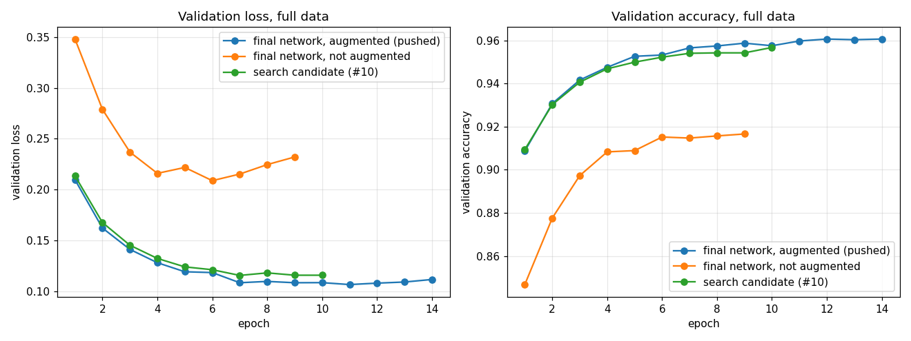
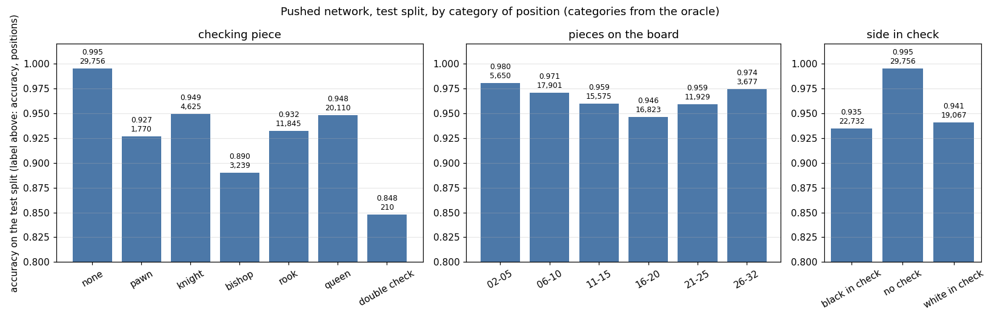
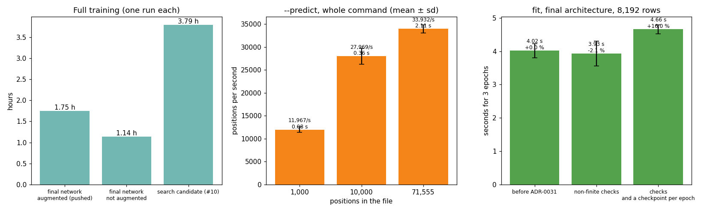

# Benchmarks and charts: learning curves, accuracy per category, timings

Measurement for issue #18 ("a benchmark without visual proof is worthless"): the learning curves of
the networks trained on the full data on one chart, the accuracy of the pushed network per category
of position, and the training and prediction times on a described machine. The confusion matrix of
the pushed network is in [10-final-network.md](10-final-network.md).

## Method

- **Reproduce**: `sh scripts/bench_report.sh` on an idle machine (a few minutes). It writes the CSV
  files, `run.txt` and the graphs to [`data/benchmarks/`](data/benchmarks/) through
  `scripts/plot_benchmarks.py`. It needs the dataset, which is not published.
- **Learning curves**: the `curve.csv` of the three networks trained on 100 % of the data with
  `scripts/train_final.sh`, already measured: the final network with and without augmentation
  ([10-final-network.md](10-final-network.md)) and the candidate of the hyperparameter search
  ([15-hyperparameters.md](15-hyperparameters.md)). No training is run again.
- **Accuracy per category**: the pushed network (`my_torch_network_final.nn`) predicts the 71,555
  positions of the test split (split seed 42, ADR-0017); `scripts/category_accuracy.cpp` sorts each
  position with the rule-based oracle (`bonus/oracle`, #37), never with the network:
  - the **piece giving check** to the king in check (pawn, knight, bishop, rook, queen), "double
    check" when two pieces give it, "none" without check;
  - the **number of pieces on the board**, in bins of five;
  - the **side in check**.

  A prediction is right when it equals the expected label of the split file.
- **Prediction time**: the whole `my_torch_analyzer --predict` command (loading the network, reading
  and checking the file, encoding, forward pass, printing) on the first 1,000, 10,000 and 71,555
  positions of the test split, 5 runs each, wall-clock time.
- **Training overheads**: `scripts/bench_overheads.cpp` times 3 epochs of `Network::fit` on the
  final architecture (901 → 256 → 128 → 5, Adam, batches of 64) with 8,192 synthetic rows, built
  against commit `62c1c94` (before the non-finite checks of ADR-0031) and against the current
  library, with and without a checkpoint per epoch (ADR-0032). The three variants alternate, 5 runs
  each, so that a change of load hits all of them.
- **Machine** ([`run.txt`](data/benchmarks/run.txt)): development laptop, Intel Core i7-1355U
  (12 threads), 14 GB RAM, Linux 7.0.0-38, g++ 15.2.0 `-O2`, matrix product on every thread
  (ADR-0024); load average 1.43 when the timings started (the compilation done by the script had
  just ended), nothing else running. Run of 2026-10-29 on commit `04625da` with the scripts of this
  measurement.

## Results

### Learning curves of the networks trained in full

- **Augmentation is the largest gain** of the three: without it the validation loss rises again
  after epoch 6 (overfitting) and the accuracy stays near 0.915, against 0.96 with it.
- The candidate of the search follows the pushed network epoch for epoch, slightly below, and stops
  at epoch 10 (early stopping); the pushed network keeps improving until epoch 11.

### Accuracy per category of position, pushed network, test split

| Checking piece | Positions | Accuracy |
| --- | --- | --- |
| none (no check) | 29,756 | 0.995 |
| knight | 4,625 | 0.949 |
| queen | 20,110 | 0.948 |
| rook | 11,845 | 0.932 |
| pawn | 1,770 | 0.927 |
| **bishop** | 3,239 | **0.890** |
| **double check** | 210 | **0.848** |

([`category_accuracy.csv`](data/benchmarks/category_accuracy.csv), with the other two groups.)

- **Bishop checks are the hardest** (0.890), worse than knight checks (0.949). A likely reason: a
  bishop attacks along a diagonal that other pieces can block, which the network must read from the
  attack maps of the encoding (ADR-0016), while a knight attacks fixed squares. Not tested further.
  Double checks (0.848) are rare (210 positions, 0.3 % of the split), so that figure is uncertain.
- **Middle-game boards are the hardest**: 0.946 with 16 to 20 pieces, against 0.980 with 2 to 5.
- **The colour barely matters**: 0.935 when Black is in check, 0.941 when White is.
- Most errors behind these figures are check against checkmate of the same side (91 % of the
  errors of the pushed network, [10-final-network.md](10-final-network.md)).

### Timings

| Measurement | Result |
| --- | --- |
| Full training, final network with augmentation (pushed) | 6,285 s (1.75 h), 14 epochs, one run |
| Full training, final network without augmentation | 4,109 s (1.14 h), 9 epochs, one run |
| Full training, search candidate (#10) | 13,661 s (3.79 h), 10 epochs, one run, other work on the laptop meanwhile |
| `--predict`, 1,000 positions | 0.08 s, about 12,000 positions/s |
| `--predict`, 10,000 positions | 0.36 s, about 28,000 positions/s |
| `--predict`, 71,555 positions (the test split) | **2.11 s, about 34,000 positions/s** |
| `fit`, 3 epochs, before the non-finite checks | 4.02 s ± 0.21 |
| `fit`, 3 epochs, with the non-finite checks (ADR-0031) | 3.93 s ± 0.38 |
| `fit`, 3 epochs, with the checks and a checkpoint per epoch (ADR-0032) | 4.66 s ± 0.14; 16.4 MB per checkpoint |

(Mean ± standard deviation over 5 runs: [`predict_times.csv`](data/benchmarks/predict_times.csv),
[`overheads.csv`](data/benchmarks/overheads.csv).)

- **Prediction speed grows with the file size**: the fixed cost (loading the 13 MB network file,
  starting the threads) weighs on small files. The test split takes 2.1 s; the run of 2026-10-27 in
  [10-final-network.md](10-final-network.md) took 2.8 s for the same file.
- **The non-finite checks cost nothing measurable**: −2 % on average, inside the run-to-run spread
  (5 to 10 %). The 3 to 7 % first written in ADR-0031 came from a laptop busy with another training;
  ADR-0031 is corrected.
- **A checkpoint costs about 0.24 s** ((4.66 − 3.93) / 3): +19 % on this small synthetic training,
  but under 0.1 % of a 450 s epoch of the full training. ADR-0032 is corrected (0.3 to 0.45 s were
  measured under load).
- The training times come from single runs of [`train_final.sh`](../../scripts/train_final.sh)
  (the `run.txt` of each run): no spread is known.

## Limits

- **One machine**, a laptop whose frequency changes with temperature; 5 runs per timing.
- **Training times are single runs**, the candidate's disturbed by other work.
- **The overheads are measured on synthetic data** with 8,192 rows: their share in a real epoch
  (2.3 million positions) is extrapolated, not measured.
- **Categories are not independent**: a queen check is often in the middle game, so the groups
  overlap; no cause is isolated.
- **One network and one split**: no confidence interval; categories of a few hundred positions
  (double check) can move by several points from one network to another.
