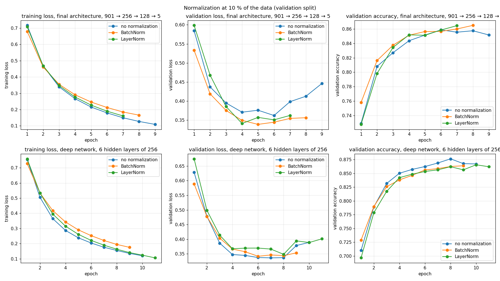

# Normalization: BatchNorm and LayerNorm against none

Measurement for issue #30: do the new normalization layers (ADR-0033) help the chess network,
on its own architecture and on a deeper one, where normalization is expected to matter more?

## Method

- **Layers**: `batch_norm` or `layer_norm` after each hidden `dense`, before its ReLU; none after
  the last `dense`. Gamma starts at 1 and beta at 0; BatchNorm momentum 0.1, epsilon 1e-5.
- **Six networks** ([`configs/normalization/`](../../configs/normalization/)), everything else as
  [`configs/final_network.conf`](../../configs/final_network.conf) (Adam 0.001, batches of 64,
  early stopping with patience 3 on the validation loss, best weights restored):

  | Network | Hidden layers | Without | BatchNorm | LayerNorm |
  | --- | --- | --- | --- | --- |
  | Final architecture | 256, 128 | `shallow_none` | `shallow_batch` | `shallow_layer` |
  | Deep | six of 256 | `deep_none` | `deep_batch` | `deep_layer` |

- **Data**: as for the hyperparameter search ([15-hyperparameters.md](15-hyperparameters.md)): 10 %
  of the split of seed 42, training part augmented, **228,976 training and 7,155 validation
  positions**, scored on the validation split. The test split is not read.
- **One seed** per network (`init seed=1`, batch order `seed=42`).
- **Reproduce**: `sh scripts/bench_normalization.sh` (resumable), which trains the six networks with
  `scripts/train_final.sh` and draws the graph with `scripts/plot_normalization.py`. Results in
  [`data/normalization/`](data/normalization/): one folder per network (`curve.csv`, `scores.txt`,
  `run.txt`) and [`summary.csv`](data/normalization/summary.csv).
- **Machine**: development laptop, Intel Core i7-1355U, 14 GB RAM, g++ 15.2.0 `-O2`. Runs of
  2026-10-29, commit `edbc19d` (no normalization, LayerNorm) and `a852953` (BatchNorm, after the fix
  below; the two commits differ only in that fix).

## Results

Scores of the restored best epoch (lowest validation loss), validation split:

| Network | Normalization | Epochs | Best validation loss | Accuracy | Macro F1 |
| --- | --- | --- | --- | --- | --- |
| Final architecture | none | 9 | 0.362 | **0.859** | 0.829 |
| Final architecture | BatchNorm | 8 | **0.339** | 0.857 | **0.831** |
| Final architecture | LayerNorm | 7 | 0.341 | 0.852 | 0.825 |
| Deep | none | 10 | **0.336** | **0.869** | **0.838** |
| Deep | BatchNorm | 9 | 0.342 | 0.856 | 0.832 |
| Deep | LayerNorm | 11 | 0.349 | 0.862 | 0.835 |

- **On the final architecture, normalization holds back overfitting but does not raise the
  score.** Without it, the validation loss climbs from 0.362 (epoch 6) to 0.446 (epoch 9) while the
  training loss keeps falling; with BatchNorm or LayerNorm it stays near 0.34 to 0.36. The accuracy
  and macro F1 of the restored epoch are within 0.007 of each other, less than the spread between
  seeds measured in [09-trials.md](09-trials.md).
- **On the deep network, normalization does not help**: the network without it is the best on
  every figure. Six hidden layers with ReLU, Adam and this initialisation already train well; the
  problem normalization solves, a deep network that fails to learn, does not appear at this depth.
- **BatchNorm slows the fall of the training loss** (0.166 at its last epoch on the final
  architecture against 0.109 without): its batch statistics add noise, a known regularizing effect.
- The configuration without normalization of the final architecture scores a macro F1 of 0.8289,
  the score of the same combination (16) in the hyperparameter search: same data, same settings,
  deterministic training.
- **Times are not compared**: per epoch, the runs without normalization were slower (45.5 s and
  122.4 s) than the normalized ones (about 36 s and 90 s) although they compute less, so the load of
  the laptop changed between runs ([`summary.csv`](data/normalization/summary.csv)).

### A bug found by this measurement

The first BatchNorm runs scored 0.798 (final architecture) and 0.768 (deep) on the validation
split, though their best epochs had reached 0.857 and 0.856. Early stopping restored the weights of
the best epoch but kept the running averages of the last one, which do not match those weights.
The fix (commit `a852953`) saves the layers' state with the best weights and restores both, also in
checkpoints (ADR-0032, format version 2); a regression test checks that the restored network has
exactly the validation loss of its best epoch. The two BatchNorm runs were trained again: their
curves are identical to the first runs (deterministic training), only the restored network changed.

## Decision

The final network is unchanged: normalization does not improve it here, and costs a layer per
hidden layer. The layers stay in the library for deeper networks, such as the convolutional
network of #29 ([ADR-0033](../adr/0033-normalization.md)).

## Limits

- **One seed** per network: the differences on the final architecture are below the seed-to-seed
  spread.
- **10 % of the data**, as in the hyperparameter search, whose winner did not hold at 100 %
  ([15-hyperparameters.md](15-hyperparameters.md)).
- **Same learning rate for all**: normalization is said to allow a larger one, which was not tried.
- **"Deep" means six hidden layers** of a fully connected network; much deeper networks, where
  normalization is usually needed, were not trained.
- **Times disturbed** by a changing load on the laptop.
