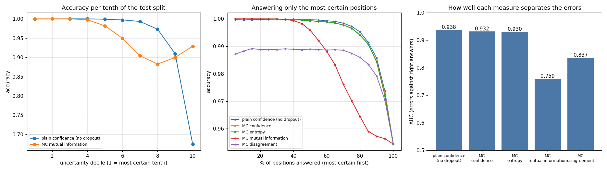

# Uncertainty: are the errors the uncertain predictions? (MC dropout)

Measurement for issue #26. Monte Carlo dropout (Gal and Ghahramani, 2016) keeps the dropout layers
active in prediction and runs each position several times: where the passes disagree, the network
is unsure. The question of the issue: are the errors the uncertain predictions? And does MC dropout
say more than the confidence a single plain prediction already gives (its top probability)?

## Method

- **Network**: the candidate of the hyperparameter search (dropout 0.2 after each hidden ReLU,
  trained on 100 % of the data, [15-hyperparameters.md](15-hyperparameters.md)). The pushed network
  has no dropout, so all its passes would be the same. The candidate is not pushed: it is
  rebuilt by `sh scripts/train_final.sh configs/candidate_network.conf` (about 4 hours); the
  sha256 of the file used is in [`run.txt`](data/uncertainty/run.txt).
- **Positions**: the 71,555 positions of the test split (split seed 42, ADR-0017).
- **Predictions**: for each position, the plain prediction (dropout off, one pass) and the MC
  prediction, mean of **30 passes** with only the dropout layers active
  (`Network::predictMonteCarlo`, ADR-0034, seed 1).
- **Five uncertainty measures**: one minus the top probability of the plain prediction (**plain
  confidence**); one minus the top probability of the MC mean (**MC confidence**); the **entropy**
  of the MC mean (total uncertainty); the **mutual information** (entropy of the mean minus the
  mean entropy of the passes: the part due to the passes disagreeing, the uncertainty of the model
  itself); the **disagreement** (share of passes whose top class is not the majority one).
- **How well a measure finds the errors**: the AUC (probability that a random error is more
  uncertain than a random right answer; 0.5 is chance, 1 perfect), the share of the errors among the
  most uncertain 5, 10 and 20 % of the positions, and the accuracy when only the most certain
  positions are answered.
- **Reproduce**: `sh scripts/uncertainty.sh` (`scripts/uncertainty.cpp`, then
  `scripts/plot_uncertainty.py`), 149 s on the development laptop (Intel Core i7-1355U, 12 threads).
  Results in [`data/uncertainty/`](data/uncertainty/).

## Results

| Measure | AUC | Errors in the most uncertain 5 % | 10 % | 20 % | Accuracy on the most certain 90 % |
| --- | --- | --- | --- | --- | --- |
| **Plain confidence (no dropout)** | **0.938** | **44.8 %** | **71.7 %** | **91.6 %** | **0.986** |
| MC confidence | 0.932 | 43.6 % | 69.7 % | 89.8 % | 0.985 |
| MC entropy | 0.930 | 41.6 % | 69.0 % | 89.6 % | 0.984 |
| MC disagreement | 0.837 | 38.2 % | 58.9 % | 75.4 % | 0.979 |
| MC mutual information | 0.759 | 9.0 % | 15.6 % | 37.6 % | 0.957 |

([`summary.csv`](data/uncertainty/summary.csv).) Accuracy over all positions: 0.9547 plain, 0.9544
MC (3,244 and 3,261 errors).

- **Yes, the errors are the uncertain predictions.** The most uncertain tenth of the test split
  holds 72 % of the errors; answering only the 90 % most certain positions raises the accuracy from
  0.955 to 0.986. The accuracy is about 1.000 on the most certain 40 % and falls to 0.68 on the
  most uncertain tenth.
- **MC dropout does not beat the plain confidence**, which costs one pass instead of 30: every MC
  measure has a lower AUC. The measures that only MC dropout gives are the weakest: the mutual
  information (0.759) and the disagreement (0.837).
- **A likely reason, not tested further**: the errors are almost all one kind, check against
  checkmate of the same side (2,973 of the 3,261 MC errors, 91 %,
  [`errors.txt`](data/uncertainty/errors.txt)). These positions are ambiguous for the encoding
  (ADR-0016 gives attacked squares, not the escape squares a mate depends on), and the network
  puts its probability between the two classes, which a single pass already shows. The mutual
  information measures another thing, the disagreement of the model with itself.
- **The MC mean does not improve the accuracy** (0.9544 against 0.9547): averaging 30 dropped
  copies of one network is not an ensemble of independently trained ones (#40).
- The disagreement is 0 on most positions (all passes agree), so its curve orders those ties
  arbitrarily: its start at 0.987 is an effect of the ties, not of the measure.

## Decision

Monte Carlo dropout stays in the library (`Network::predictMonteCarlo`, ADR-0034), but the
uncertainty to show, in the GUI for instance, is the plain top probability: it finds the errors as
well, for one pass instead of 30, and also works with the pushed network, which has no dropout.

## Limits

- **One network**, with dropout 0.2: a network trained with more dropout could give MC passes that
  disagree more; not tried.
- **30 passes, one seed**: more passes would steady the mutual information and the disagreement.
- **One kind of error dominates**: on data with other kinds of errors, the mutual information could
  do better.
- **The test split comes from the same distribution as the training data**: MC dropout is said to
  help most on positions unlike the training data, which this split does not contain.
