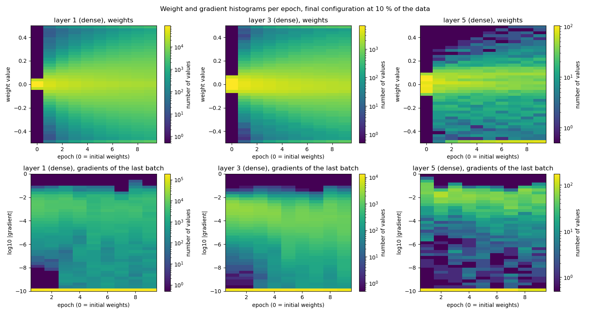
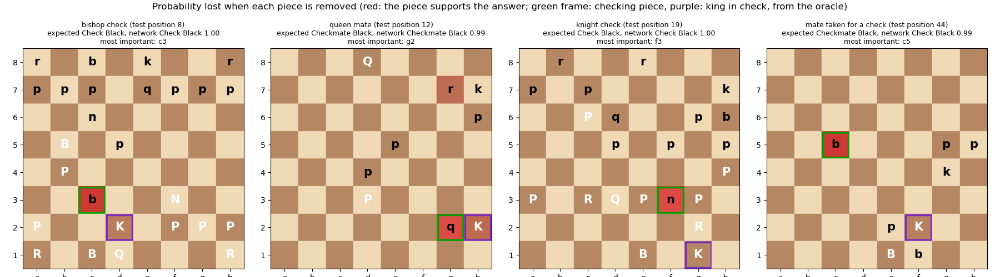
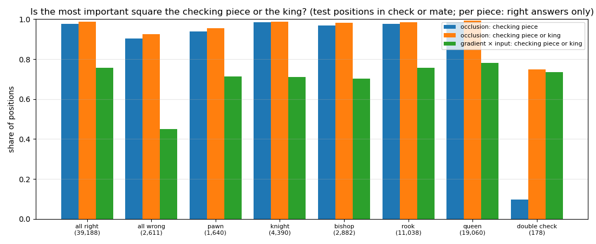

# Network inspection: summary, histograms, saliency

Measurement for issue #36: what has the network learned? A summary of its layers, the evolution of
its weights and gradients during training, and, on real positions, which squares decide its answer.
Decision: [ADR-0035](../adr/0035-network-inspection.md). The saliency is also drawn in the chess GUI
([gui.md](../gui.md)).

## Method

- **Reproduce**: `sh scripts/inspect.sh` (`scripts/inspect.cpp`, then
  `scripts/plot_inspection.py`). Results in [`data/inspection/`](data/inspection/), with
  [`run.txt`](data/inspection/run.txt) (commit, network checksum, machine).
- **Summary**: `modelSummary` of the pushed network.
- **Histograms**: the final configuration ([`configs/final_network.conf`](../../configs/final_network.conf))
  trained at 10 % of the data (the files of `scripts/train_final.sh`, 228,976 training and 7,155
  validation positions). An epoch callback (`TrainConfig::onEpoch`) writes, before training and
  after each epoch, the histogram of the weights of each Dense layer (40 bins over [-0.5, 0.5],
  values outside in the end bins) and of their gradients of the last batch of the epoch (40 bins of
  log10 |g| over [-10, 0]). The same training run by `my_torch_analyzer --train` gives the same
  loss at every epoch ([`histograms_training.log`](data/inspection/histograms_training.log)): the
  callback reads, it does not disturb.
- **Saliency** of the pushed network on the **41,799 test positions in check or mate** (split seed
  42), 52 s. For each square: **occlusion**, the probability of the network's answer minus the
  same probability with the piece of the square removed (attack maps recomputed); and **gradient ×
  input**, the gradient of that probability summed over the square's inputs (its piece, and whether
  each side attacks it). The rule-based oracle (`bonus/oracle`) names the checking piece and the
  king in check, never used by the network.
- **Question**: is the most important square the checking piece, or the king in check?

## Summary

[`summary.txt`](data/inspection/summary.txt):

| # | Layer | Output | Parameters |
| --- | --- | --- | --- |
| 1 | dense | 256 | 230,912 |
| 2 | relu | 256 | 0 |
| 3 | dense | 128 | 32,896 |
| 4 | relu | 128 | 0 |
| 5 | dense | 5 | 645 |
| 6 | softmax | 5 | 0 |
| | **Total** | | **264,453** |

87 % of the parameters are in the first layer, which reads the 901 inputs.

## Weight and gradient histograms

- **The weights spread out**: they start inside ±1/√(inputs) (default initialisation, ADR-0023:
  ±0.033, ±0.063 and ±0.088 for the three layers) and widen at every epoch; after 9 epochs, 2.8 % of
  the first layer's weights, 3.6 % of the second's and 13.4 % of the last one's are beyond ±0.475
  (the end bins). No layer collapses to 0.
- **Many gradients are 0**: 80 % of the first layer's gradients are below 1e-10, because the input
  is sparse (a one-hot board: an input that is 0 in the whole batch gives a zero gradient to its
  weights), and 37 % of the second layer's, likely ReLU units inactive on the whole batch. The
  other gradients stay roughly between 1e-6 and 1e-1 at every epoch: no vanishing or exploding
  gradient, consistent with ADR-0031 never stopping a training.
- These are the gradients of one batch, the last of each epoch: a picture, not an average.

## Saliency: which squares decide the answer?

The first test position of each kind (frames from the oracle: green, the checking piece; purple,
the king in check):

- **Bishop check, knight check**: the most important square is the checking piece; nothing else
  counts.
- **Queen mate on g2**: the queen first, then the rook on g7, which protects it (without the rook
  the king could take the queen: no mate any more), and the king. The network uses the protection
  of the mating piece.
- **Mate taken for a check** (an error): the network finds the checking bishop, but answers check:
  the mate depends on the king's escape squares, which the encoding does not give directly
  (ADR-0016). It sees the cause of the check, not the absence of escape.

The [fool's mate in the GUI](../gui-saliency.png) shows the same: the queen on h4, then the White
pieces on d2, e2 and f1 that block the escape of the king.

| Positions | Count | Occlusion: checking piece | Occlusion: checking piece or king | Gradient × input: checking piece or king |
| --- | --- | --- | --- | --- |
| Right answers | 39,188 | **97.6 %** | **98.6 %** | 75.7 % |
| Wrong answers | 2,611 | 90.3 % | 92.6 % | 45.0 % |
| Right, pawn check | 1,640 | 93.8 % | 95.6 % | 71.4 % |
| Right, knight check | 4,390 | 98.6 % | 98.9 % | 70.9 % |
| Right, bishop check | 2,882 | 96.9 % | 98.2 % | 70.3 % |
| Right, rook check | 11,038 | 97.7 % | 98.5 % | 75.7 % |
| Right, queen check | 19,060 | 98.6 % | 99.2 % | 78.1 % |
| Right, double check | 178 | 9.6 % | 74.7 % | 73.6 % |

([`saliency_agreement.csv`](data/inspection/saliency_agreement.csv); "check" includes mates.)

- **The network looks at the right square**: on 97.6 % of its right answers, removing the
  checking piece is what changes its answer most. It has learned where the check comes from, not
  a shortcut elsewhere on the board.
- **Its errors are not about where to look**: on 90 % of them the checking piece is still the most
  important square. As in [16-benchmarks.md](16-benchmarks.md) and
  [18-uncertainty.md](18-uncertainty.md), the errors are about check against mate, decided by
  other squares (the escapes).
- **Bishop checks**: 96.9 % here, though they are the least accurate category (0.890,
  [16-benchmarks.md](16-benchmarks.md)): the network finds the bishop, its errors are elsewhere.
- **Double check**: with two checking pieces, removing one leaves a check, so the king is the most
  important square (74.7 % for either).
- **Occlusion is the better map**: gradient × input agrees with the oracle on 75.7 % of the right
  answers only. On confident answers (probability near 1) the softmax saturates and the gradients
  nearly vanish (0.018 at most on the fool's mate), so their ranking is noisy. The GUI shows
  occlusion by default.

## Limits

- **Occlusion removes a piece**, which can make a position no chess game reaches (a king removed);
  the network answers anyway, so the map measures its reaction, not a chess fact.
- **The most important square only**: the agreement looks at one square per position; the
  examples show that the network also uses other squares (protection, escape squares).
- **One network**, the pushed one; **histograms of one 10 % training** and of one batch per epoch.
- **Gradient × input on one-hot inputs** only counts the inputs that are 1; other methods
  (integrated gradients) were not tried.
