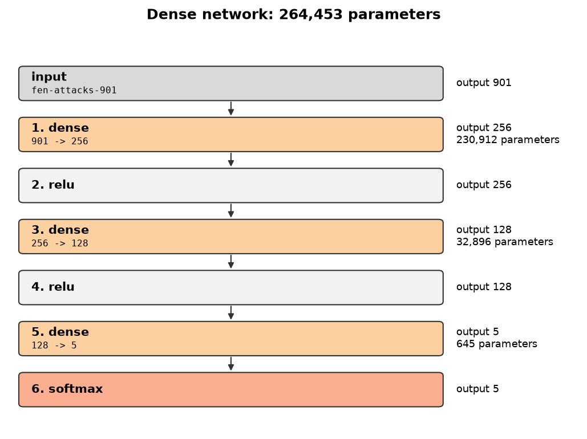
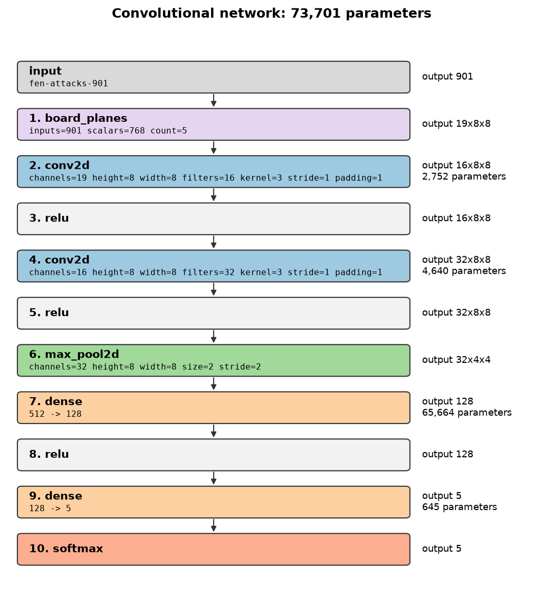
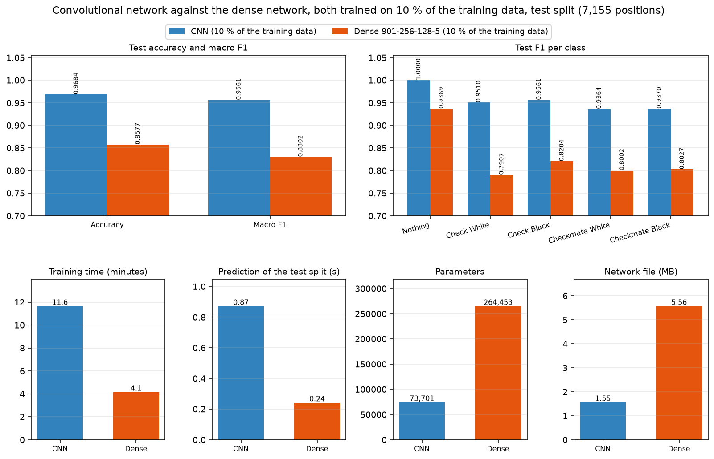

# Convolutional network against the dense network (issue #29)

**Question**: does a convolutional network on the board planes classify chess positions better than
the dense network of `configs/final_network.conf`, and at what cost in time, parameters and file
size? What do the two architectures look like?

**Short answer**: trained on the same 10 % of the data, the CNN scores 0.9684 test accuracy against
0.8577 for the dense network, but that dense network is one that **overfits when given only 10 % of
the data** (its best validation loss is at epoch 6, then it rises), not a converged one. The fair
reference is the pushed dense network trained on all the data, which scores 0.9589 on the same test
positions: the 10 % CNN is about 1 point above it, with one seed, so that gap is small and not
established. The CNN has 3.6 times fewer parameters, but takes twice as long per epoch to train and
3.6 times longer to predict. **The full-data CNN was not run** (see "What was not measured"): the
pushed network stays dense.

## Method
- Networks, both in [`configs/`](../../configs/): `final_network.conf` (dense, 901 → 256 → 128 → 5)
  and `cnn_network.conf`: `board_planes` (the 901 inputs of `fen-attacks-901` become 19 planes of
  8 × 8), `conv2d` 19 → 16 (3 × 3, padding 1), ReLU, `conv2d` 16 → 32, ReLU, `max_pool2d` 2 × 2
  (32 × 4 × 4), `dense 512 128`, ReLU, `dense 128 5`, softmax. Same input, labels, loss
  (cross-entropy), Adam lr 0.001, batch 64, at most 30 epochs, early stopping with patience 3 on
  the validation loss (best epoch restored), He-normal convolution weights and the default
  initialisation for the dense layers, seed 1. Layers and design: [ADR-0037](../adr/0037-convolutional-layers.md).
- Architecture diagrams, generated from the configurations by `sh scripts/architecture.sh`
  (`scripts/architecture.cpp` loads the file and prints layer, settings, output shape and
  parameter count from the library's own `Layer::outputWidth` and `parameters()`; matplotlib
  draws them, [data/architecture_dense.tsv](data/architecture_dense.tsv),
  [data/architecture_cnn.tsv](data/architecture_cnn.tsv)):

  

  

  The dense total, 264,453, is the summary of the pushed network
  ([data/inspection/summary.txt](data/inspection/summary.txt)): 901·256 + 256, 256·128 + 128 and
  128·5 + 5.
- Data: the same split as the final network (seed 42, [ADR-0017](../adr/0017-dataset-split.md)),
  **keeping the first 10 % of each split** (`FRACTION=0.1` of `scripts/train_final.sh`): 228,976
  augmented training lines (57,244 positions before the two symmetries,
  [ADR-0019](../adr/0019-symmetry-augmentation.md)), 7,155 validation lines (appended untouched at
  the end of the training file, [ADR-0022](../adr/0022-validation-tail-and-training-pipeline.md)) and **7,155 test
  positions**, scored once per network.
- Commands (the two runs one after the other, nothing else running; the script then times three
  predictions of the test split per network and writes the CSV and the chart):
  ```bash
  FRACTION=0.1 sh scripts/train_final.sh configs/cnn_network.conf runs/cnn_10pct
  FRACTION=0.1 sh scripts/train_final.sh configs/final_network.conf runs/final_10pct
  sh scripts/bench_cnn.sh runs/cnn_10pct runs/final_10pct   # data/cnn_vs_dense.csv, cnn_vs_dense.png
  sh scripts/architecture.sh                                 # the two diagrams
  ```
- Machine, 2026-10-31, both runs: laptop, 12th Gen Intel Core i5-12450H, 12 threads
  ([ADR-0024](../adr/0024-parallel-blocked-matmul.md)), 15 GB RAM, Linux 6.8.0-90-generic, g++ 13.3.0.
  Run cards: [cnn](data/cnn-vs-dense/cnn/run.txt), [dense](data/cnn-vs-dense/dense/run.txt)
  (the commit shown there is `eb1b384` with uncommitted changes: the working tree held only the
  benchmark scripts and documents of this issue, plus the local `Makefile` change).
- The test split was used **only to measure** these two networks. The CNN's size (16 and 32
  filters) was chosen on pilots scored on the validation split (below); nothing was tuned on
  the test positions, and no hyperparameter of either network was searched.

### Pilots, on the validation split
One epoch on the same 228,976 training lines (`FRACTION=0.1 EVAL=validation`, configurations in
[data/cnn-pilots/](data/cnn-pilots/)), to decide the size of the CNN before the benchmark. The rule
fixed beforehand: a full epoch extrapolated above about 15 minutes means fewer filters. The
extrapolation multiplies by 10 (the full augmented file has 2,289,784 lines); it is **not a
measurement**.

| Pilot | Filters | Time for one epoch | Extrapolated to the full file | Validation accuracy after 1 epoch |
| --- | --- | --- | --- | --- |
| 1st session | 32 and 64 | 430.7 s | 72 min | 0.9494 |
| 1st session | 16 and 32 | 158.1 s | 26 min | 0.9357 |
| 2nd session, same configuration and data | 32 and 64 | 154.0 s | 26 min | 0.9494 |

The first two pilots decided the size (16 and 32). The same 32 and 64 pilot, repeated about a day later
(26 h), took 154 s instead of 431 s: **the laptop was 2.8 times slower during the first session**
(cause not identified: power mode, temperature or another load). The 32 and 64 network is still
above the 15-minute rule with the faster machine (26 min), so the choice stands, but the 72 and 26
minute figures above, and the comment in `configs/cnn_network.conf`, come from the slow session.
In the faster session the 16 and 32 network took 58.1 s per epoch in the benchmark, about 10
minutes extrapolated.

## Results



Every number below is in [data/cnn_vs_dense.csv](data/cnn_vs_dense.csv), written by
`scripts/bench_cnn.sh` from the run cards, `scores.txt` of each run
([data/cnn-vs-dense/](data/cnn-vs-dense/)) and its own timings.

| | CNN | Dense |
| --- | --- | --- |
| **Test accuracy** (7,155 positions) | **0.9684** | 0.8577 |
| **Test macro F1** | **0.9561** | 0.8302 |
| Epochs run (best epoch, from the validation loss) | 12 (9) | 9 (6) |
| Training time | 697.6 s (11.6 min), 58.1 s per epoch | 247.9 s (4.1 min), 27.5 s per epoch |
| Peak memory of the training | 442 MB | 172 MB |
| Prediction of the test split, median of 3 | 0.87 s | 0.24 s |
| Parameters | 73,701 | 264,453 |
| Network file | 1,548,849 bytes | 5,559,045 bytes |

Per class, on the 7,155 test positions:

| Class | CNN precision | CNN recall | CNN F1 | Dense precision | Dense recall | Dense F1 | Positions |
| --- | --- | --- | --- | --- | --- | --- | --- |
| Nothing | 1.0000 | 1.0000 | 1.0000 | 0.9460 | 0.9280 | 0.9369 | 2,944 |
| Check White | 0.9728 | 0.9303 | 0.9510 | 0.7883 | 0.7931 | 0.7907 | 1,305 |
| Check Black | 0.9683 | 0.9442 | 0.9561 | 0.8254 | 0.8155 | 0.8204 | 1,165 |
| Checkmate White | 0.9100 | 0.9644 | 0.9364 | 0.7864 | 0.8145 | 0.8002 | 954 |
| Checkmate Black | 0.9203 | 0.9543 | 0.9370 | 0.7890 | 0.8170 | 0.8027 | 787 |

Confusion matrices: [cnn](data/cnn-vs-dense/cnn/confusion.csv),
[dense](data/cnn-vs-dense/dense/confusion.csv). Learning curves:
[cnn](data/cnn-vs-dense/cnn/curve.csv), [dense](data/cnn-vs-dense/dense/curve.csv).

**Reference: the pushed network, trained on all the data.** `my_torch_network_final.nn` (dense,
trained on the whole augmented training split, never on a test position,
[10-final-network.md](10-final-network.md)) scored on **the same 7,155 test positions** with the
build of this branch (command and per-class scores in
[data/cnn-vs-dense/pushed_network_10pct_test.txt](data/cnn-vs-dense/pushed_network_10pct_test.txt)):

| Network, 7,155 test positions | Training data | Accuracy | Macro F1 |
| --- | --- | --- | --- |
| Dense, pushed | 100 % | 0.9589 | 0.9459 |
| CNN (this benchmark) | 10 % | 0.9684 | 0.9561 |
| Dense (this benchmark) | 10 % | 0.8577 | 0.8302 |

The 10 % CNN is 0.95 points of accuracy and 1.02 points of macro F1 above the full-data dense
network on these positions: it matches what the dense network needs ten times more data (and
about 1 h 45 of training on the other laptop) to reach, with one seed each. Next to the 0.3 to 0.6
points of macro F1 of seed spread measured on the dense network ([09-trials.md](09-trials.md)),
a gap of about 1 point is small: suggestive, not established. Scored on the whole test split
(71,555 positions), the pushed network gives accuracy 0.9615 and macro F1 0.9478
([data/cnn-vs-dense/pushed_network_rescore.txt](data/cnn-vs-dense/pushed_network_rescore.txt)), the
same numbers as before this branch: the new `Layer::outputWidth` contract and the width validation
did not change a dense network's predictions.

## Reading
- **The CNN learns the task from far less data.** With 10 % of the data it reaches 0.9684 accuracy
  and 0.9561 macro F1, 11.1 and 12.6 points above the dense network trained on the same lines, and
  about 1 point above the pushed dense network trained on ten times more (table above). For
  scale, the binomial standard error of an accuracy of 0.97 on 7,155 positions is about 0.2 points
  (a calculation, not a measurement), and the seed spread measured on the dense network in
  [09-trials.md](09-trials.md) is 0.3 to 0.6 points of macro F1: the 11-point gap over the 10 % dense network is much
  larger than both; the 1-point gap over the pushed network is not (see above).
- **The dense network overfits at this size**: its training loss falls to 0.109 while its
  validation loss rises from 0.362 (epoch 6, the best) to 0.446; the CNN's validation loss
  stays between 0.090 and 0.107 from epoch 8 to 12 and its best epoch is the 9th ([curves](data/cnn-vs-dense/)). The shared
  filters (a detector of "a piece attacks this square" is learnt once, not once per square) are
  the likely reason; this document does not isolate that cause.
- **The CNN makes only one kind of error**: its 226 errors are all check against checkmate of the
  same side (zero colour errors, zero confusion with "Nothing": Nothing has F1 1.0000). The dense
  network has 1,018 errors, of which 650 (64 %) are check against checkmate of the same side and
  the rest involve other classes, including 212 "Nothing" positions mislabelled. For the pushed
  dense network at full data that share was 91 % ([10-final-network.md](10-final-network.md)): the
  remaining weakness (does the side in check have an escape?) is the same.
- **Costs**: the CNN has 3.6 times fewer parameters and a network file 3.6 times smaller, but an
  epoch takes 2.1 times longer, and predicting the test split 3.6 times longer (0.87 s against
  0.24 s, the analyzer's whole pipeline included), with 2.6 times the memory of the dense
  network during training. The measured speed is that of the matrix product of
  [ADR-0024](../adr/0024-parallel-blocked-matmul.md), about 7 GFLOPS in double precision, as computed from a one-off micro-benchmark that was not
  saved (`Conv2D` forward of one batch of 64 samples: 8 ms for 19 → 32 filters, 22 ms for 32 → 64
  filters, in the slow session).

## What was not measured
- **The full-data CNN.** A first launch of the two full trainings (2,289,784 augmented lines, one
  after the other) was lost: the background processes disappeared without a log or a network file
  (cause not identified), after about a day of waiting. They were not relaunched. Extrapolated
  from 58.1 s per epoch on 10 % of the lines, one full epoch would take about 10 minutes and the
  CNN about two hours for 12 epochs, **an extrapolation, not a measurement**. The dense network's
  full-data time on the other laptop is 6,285 s ([10-final-network.md](10-final-network.md)); it
  was not re-run here, so no full-data time comparison is claimed.
- Whether the CNN still beats the dense network at 100 % of the data. The 10 % CNN is only about
  1 point above the full-data dense network on the same 7,155 positions (0.9684 against 0.9589), one
  seed each; a CNN trained on all the data would probably improve, but that is a guess, not a
  measurement. The 10 % dense run (0.8577) is a data-starved baseline, not the dense network's
  best.
- Other CNN sizes, kernels, pooling, depths, learning rates: no search was made for either network.

## Limits and next steps
- **One seed per network, one split, 7,155 test positions**: the third decimal is not significant.
- **Small data regime only**: the CNN-against-dense comparison at equal data is at 10 %, where the
  dense network overfits; at full data only the dense network was trained. The first thing to run, when a few hours of the machine
  are free: `sh scripts/train_final.sh configs/cnn_network.conf runs/cnn`, then `bench_cnn.sh`
  against the full dense run.
- **Timing noise**: the machine's speed varied 2.8 times between two sessions (pilots above). The
  two networks of the benchmark were measured one after the other in the same session, so their
  ratio is meaningful, the absolute seconds are not portable.
- **The scalars are broadcast as constant planes** (five of the 19 channels carry one number each,
  [ADR-0037](../adr/0037-convolutional-layers.md)): a shortcut that works here, not the cleanest
  design.
- The CNN is trained with the dense network's settings (Adam 0.001, batch 64, patience 3): they
  may not be the CNN's best.
- Candidates, not measured: more filters (the 32 and 64 network scored 0.9494 on the validation
  split after one epoch, against 0.9357 for 16 and 32), a third convolution, average instead of
  max pooling, a saliency map of the CNN (ADR-0035 follow-up).
