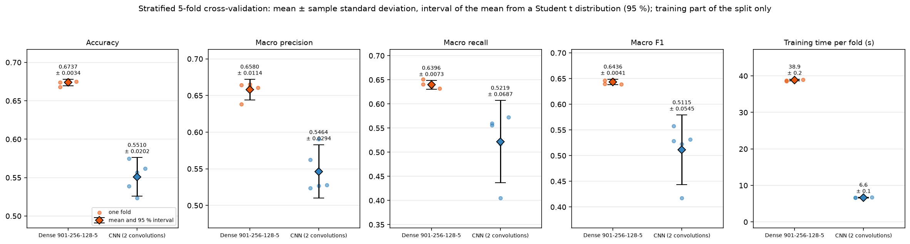

# Stratified k-fold cross-validation of the dense network and the CNN (issue #39)

**Question**: how much does a score move when the data is split differently, and can the two
networks of [20-cnn.md](20-cnn.md) be reported as a mean with an interval instead of one number
from one split?

**Short answer**: 5-fold cross-validation gives each metric as a mean ± sample standard deviation
over the folds, with a 95 % interval of the mean. On the small budgets that fit the machine, the
dense network scores 0.6737 ± 0.0034 accuracy (macro F1 0.6436 ± 0.0041) and the CNN 0.5510 ±
0.0202 (macro F1 0.5115 ± 0.0545). **These two rows are not a comparison of the architectures**:
the CNN was given a fifth of the rows and 2 epochs against 5 for the dense network, i.e. far fewer
weight updates, and it is not converged. The result that carries over is the spread: from one fold
to the next, the accuracy of the dense network moves by about 0.3 points, that of the CNN by
about 2 points, and the CNN's macro F1 by about 5 points. Those figures are the fold-to-fold
variation of **under-trained networks**; they are not the spread of the pushed network (0.9615
accuracy on the test split), which was not cross-validated.

## Method
- Library: `my_torch::crossValidate(source, k, seed, trainer)` in
  [`include/my_torch/Validation.hpp`](../../include/my_torch/Validation.hpp), decided in
  [ADR-0039](../adr/0039-cross-validation.md). It splits with `stratifiedKFold`
  ([ADR-0027](../adr/0027-generic-data-splits.md)): every class is spread over the k folds, each
  row is held out exactly once. It calls a trainer once per fold, in order, and summarises
  accuracy, macro precision, macro recall and macro F1 with `summarize`: the mean and the
  **sample** standard deviation (n - 1 in the denominator).
- Objective: [`scripts/cross_validation.cpp`](../../scripts/cross_validation.cpp). Each fold builds a
  **fresh** network from the configuration (the same `configs/` file and the same initialisation
  seed in every fold), trains it on the k - 1 other folds for a **fixed number of epochs**, and
  scores it on the held-out fold with `my_torch::report` ([ADR-0026](../adr/0026-scores-from-the-library.md)).
  Adam 0.001, batch 64, cross-entropy, as in the configurations; the script overrides only the
  number of epochs.
  - **No early stopping** (`patience = 0`, no validation set): stopping on the held-out fold, or
    restoring its best epoch, would choose the model with the labels it is scored on.
  - **No augmentation**: the symmetric images of a held-out position would sit in the training
    part, a leak ([ADR-0019](../adr/0019-symmetry-augmentation.md)).
- Data: [`scripts/bench_cross_validation.sh`](../../scripts/bench_cross_validation.sh) splits the
  dataset once with seed 42 ([ADR-0017](../adr/0017-dataset-split.md)) and keeps the first
  fraction of the **training part only** (572,446 positions): **the validation and test parts are
  never read**. The folds are drawn with seed 42 as well.

  | Model | Configuration | Fraction of the training part | Rows | Epochs per fold | Rows per training part (fold) |
  | --- | --- | --- | --- | --- | --- |
  | dense | `configs/final_network.conf` (901-256-128-5) | 5 % | 28,622 | 5 | 22,897 or 22,898 |
  | cnn | `configs/cnn_network.conf` | 1 % | 5,724 | 2 | 4,579 or 4,580 |

  The class mix is that of the whole training part (Nothing 41.7 % in the dense subset, 41.7 % in
  the CNN subset, 41.6 % in the whole part). The CNN has a smaller fraction and fewer epochs because
  the pilots of [20-cnn.md](20-cnn.md) put it at 58 to 158 s per epoch on 10 % of the data; its
  fold turned out cheap (6.6 s), so the budget could be raised (see "Weaknesses").
- Command (5 folds, seed 42, defaults of the script; variables `K`, `SEED`, `DENSE_FRACTION`,
  `DENSE_EPOCHS`, `CNN_FRACTION`, `CNN_EPOCHS`, `OUT`, `DATASET`):
  ```bash
  sh scripts/bench_cross_validation.sh     # folds.csv, summary.csv, run.txt, cross_validation.png
  ```
  `scripts/plot_cross_validation.py` computes the summary: mean, sample standard deviation and
  the 95 % interval of the mean, mean ± t(0.975, k - 1) · std / sqrt(k), t = 2.7764 for k = 5
  (Student t table, 4 degrees of freedom).
- Machine, 2026-11-04: laptop, 12th Gen Intel Core i5-12450H, 12 threads
  ([ADR-0024](../adr/0024-parallel-blocked-matmul.md)), 15 GB RAM, Linux 6.8.0-90-generic, g++
  13.3.0. Run card: [data/cross_validation/run.txt](data/cross_validation/run.txt) (commit
  `f0713ab` with uncommitted changes: the working tree held the files of this issue).
- **Load of the machine**: the 1, 5 and 15 minute load averages were 2.59, 5.96 and 5.17 when the
  script started, the 15-minute figure being partly my own unit-test build and run a few minutes
  earlier; nothing else of mine was running during the benchmark. The load rose to about 7.5
  during it, from the benchmark's own threads. **The absolute times below are therefore those of
  a machine that was not idle, and are not portable**; the two networks ran one after the other
  in the same session.

## Results



Folds: [data/cross_validation/folds.csv](data/cross_validation/folds.csv). Summary:
[data/cross_validation/summary.csv](data/cross_validation/summary.csv). Mean ± sample standard
deviation over the 5 folds, and the 95 % interval of the mean in brackets:

| Metric | Dense (22.9k training rows, 5 epochs) | CNN (4.6k training rows, 2 epochs) |
| --- | --- | --- |
| Accuracy | 0.6737 ± 0.0034 [0.6695, 0.6780] | 0.5510 ± 0.0202 [0.5260, 0.5761] |
| Macro precision | 0.6580 ± 0.0114 [0.6439, 0.6721] | 0.5464 ± 0.0294 [0.5099, 0.5829] |
| Macro recall | 0.6396 ± 0.0073 [0.6306, 0.6486] | 0.5219 ± 0.0687 [0.4366, 0.6072] |
| Macro F1 | 0.6436 ± 0.0041 [0.6385, 0.6487] | 0.5115 ± 0.0545 [0.4439, 0.5791] |
| Time of one fold (fit and scoring) | 38.9 ± 0.2 s | 6.6 ± 0.1 s |
| Wall time of the 5 folds | 194 s | 34 s |

Per fold, accuracy of the dense network: 0.6679, 0.6751, 0.6749, 0.6738, 0.6770; of the CNN:
0.5389, 0.5231, 0.5616, 0.5747, 0.5568. The CNN's macro F1 of the second fold, 0.4171, comes from a
macro recall of 0.4046 (a class it hardly predicts after two epochs), and pulls both its standard
deviation and its interval up.

## Reading
- **A single split hides a spread that depends on the model.** The dense network's five fold scores
  lie within 0.9 points of accuracy of each other, the CNN's within 5.2 points (0.5231 to 0.5747).
  With one split, the CNN's score could have been 0.52 or 0.57, and reporting only one of the
  two would have been misleading by more than the dense network's whole spread. Two models a
  point apart would be indistinguishable here: the intervals above are ±0.4 and ±2.5 points of
  accuracy.
- **The 12-point gap between the two rows is a difference of training budget**, not of
  architecture: about 1,790 weight updates per fold for the dense network (22,897 rows, batch 64,
  5 epochs) against about 140 for the CNN (4,579 rows, 2 epochs). The conclusion of
  [20-cnn.md](20-cnn.md), measured on a larger and equal budget with early stopping, is neither
  confirmed nor contradicted here.
- **Absolute levels are far below the pushed network** (0.6737 against 0.9615 test accuracy):
  5 % of the data, 5 epochs, no augmentation and no early stopping against the full augmented
  training split and up to 30 epochs. These are cross-validation scores of a small budget, not
  estimates of the pushed network's accuracy.
- **Cost**: k folds cost k times one training, hence the small fractions; the time of a fold is very
  steady (±0.2 s on 38.9 s, ±0.1 s on 6.6 s), so the wall time of a larger run can be predicted
  from one fold.

## Weaknesses
- **Unequal budgets, so no architecture comparison.** The defaults give the CNN a fifth of the
  dense network's rows and 2 epochs against 5. A fold of the CNN took only 6.6 s, so the dense
  network's budget is affordable for it; a run with `CNN_FRACTION=0.05 CNN_EPOCHS=5` (the dense
  network's budget) would fit in a few minutes per model. **It was not run**, so nothing is
  claimed about what it would give.
- **The CNN is under-trained and unstable at 2 epochs** (macro recall between 0.40 and 0.57): its
  large standard deviation partly measures that instability, not only the sensitivity to the
  split.
- **The initialisation and shuffling seeds are the same in every fold** (the configuration's
  `init seed=1` and `train seed=42`). The spread above is the effect of the training data only;
  the seed-to-seed spread of [09-trials.md](09-trials.md) (0.3 to 0.6 points of macro F1 on the
  dense network) would come on top, and was not measured here.
- **The folds are not independent**: two training parts share 75 % of their rows (k = 5), so the
  standard deviation under-estimates the spread of a fresh split, and the 95 % interval, from a
  Student t distribution with 4 degrees of freedom, is optimistic ([ADR-0039](../adr/0039-cross-validation.md)).
  With only five values per model the interval is itself uncertain.
- **One fold seed, one split seed, no repetition**: the dataset's first rows of the training part
  were kept (the split file is not ordered by class: the class mix is preserved, table above), but
  a different subset or a different fold seed was not run.
- **Duplicates across folds were not re-checked.** The split removes the duplicate positions of
  the dataset ([ADR-0017](../adr/0017-dataset-split.md)); whether two mirror images of a position
  fall in different folds was not measured, which would inflate the scores if it happened.
- **The load was not idle** (see Method): the times are indicative only.
- The macro F1 of `my_torch::report` is the unweighted mean over the five classes: a class that the
  network hardly predicts weighs as much as "Nothing".

## Reproduction
```bash
make mytorch
sh scripts/bench_cross_validation.sh                       # defaults above, about 4 minutes
OUT=runs/cv_budget/out CNN_FRACTION=0.05 CNN_EPOCHS=5 sh scripts/bench_cross_validation.sh runs/cv_budget
```
The second command only shows how to change the budget (`OUT` keeps the results of this document
untouched); it is not a measurement of this document. Tests: `tests/my_torch/test_validation.cpp`
(trainer called k times in order, complementary parts, every row held out once, summary equal to
`summarize` of the per-fold values), run by `make tests_run`.
