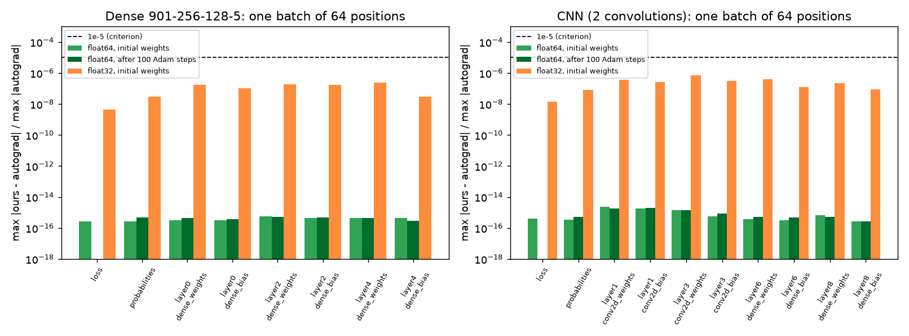
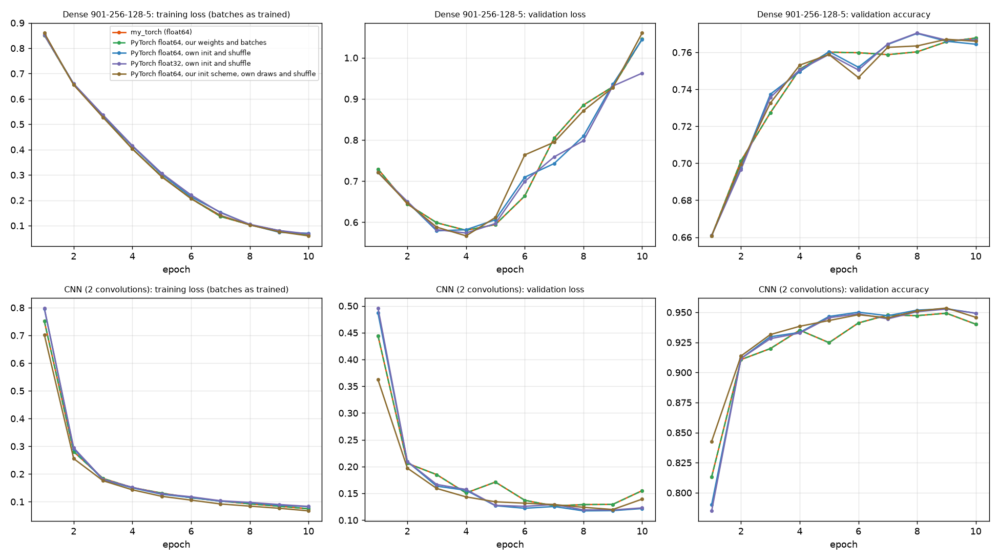
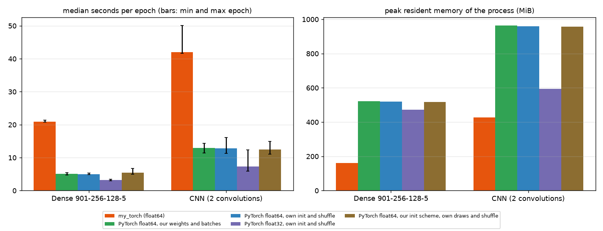
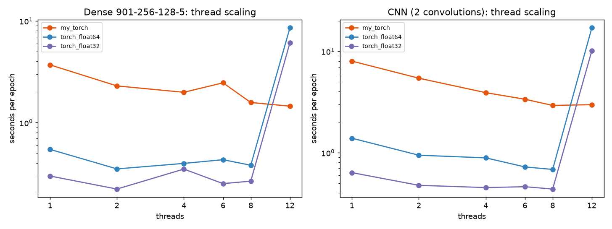
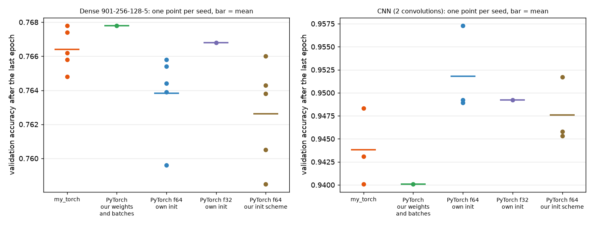

# PyTorch reference: same architectures, same weights, same batches (issue #42)

**Question**: does the same network, trained the same way, give the same result in PyTorch? Are our
gradients those of automatic differentiation? What does our implementation cost in time and memory,
and where does an accuracy gap, if any, come from?

**Short answer** (all on the machine and the load described below, every number from
[`data/pytorch_reference/`](data/pytorch_reference/)):
- **Gradients**: on one batch of 64 positions with identical weights, our gradients, loss and output
  probabilities equal PyTorch's autograd to **6.7e-16 in absolute value and 2.3e-15 relative to the
  largest gradient of each tensor**, in float64, for both architectures, at the initial weights and
  after 100 Adam steps. The criterion of the issue (1e-5) is met with ten orders of magnitude to spare.
- **Same start, same batches, same result**: PyTorch started from our initial weights and fed our
  batches in our order (10 epochs, 8,950 Adam steps) ends with weights that differ from ours by at
  most **7.1e-11** (dense) and **3.3e-13** (CNN), and predicts **the same class on all 71,558
  validation positions**. The training loop, Adam, cross-entropy and the convolution are, to
  rounding, the ones of PyTorch.
- **Speed**: PyTorch is faster. Median seconds per epoch on 57,244 positions: dense 20.9 s for us
  (12 threads) against 5.0 s (float64) and 3.2 s (float32), i.e. 4.2 and 6.4 times; CNN 42.0 s
  against 12.8 s and 7.3 s, i.e. 3.3 and 5.7 times. At a single thread the gap is 5.8 to 6.8 times in
  float64 (thread sweep, short runs).
- **Memory**: we need less. Peak resident memory of the whole process: dense 161 MiB against 519 MiB
  (PyTorch float64) and 472 MiB (float32); CNN 428 MiB against 960 MiB and 593 MiB. The Python
  process holds 221 MiB right after `import torch`, before any data.
- **Accuracy after the same budget** (10 % of the training split, 10 epochs, validation split, no
  early stopping): dense 0.7664 ± 0.0012 (5 seeds) for us against 0.7638 ± 0.0025 for PyTorch
  float64; CNN 0.9438 ± 0.0041 (3 seeds) against 0.9518 ± 0.0048. **The arithmetic explains none of
  the gap** (the previous point). The accuracy gaps are suggestive at best, not established: dense
  0.26 points (about 2.1 standard errors, 5 seeds), CNN 0.80 points (2.2 standard errors, 3 seeds).
  The stronger evidence is the CNN's validation loss (0.1470 against 0.1187, 4.2 standard errors).
  PyTorch drawing *our* initialisation scheme lands between the two (0.9476 accuracy, 0.1358 loss),
  but its difference to native PyTorch (0.42 points of accuracy, 1.2 standard errors) is itself not
  established. What is left, and not ruled out, is the draws (which initial weights and batch order
  a seed gives); the initialisation scheme is a candidate cause that was not demonstrated. Details
  and limits below.

## Method

### What is compared
| | Ours | PyTorch |
| --- | --- | --- |
| Architecture | `configs/final_network.conf` (901-256-128-5, ReLU, softmax) and `configs/cnn_network.conf` (board_planes, two 3x3 convolutions with 16 and 32 filters, 2x2 max pooling, 512-128-5) | built by `comparison/mytorch_net.py` from the same two files (the `layers` lines are parsed, nothing is typed twice); the final softmax is left to `cross_entropy` |
| Data | the library's encoder (`fen-attacks-901`, ADR-0016), batch by batch | **the same encoder**: `pytorch_reference export` writes the 901 values of every position as bytes (each checked to be 0 or 1) and PyTorch reads that array |
| Loss, optimizer | cross-entropy fused with softmax (ADR-0007), Adam lr 0.001, betas 0.9 and 0.999, epsilon 1e-8 (outside the root) | `F.cross_entropy` (mean over the batch), `torch.optim.Adam` with the same values; same formulas |
| Batches | 64, one shuffle per epoch (portable Fisher-Yates over `std::mt19937_64`, ADR-0009); 57,244 positions = 894 batches of 64 and one of 28, loss averaged with the batch size as weight | 64; the same batches (variant *shared*) or `torch.randperm` |
| Initial weights | dense: U(±sqrt(1 / fan_in)); convolution: He normal; biases 0 | variant *shared*: ours; *native*: PyTorch's default (dense and convolution U(±1 / sqrt(fan_in)), biases uniform in the same interval); *scheme*: our distributions drawn by PyTorch's generator |
| Precision | float64 (`Scalar`, ADR-0003) | float64 for the equivalence and the like-for-like timings; float32 (PyTorch's default) reported next to it |
| Early stopping, augmentation, scheduler | none | none |

The three PyTorch variants and their purpose (ADR-0040):
1. **shared** (float64): starts from our exact initial weights (`init_weights.bin`) and replays our
   exact batch order (`orders.bin`, recorded by a wrapper around the data source). What can differ is
   rounding: it tests the arithmetic.
2. **native** (float64, and float32 once): PyTorch's own initialisation and shuffling, seeded with the
   configuration's seeds plus the seed index. It is what a PyTorch user would get.
3. **scheme** (float64): our initialisation distributions (dense U(±sqrt(1 / fan_in)), convolution
   N(0, 2 / fan_in), zero biases) drawn by PyTorch's generator, PyTorch's shuffling. It separates the
   initialisation scheme from the seed.

### Protocol
- **Data**: the split of ADR-0017 with seed 42 (`dataset_split.sh`), the first 10 % of the training
  part (57,244 of 572,446 positions) for training, the **whole validation part** (71,558 positions)
  for scoring after every epoch. **The test split is not read.** No augmentation.
- **Budget**: 10 epochs each, batch 64, no early stopping, so that every run does the same number of
  Adam steps; the score is that of the last epoch. Seeds: 5 for the dense network, 3 for the CNN
  (the network index and the shuffling seed both move with the seed, `INDEX` of `pytorch_reference
  train`, `--seed-index` of `train_reference.py`); *shared* and *native float32* once, seed 0.
- **Time per epoch**: seconds of the training pass only (batch preparation, forward, backward,
  Adam), the scoring of the validation set excluded on both sides. Ours includes encoding the batch
  from the position (at most 0.7 s per epoch: parsing, encoding and writing all 57,244 positions
  takes 0.65 to 0.74 s, [encoding_cost.txt](data/pytorch_reference/encoding_cost.txt); a bound, since
  it includes the parsing and the writing), PyTorch's includes turning bytes into floats.
- **Peak memory**: `/usr/bin/time -f "%e %M"` on the whole process, training and scoring included.
- **Threads**: each implementation at its best thread count from a sweep
  ([thread_sweep.csv](data/pytorch_reference/thread_sweep.csv), 4,000 positions, 3 epochs, the mean
  of epochs 2 and 3, one run per setting, 1 to 12 threads). Chosen: ours 12 (dense) and 8 (CNN);
  PyTorch 2 (dense) and 8 (CNN) in both precisions.
- **Gradient check**: `pytorch_reference gradient` runs one forward and backward pass on the first 64
  positions as `Network::fit` does and writes the weights, the gradients, the loss and the
  probabilities; `comparison/gradient_check.py` loads the same weights into the PyTorch twin and
  compares with autograd. A tensor passes when **both** the largest absolute difference and that
  difference divided by the largest absolute gradient of the tensor are at most **1e-5**. Done at the
  initial weights and after 100 Adam steps on the following 100 batches (biases then non-zero), in
  float64 (gating) and float32 (information).

### Machine, load, versions
- Laptop, 12th Gen Intel Core i5-12450H, 12 threads, 15 GB RAM, Linux 6.8.0-90-generic, g++ 13.3.0
  (`-O2`), Python 3.12.3, **torch 2.15.0+cpu, numpy 2.5.4**. Run card:
  [run.txt](data/pytorch_reference/run.txt) (training runs from 2026-11-04T09:58Z to 11:36Z, with
  the scripts of commit `6bb8453`; the *scheme* step and its option were added in `9a32a24`, and the
  tables and graphs regenerated from the same run files by the final collection).
- **Load: the machine was not idle.** It was the owner's desktop session during the whole run (a
  browser renderer used about one core, other browser processes more). The 1-minute load average
  read from `/proc/loadavg` at the start of each run is in
  [summary.csv](data/pytorch_reference/summary.csv) (`load1_at_start`): between 3.4 and 10.9, and it
  includes the previous run of my own, which used 2 to 12 threads. **Absolute times are those of this
  loaded machine and are not portable**; the ratios between implementations come from runs made one
  after the other under the same conditions, and the spread between epochs is given.

## Results

### 1. Gradients against autograd



[gradient_check.csv](data/pytorch_reference/gradient_check.csv) has one line per tensor, loss and
probabilities. Largest value over the 8 (dense) or 10 (CNN) quantities of each case:

| Case | dtype | max abs. difference | max relative to the largest gradient | max L2 relative error | Within 1e-5 |
| --- | --- | --- | --- | --- | --- |
| dense, initial weights | float64 | 4.4e-16 | 5.5e-16 | 4.4e-16 | yes |
| dense, after 100 Adam steps | float64 | 4.4e-16 | 5.1e-16 | 4.0e-16 | yes |
| CNN, initial weights | float64 | 6.7e-16 | 2.3e-15 | 1.7e-15 | yes |
| CNN, after 100 Adam steps | float64 | 4.4e-16 | 1.9e-15 | 1.8e-15 | yes |
| dense, initial weights | float32 | 7.2e-9 | 2.5e-7 | 1.9e-7 | yes |
| dense, after 100 Adam steps | float32 | 1.6e-7 | 2.7e-7 | 1.8e-7 | yes |
| CNN, initial weights | float32 | 2.3e-8 | 7.2e-7 | 3.9e-7 | yes |
| CNN, after 100 Adam steps | float32 | 1.7e-7 | 9.8e-7 | 6.9e-7 | yes |

The float64 rows are the check of the issue and sit at the rounding of double precision. The float32
rows are information: single precision alone would already use up to 10 % of the 1e-5 margin on the
CNN, so the criterion is only meaningful in float64, where our `Scalar` lives.

### 2. Same start and same batches: the result is the same

[equivalence.csv](data/pytorch_reference/equivalence.csv), PyTorch float64 *shared* against our run
of seed 0 after 10 epochs (8,950 steps):

| | Largest weight difference | Relative L2 difference of all weights | Same predicted class on the validation split | Largest difference of the training loss per epoch | Largest difference of the validation loss per epoch | Largest difference of the validation accuracy |
| --- | --- | --- | --- | --- | --- | --- |
| Dense | 7.1e-11 | 1.9e-11 | 71,558 of 71,558 | 4.0e-13 | 1.6e-11 | 0 |
| CNN | 3.3e-13 | 2.5e-14 | 71,558 of 71,558 | 1.1e-16 | 3.3e-16 | 0 |

The dense weights drift further (7e-11) than the CNN's (3e-13) over the same number of steps; both
are far below anything that changes a prediction. In the curves below the dashed green line (*shared*)
lies exactly under ours (orange).



### 3. Time per epoch



Seed 0, median of the 10 epochs (minimum and maximum in brackets),
[summary.csv](data/pytorch_reference/summary.csv) and [epochs.csv](data/pytorch_reference/epochs.csv):

| Implementation | Threads | Dense: seconds per epoch | Dense: ratio to ours | CNN: seconds per epoch | CNN: ratio to ours |
| --- | --- | --- | --- | --- | --- |
| **my_torch** (float64) | 12 / 8 | **20.9** (20.8 to 21.4) | 1 | **42.0** (41.6 to 50.1) | 1 |
| PyTorch float64, our weights and batches | 2 / 8 | 5.0 (4.7 to 5.4) | 4.2 | 12.9 (11.4 to 14.4) | 3.2 |
| PyTorch float64, own init and shuffle | 2 / 8 | 5.0 (4.9 to 5.4) | 4.2 | 12.8 (11.3 to 16.2) | 3.3 |
| PyTorch float64, our init scheme | 2 / 8 | 5.4 (4.9 to 6.7) | 3.9 | 12.4 (11.1 to 14.9) | 3.4 |
| PyTorch float32, own init and shuffle | 2 / 8 | 3.2 (3.0 to 3.4) | 6.4 | 7.3 (5.9 to 12.4) | 5.7 |

Ours uses 12 threads (dense) and 8 (CNN) where PyTorch uses 2 and 8, so per core the gap is larger
than the ratios say. At one thread, in the thread sweep (4,000 positions, mean of epochs 2 and 3,
float64): dense 3.70 s for us against 0.55 s (6.8 times), CNN 8.00 s against 1.39 s (5.8 times).
Float32 is 1.5 to 1.8 times faster than float64 in PyTorch.



**Warning on threads.** In the sweep, PyTorch at 12 threads was 23 to 27 times slower than at its
best setting (dense float32 6.1 s per epoch against 0.22 s at 2 threads, CNN float64 17.0 s against
0.68 s at 8): with the desktop load the 12 intra-op threads fight for cores. Ours did not degrade at
12 threads (1.45 s, the best setting for the dense network). A benchmark that gives both libraries
"all the threads" would have reported us 3 to 6 times faster than PyTorch in the sweep (12 threads, 4,000 positions); the chosen
counts are those of the sweep, not a flattering choice, but the sweep itself is short and noisy
(see Weaknesses).

### 4. Memory

Peak resident set size of the whole process (`/usr/bin/time`, 1 MiB = 1,048,576 bytes), seed 0:

| Implementation | Dense | CNN |
| --- | --- | --- |
| **my_torch** | **161 MiB** | **428 MiB** |
| PyTorch float64 (all three variants within 7 MiB) | 517 to 523 MiB | 957 to 964 MiB |
| PyTorch float32 | 472 MiB | 593 MiB |

Not like for like, in PyTorch's disfavour: the Python process holds **221 MiB right after the
imports** (before any data, `rss_after_import_mib` in summary.csv), and the encoded data is one
111 MiB byte array (training and validation, 128,802 positions × 901 bytes), where we parse the
positions (46 MiB at the encoding step, [encoding_cost.txt](data/pytorch_reference/encoding_cost.txt))
and encode batch by batch (ADR-0021). Subtracting those two (332 MiB), what training adds in PyTorch
is about 190 MiB (dense, float64) and 630 MiB (CNN, float64), against 140 and 260 MiB in float32: the
CNN's activations and convolution workspace in double precision are large. A fair reading: a PyTorch
process costs a fixed 330 MiB or so for the runtime and this data, and ours does not; beyond that
fixed part the dense networks are of the same order (190 against 161 MiB, the latter including all
our data structures) and the CNN is larger in PyTorch in float64 (630 against 428 MiB).

### 5. Accuracy after the same budget, and the gap



Validation accuracy after the 10th epoch, mean ± sample standard deviation over the seeds
([seeds.csv](data/pytorch_reference/seeds.csv)):

| Implementation | Dense (5 seeds) | CNN (3 seeds) |
| --- | --- | --- |
| **my_torch** | **0.7664 ± 0.0012** (0.7648 to 0.7678) | **0.9438 ± 0.0041** (0.9401 to 0.9483) |
| PyTorch float64, own init and shuffle | 0.7638 ± 0.0025 (0.7596 to 0.7658) | 0.9518 ± 0.0048 (0.9489 to 0.9573) |
| PyTorch float64, our init scheme | 0.7626 ± 0.0030 (0.7585 to 0.7660) | 0.9476 ± 0.0036 (0.9453 to 0.9517) |
| PyTorch float64, our weights and batches (seed 0) | 0.7678 (ours: 0.7678) | 0.9401 (ours: 0.9401) |
| PyTorch float32, own init and shuffle (seed 0) | 0.7668 | 0.9492 |

Mean validation loss after the 10th epoch: dense 1.0325 (ours), 1.0515 (native), 1.0430 (scheme);
CNN 0.1470, 0.1187 and 0.1358. Both networks overfit at this budget (training loss below 0.09, the
dense validation loss rises from epoch 4, see the curves): these are the scores after a fixed number
of epochs, not the best of the run, and they are far below the pushed network (0.9615 on the test
split, trained on all the data, augmented, with early stopping, [10-final-network.md](10-final-network.md)).

**Where the gap comes from**, in the order of what was tested:
1. **Not the arithmetic.** With the same start and the same batches the two programs give the same
   predictions (section 2). A systematic difference between the libraries, for these two architectures,
   would have shown there.
2. **Not the numeric precision.** Float32 (0.7668, 0.9492, one seed) is inside the float64 spread.
3. **The draws, i.e. which random initial weights and which batch order a seed gives: the explanation
   left once the others are excluded, not a measured cause.** Every other difference between the
   columns is a different sample of the same distributions, and the spread between seeds is 0.12 to
   0.30 points of accuracy (dense) and 0.36 to 0.48 (CNN). The dense gap of 0.26 points to the native
   variant (0.38 to the scheme variant) is 2.1 (2.6) standard errors of the difference of two means
   of 5; with the comparisons made here, I **do not claim** that it is real, nor that it is not. The
   CNN accuracy gap of 0.80 points to the native variant (2.2 standard errors, means of 3) is
   suggestive and **not established either**, at the same standard.
4. **The initialisation scheme, for the CNN: a candidate, not shown.** The CNN's validation loss gives
   the clearest signal: 0.1470 for us against 0.1187 for native PyTorch (difference 0.0283, 4.2
   standard errors, 3 seeds each). With PyTorch drawing our distributions the loss is 0.1358: 0.0112
   below ours (1.8 standard errors) and 0.0171 above native PyTorch. The
   scheme variant therefore sits between the two, and the point estimate would attribute about 60 %
   of the loss gap and about half of the accuracy gap (0.80 to 0.38 points) to the scheme. **That
   attribution is not established**: the difference between native and scheme PyTorch is 0.0042 of
   accuracy (about 1.2 standard errors) and the loss difference 0.0171 is of the same order as the
   seed spread, with 3 seeds each. The two schemes differ for the convolutions by a standard
   deviation of the weights 2.4 times larger in ours (He normal, N(0, 2 / fan_in), against
   U(±1 / sqrt(fan_in)), variance 1 / (3 fan_in)) and by the biases (zero against uniform); this
   experiment does not separate these two, and no mechanism was tested.

What I conclude: our trainer is equivalent to PyTorch's for these two networks (same start and
batches, same predictions). At this budget the CNN scores somewhat worse than PyTorch's default
initialisation in the runs made here (validation loss 0.1470 against 0.1187, 4.2 standard errors;
accuracy 0.9438 against 0.9518, 2.2 standard errors, suggestive only). The data do not establish
why: the draws are the explanation not excluded, and the initialisation scheme is a candidate that
the scheme variant neither confirms nor rules out. No accuracy gap is established on the dense
network.

## Weaknesses
- **A small budget, not the pushed network's.** 10 % of the training split, 10 epochs, no
  augmentation, no early stopping, last-epoch score: the numbers above say nothing about the 0.9615
  of the pushed network, and a gap at this budget need not exist at 100 % of the data with early
  stopping. The score moves from one epoch to the next, between the 6th and the 10th epoch, by 0.4
  points on average and up to 1.1 points on the CNN (0.2 and 0.55 on the dense network), our runs,
  [epochs.csv](data/pytorch_reference/epochs.csv): a noise of the size of the gaps discussed, and
  the last-epoch score is not the best one.
- **Few seeds.** 5 and 3 for the three comparable variants, 1 for *shared* and *float32*. The
  standard deviations of 3 values are themselves very uncertain, no significance test was run (no
  scipy: only ratios of differences to standard errors are given) and several comparisons were made
  (two networks, two PyTorch variants): a 2-standard-error difference is expected to show up by
  chance somewhere.
- **The load.** The machine ran a desktop session (see Method); times carry it. One of our CNN runs
  (seed 2) had an epoch of 182.7 s against about 42 s for the others, a stall whose cause I did not
  identify; the medians used here ignore it, and the time table uses seed 0. The 1-minute load
  recorded at the start of each run is polluted by the previous run.
- **The thread choice comes from a short, noisy sweep** (4,000 positions, 3 epochs, one run per
  setting, under load): for the CNN our 8 and 12 threads differ by 2 %, and the dense PyTorch times
  at 2 to 8 threads lie between 0.35 and 0.43 s (float64) and 0.22 and 0.35 s (float32), so 2 threads
  is the minimum of noisy numbers, not a clear optimum. The main benchmark was then run once per
  variant for the timings (seed 0). The PyTorch default (8 threads here) was not run as such.
- **Float64 is not PyTorch's fast path.** The like-for-like timings are in float64, a configuration
  nobody trains with; the float32 line shows what a user gets (1.5 to 1.8 times faster). It
  does not change the conclusion that PyTorch is faster; it makes the gap larger.
- **Memory is not like for like** (see section 4): runtime and data array on one side, nothing on
  the other, and the figure is the peak of the process, not of the network.
- **The encoding is shared.** Both sides read the positions encoded by our C++ code; an error in
  `fen-attacks-901` would be on both sides. Only the network, the loss and the optimizer are
  independently checked.
- **Two architectures, one optimizer.** Dense, ReLU, softmax, Conv2D, max pooling, `board_planes`,
  Adam; dropout, normalization, the other optimizers and schedulers are not reproduced.
- **The gradient check is two batches per architecture**, at the initial weights and after 100
  steps, on non-adversarial data: no ties of the max pooling or kink of the ReLU were looked for.
- **The experiment on the initialisation scheme changes two things at once** (the convolution weights'
  variance and the biases), and does not test why it matters.
- The commit in `run.txt` is that of the final collection; the training runs used the scripts of
  the earlier commits listed above, which differ only by the *scheme* step and option and by the
  tables and graphs.

## Reproduction
```bash
python3 -m venv comparison/.venv        # git-ignored; torch CPU wheel, see comparison/README.md
comparison/.venv/bin/pip install -r comparison/requirements.txt \
    --index-url https://download.pytorch.org/whl/cpu --extra-index-url https://pypi.org/simple
make mytorch
sh scripts/bench_pytorch_reference.sh              # gradient, sweep, train, scheme, collect: about 2 hours
STEPS=gradient sh scripts/bench_pytorch_reference.sh   # the gradient check alone, about a minute
scripts/check_comparison_isolation.sh              # no ML library outside comparison/ (ADR-0036)
```
The script prints its variables (budget, seeds, thread counts, directories). Large intermediate
files go to `runs/pytorch_reference/` (git-ignored). Decisions: [ADR-0040](../adr/0040-pytorch-reference.md)
(protocol) and [ADR-0036](../adr/0036-comparison-framework.md) (isolation, awaiting the teaching
staff's approval). Code: `scripts/pytorch_reference.cpp` (our side, library headers only),
`comparison/` (PyTorch), `scripts/plot_pytorch_reference.py` (tables and graphs, no PyTorch).
