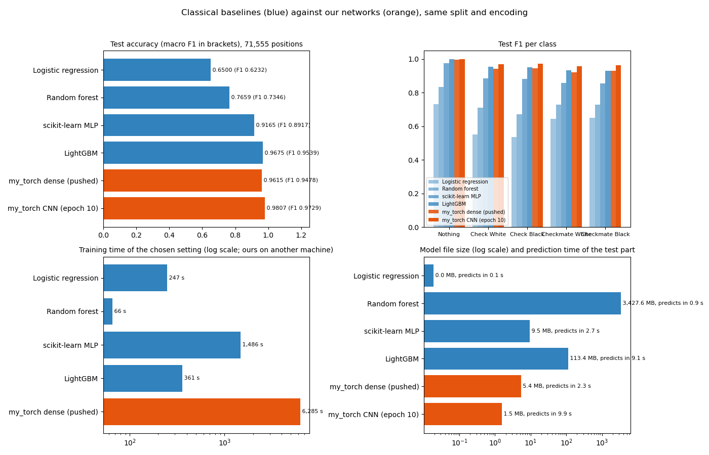

# Classical baselines against our networks

Measurement for issue #43: does a neural network earn its place on this task, or would a classical
method do as well? Four model families from scikit-learn and LightGBM, on exactly the data of our
network, against the pushed dense network and the epoch-10 CNN. Decision:
[ADR-0043](../adr/0043-classical-baselines.md); framework: [ADR-0036](../adr/0036-comparison-framework.md).

## Method

- **Data**: the split of ADR-0017 (seed 42) that the pushed network used: 572,446 training,
  71,558 validation and 71,555 test positions, encoded with our own `fen-attacks-901`
  (`pytorch_reference export`, 901 values of 0 or 1 per position). The baselines see **no
  augmentation**; the pushed network was trained on the augmented training part (2,289,784 lines).
  Our network without augmentation is in the table for that reason.
- **Models and settings** (`bonus/comparaison/baselines.py`), each setting trained on the whole
  training part and scored on the validation part; the best macro F1 is kept and only that model
  reads the test part, once:

| Family | Settings tried |
| --- | --- |
| Logistic regression (lbfgs, 300 iterations) | C = 0.1, 1, 10 |
| Random forest (100 trees, √901 features per split) | minimum leaf 1, 5, 20 |
| scikit-learn `MLPClassifier`, our architecture 901-512-256-5, Adam, batch 384, 15 epochs | learning rate 0.001, 0.0003 |
| LightGBM, learning rate 0.1, up to 2,000 rounds, early stopping on the validation loss (20) | 63, 255 leaves |

- **Measured**: test accuracy, macro F1 and F1 per class; training time of the chosen setting;
  prediction time of the 71,555 test positions; peak memory of the whole run (GNU time); size of the
  saved model (pickled for the baselines, the `.nn` file for ours).
- **Machine**: Intel Core i7-1355U, 12 threads, 15 GB RAM, Linux 7.0; Python 3.14.4, scikit-learn
  1.9.1, LightGBM 4.7.0, NumPy 2.5.4; 2026-11-04 ([`run.txt`](data/baselines/run.txt)). Our
  networks were re-scored on the same machine; the training time of the pushed network comes from
  its own run (another machine, an AMD EPYC server).
- **Reproduce**: `sh scripts/bench_baselines.sh` (needs `bonus/comparaison/.venv`, see
  `bonus/comparaison/README.md`).

## Results

| Model | Test accuracy | Macro F1 | Training | Prediction (test) | Model size | Peak memory |
| --- | --- | --- | --- | --- | --- | --- |
| Logistic regression (C = 10) | 0.6500 | 0.6232 | 247 s | 0.1 s | 19 KB | 2.8 GB |
| Random forest (leaf 1) | 0.7659 | 0.7346 | 66 s | 0.9 s | **3.4 GB** | 7.2 GB |
| scikit-learn MLP (lr 0.001) | 0.9165 | 0.8917 | 1,486 s | 2.7 s | 9.5 MB | 2.8 GB |
| LightGBM (255 leaves) | 0.9675 | 0.9539 | 361 s | 9.1 s | 113 MB | 3.2 GB |
| my_torch dense, no augmentation | 0.9162 | 0.8934 | 4,109 s (server) | — | — | — |
| **my_torch dense, pushed** (augmented) | 0.9615 | 0.9478 | 6,285 s (server) | 2.3 s | 5.4 MB | 0.15 GB |
| **my_torch CNN, epoch 10** | **0.9807** | **0.9729** | not measured | 9.9 s | **1.5 MB** | 0.41 GB |

Per class, every setting tried and the confusion matrices: [`data/baselines/`](data/baselines/).
The no-augmentation row comes from
[`final-network/not-augmented`](data/final-network/not-augmented/scores.txt) (same split and test).

## Analysis

- **The task is not linear.** The logistic regression stops at 65 %: a check or a mate depends on
  combinations of squares (a piece, the line to the king, nothing in between), which a weighted sum
  of the 901 inputs cannot express.
- **Trees on 901 binary columns.** The random forest reaches 77 %, with fully grown trees that weigh
  3.4 GB: each split looks at one square at a time, and √901 = 30 random columns per split rarely
  contain the right ones. A bigger forest did not fit: a run with 300 trees, while the best forest so
  far was still in memory, was killed by the 15 GB machine.
- **The same architecture in scikit-learn matches ours on the same data.** The `MLPClassifier` with
  our 901-512-256-5 shape gets 91.7 %, the level of our network trained without augmentation
  (91.6 %), and below the pushed one (96.2 %): the 4.5 points come from the augmentation of the
  training part (ADR-0019), not from the library.
- **LightGBM beats our dense network**, by 0.6 point (96.75 % against 96.15 %), with no
  augmentation and in 6 minutes. Boosting builds its trees one after the other on the errors of the
  previous ones, and finds the useful combinations of squares that the random forest misses. It
  costs a model of 113 MB, 21 times our network file, and a prediction 4 times slower.
- **The CNN beats every baseline**: 98.07 %, +1.3 points over LightGBM, with the smallest file
  (1.5 MB). Convolutions see neighbouring squares together, which is how a check is built.

## Limits

- **Unequal budgets.** Each baseline got a small grid (2 or 3 settings) and no augmentation; our
  pushed network got augmentation and its own hyperparameter search (ADR-0028). LightGBM with more
  leaves or the augmented data could do better.
- **Training times are not comparable across rows**: ours were measured on another machine, and the
  baselines use every thread of this one.
- **One run per setting** (seed 42): no spread between seeds, so differences under about 0.5 point
  are not established (ADR-0039 measured ±0.3 point between folds on a smaller network).
- **The forest is limited by memory**, not by its method: 100 trees was the largest that fit.
- The model sizes compare different formats: pickled Python objects against our network files (text
  at the time of the measurement).
