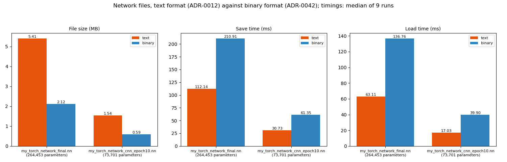

# Network file: text against binary

Measurement for [ADR-0042](../adr/0042-binary-network-file-format.md), which replaces the text
network file of [ADR-0012](../adr/0012-network-file-format.md) by a binary one after the first
review ("the whole file is plain text, without any encoding"). Two questions: what does the binary
format change in size and time, and does the analyzer answer exactly the same?

## Method

- **Networks**: the two pushed networks, `my_torch_network_final.nn` (dense 901-256-128-5,
  264,453 parameters) and `bonus/networks/my_torch_network_cnn_epoch10.nn` (CNN, 73,701
  parameters).
- **Size and time**: each network saved in both formats (`Network::saveText`, `Network::save`), the
  file size, and the median of 9 runs of `save` and of `load`, on a warm disk cache
  (`scripts/bench_binary_format.cpp`).
- **Same answers**: each network written in both formats, then `./my_torch_analyzer --predict` on
  the 71,555 positions of the test split (seed 42) with each file; the two outputs are compared byte
  for byte.
- **Machine**: Intel Core i7-1355U, 12 threads, 15 GB RAM, Linux 7.0, g++ 15.2.0 `-O2`, local SSD,
  2026-11-04 (`data/binary_format/run.txt`). One run of the script; the machine was otherwise idle.
- **Reproduce**: `sh scripts/bench_binary_format.sh [TEST_FILE]`.

## Results

| Network | Format | File | Save | Load |
| --- | --- | --- | --- | --- |
| dense, pushed | text | 5,406,197 B | 112 ms | 63 ms |
| dense, pushed | **binary** | **2,123,677 B** (÷ 2.55) | 211 ms | 137 ms |
| CNN, epoch 10 | text | 1,543,081 B | 31 ms | 17 ms |
| CNN, epoch 10 | **binary** | **594,204 B** (÷ 2.60) | 61 ms | 40 ms |

Data: [`data/binary_format/binary_format.csv`](data/binary_format/binary_format.csv).

Predictions on the 71,555 test positions: **identical** for both networks
([`equivalence.txt`](data/binary_format/equivalence.txt)). The test suite also checks it bit for
bit: a network saved in binary and reloaded writes exactly the same text as the original.

## Analysis

- **Size**: 2.55 to 2.60 times smaller. The dense network has 264,453 parameters, i.e. 2,115,624
  bytes as raw binary64: the binary file is 2,123,677 bytes, **0.4 % above that lower bound** (the
  header, the keyword codes, the labels and one type byte per row of weights). The text format was
  2.56 times the lower bound.
- **Time**: the binary format is **about 2 times slower** to save and to load (137 ms against 63 ms
  to load the pushed network). This is the cost of the design chosen in ADR-0042: the decoder turns
  the binary tokens back into records that the existing text reader parses, so every number is
  formatted then parsed again. A dedicated binary reader would avoid it, at the price of one reader
  per layer type. At 137 ms, loading is still about 6 % of the 2.3 s that the analyzer takes to
  predict the test split: not worth that extra code today.
- **Answers**: unchanged, as expected from a format that stores each double as its 8 bytes.

## Limits

- One machine, one run of the script (each timing a median of 9); timings on another disk or a cold
  cache will differ, sizes will not.
- Only the two pushed networks were measured; the size ratio depends on how many weights a network
  has against its fixed header.
