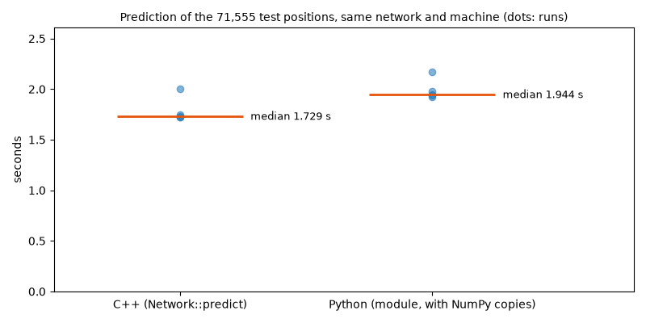

# Python bindings against the C++ library

Does calling the library from Python (ADR-0044) give the same results, and what does it cost? The
pushed network predicts the whole test split in C++ and through the module, on the same machine.

## Method

- **Data**: the test part of the split of ADR-0017 (seed 42), 71,555 positions, encoded with
  `fen-attacks-901` by `pytorch_reference export` (reused from
  [23-baselines.md](23-baselines.md)); network `my_torch_network_final.nn`.
- **C++**: `scripts/bench_python_bindings.cpp` times `Network::predict` on the whole matrix, 5 runs,
  and writes the probabilities.
- **Python**: `bonus/python/bench.py` times `Network.predict` through the module on the same rows,
  5 runs, **including** the copy of the NumPy array into the library and of the result back. It
  then compares the probabilities with the C++ ones bit for bit, and the argmax labels with the
  predictions of `my_torch_analyzer --predict` on the same positions.
- **Machine**: Intel Core i7-1355U, 12 threads, Linux 7.0, g++ 15.2.0, Python 3.14.4, pybind11
  3.1.0, NumPy 2.5.4; 2026-11-04 ([`run.txt`](data/python_bindings/run.txt)).
- **Reproduce**: `sh scripts/bench_python_bindings.sh` (after `scripts/bench_baselines.sh`, which
  encodes the test part; needs `bonus/python/.venv`, see `bonus/python/README.md`).

## Results

| | C++ `Network::predict` | Python module |
| --- | --- | --- |
| Median of 5 runs | 1.729 s | 1.944 s (+12 %) |
| Probabilities | reference | identical, bit for bit (largest difference 0) |
| Labels against `my_torch_analyzer` | — | 71,555 / 71,555 |

Every run: [`times.csv`](data/python_bindings/times.csv); summary:
[`summary.txt`](data/python_bindings/summary.txt).

## Analysis

- **Same results.** The module runs the same compiled code on the same numbers: not one bit differs
  on 357,775 probabilities, and every label is the analyzer's.
- **The cost is the crossing, not the computation.** The 0.21 s gap is what the module adds around
  the same `Network::predict`: the input array (71,555 × 901 values, 516 MB in float64) is copied
  into a `Matrix`, and the result back. This split was not timed separately.
- The first run of each side is slower (2.00 s and 2.17 s): caches and memory are cold. The
  medians leave it out.

## Limits

- One machine, one network, 5 runs per side.
- Only prediction is measured; `fit` goes through the same calls and adds the same copy once per
  call, not per epoch.
- The analyzer's predictions were made when the network file was still text; the binary file gives
  the same predictions ([24-binary-format.md](24-binary-format.md)).
