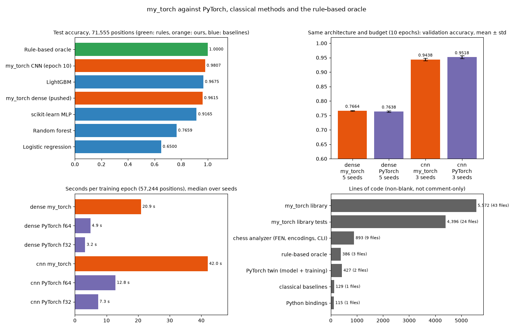

# Final comparison: my_torch against PyTorch, classical methods and the oracle

Summary for the defense (issue #44): where our library and our networks stand against an
industrial framework (PyTorch), classical machine learning, and the rule-based oracle. It gathers
measurements made on **the same split and encoding** (ADR-0017, seed 42; `fen-attacks-901`),
re-runs nothing that is already measured, and adds the oracle and the lines of code. Details and
methods are in the reports it cites.

## Sources

| Part | Measured in | Machine |
| --- | --- | --- |
| Our networks and the classical baselines on the test split | [23-baselines.md](23-baselines.md) | i7-1355U (training of the pushed network: AMD EPYC server) |
| PyTorch with the same architectures: gradients, time, memory, same-budget accuracy | [22-pytorch-reference.md](22-pytorch-reference.md) | see its `run.txt` |
| Calling the library from Python | [25-python-bindings.md](25-python-bindings.md) | i7-1355U |
| Rule-based oracle on the test split, file sizes, lines of code | this report ([`run.txt`](data/comparison/run.txt)) | i7-1355U, 2026-11-04 |

**Reproduce**: `sh bonus/comparaison/comparison_report.sh` (after `scripts/bench_baselines.sh`,
which writes the split); it writes [`comparison.csv`](data/comparison/comparison.csv),
[`lines_of_code.csv`](data/comparison/lines_of_code.csv) and the graph.

## 1. Accuracy on the test split (71,555 positions)

| Model | Accuracy | Macro F1 | F1 Nothing | F1 Check W | F1 Check B | F1 Mate W | F1 Mate B |
| --- | --- | --- | --- | --- | --- | --- | --- |
| Rule-based oracle (`bonus/oracle`) | **1.0000** | 1.0000 | 1 | 1 | 1 | 1 | 1 |
| **my_torch CNN** (epoch 10) | **0.9807** | **0.9729** | 0.9999 | 0.9701 | 0.9738 | 0.9578 | 0.9630 |
| LightGBM | 0.9675 | 0.9539 | 0.9998 | 0.9546 | 0.9505 | 0.9352 | 0.9297 |
| **my_torch dense** (pushed) | 0.9615 | 0.9478 | 0.9958 | 0.9427 | 0.9470 | 0.9224 | 0.9309 |
| scikit-learn MLP (our shape) | 0.9165 | 0.8917 | 0.9771 | 0.8860 | 0.8818 | 0.8580 | 0.8555 |
| Random forest | 0.7659 | 0.7346 | 0.8351 | 0.7097 | 0.6720 | 0.7278 | 0.7284 |
| Logistic regression | 0.6500 | 0.6232 | 0.7317 | 0.5520 | 0.5359 | 0.6456 | 0.6509 |

## 2. Our library against PyTorch, same architecture and budget

| | my_torch | PyTorch (float64) | PyTorch (float32) |
| --- | --- | --- | --- |
| Gradients against autograd | — | within 4.4e-16 (dense) and 6.7e-16 (CNN) | — |
| Same weights and batches, 10 epochs | — | same predicted class on 71,558 / 71,558 validation positions | — |
| Validation accuracy, dense (5 seeds) | 0.7664 ± 0.0012 | 0.7638 ± 0.0025 | 0.7668 (1 seed) |
| Validation accuracy, CNN (3 seeds) | 0.9438 ± 0.0041 | 0.9518 ± 0.0048 | 0.9492 (1 seed) |
| Seconds per epoch, dense | 20.9 (12 threads) | 4.9 (2 threads) | 3.2 |
| Seconds per epoch, CNN | 42.0 (8 threads) | 12.8 (8 threads) | 7.3 |
| Peak memory, dense / CNN | **161 / 428 MiB** | 517 to 523 / 957 to 964 MiB | 472 / 593 MiB |

Validation accuracy after a fixed 10-epoch budget on 57,244 positions, not the pushed network: see
22 for why these scores are below the test scores of section 1.

## 3. Cost of each model

| Model | Training | Prediction of the test split | Model file | Peak memory |
| --- | --- | --- | --- | --- |
| Rule-based oracle | none | 0.32 s (file reading included) | none (386 lines of rules) | 16 MB |
| my_torch dense | 6,285 s (server) | 2.3 s (analyzer, FEN parsing included) | **2.1 MB** (binary, ADR-0042) | 149 MB |
| my_torch CNN | not measured for this snapshot | 9.9 s | **0.6 MB** | 416 MB |
| LightGBM | 361 s | 9.1 s | 113 MB | 3.3 GB |
| scikit-learn MLP | 1,486 s | 2.7 s | 9.5 MB | 2.9 GB |
| Random forest | 66 s | 0.9 s | 3.4 GB | 7.3 GB |
| Logistic regression | 247 s | 0.1 s | 19 KB | 2.9 GB |

The file sizes of our networks are the current binary files; [23-baselines.md](23-baselines.md)
measured them as text (5.4 MB and 1.5 MB). The baselines' sizes are pickled Python objects.

## 4. Lines of code

Non-blank lines that are not only a comment, counted by `report.py`:

| Part | Lines | Files |
| --- | --- | --- |
| my_torch library (`include/my_torch`, `src/my_torch`) | 5,572 | 43 |
| its tests (`tests/my_torch`) | 4,396 | 24 |
| chess analyzer (FEN, encodings, command line) | 893 | 9 |
| rule-based oracle | 386 | 3 |
| PyTorch twin of our networks (model and training) | 427 | 2 |
| classical baselines (four families) | 129 | 1 |
| Python bindings | 115 | 1 |

## Analysis

- **The task has an exact answer, and a program of rules finds it.** The oracle agrees with all
  71,555 labels in 0.32 s with no training: check and mate follow from the rules of chess, and the
  labels of the dataset agree with them ([verification-dataset.md](../verification-dataset.md)). No
  network can beat it; what a network shows is how close it gets by **learning from examples only**,
  without being told the rules. The CNN gets within 1.9 points.
- **Among learned models, our CNN is first**: +1.3 points over LightGBM, the best classical method,
  with a file 190 times smaller and an eighth of its memory. Our dense network is 0.6 point below
  LightGBM; it was trained with augmentation where the baselines were not (see 23).
- **Our library computes what PyTorch computes.** Gradients agree to the rounding of double
  precision, and from the same start the two produce the same predictions. At the same budget the
  dense networks are level; the CNN is 0.8 point below native PyTorch, which with 3 seeds is not
  established either way (2.2 standard errors, see 22).
- **PyTorch trains 3 to 6 times faster**, more per core: optimized kernels and float32 where we stay
  in double precision with our own loops. **We use 2 to 3 times less memory**: no interpreter or
  framework runtime (PyTorch holds 221 MiB right after its imports).
- **What a framework saves is code.** Our library is 5,572 lines plus 4,396 of tests; the same two
  networks written with PyTorch take 427 lines, the four classical families 129. Writing the library
  is what the subject asks; the price is the time to write, test and optimize it.
- **From Python**, our library gives the same bits as from C++, with 12 % more time for the NumPy
  copies (25).

## Limits

- The sources were measured at different dates and partly on different machines (training of the
  pushed network on a server); each source says which.
- The CNN is the epoch-10 snapshot, not a network trained to the end; its training time was not
  measured.
- Prediction times of our networks go through the analyzer and include FEN parsing and encoding;
  those of the baselines start from encoded arrays.
- Lines of code count our own code only: PyTorch, scikit-learn and LightGBM themselves are not
  counted.
- The oracle needs the rules of chess written by hand; a network given a task whose rules are
  unknown would not have that option.
