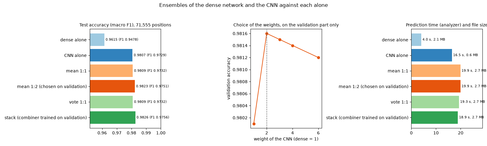

# Ensembles of networks against each network alone

Measurement for issue #40: does combining our dense network and our CNN beat the CNN alone, and
at what cost? Decision: [ADR-0045](../adr/0045-model-ensembles.md).

## Method

- **Members**: the pushed dense network (`my_torch_network_final.nn`) and the CNN snapshot
  (`bonus/networks/my_torch_network_cnn_epoch10.nn`), unchanged: no member is re-trained.
- **Data**: the split of ADR-0017 (seed 42) on which both were trained: 71,558 validation and 71,555
  test positions (written by `scripts/bench_baselines.sh`).
- **Choices on the validation part only**: the weight of the CNN in the mean (1, 2, 3, 4, 6, the
  dense network having 1), kept by validation accuracy; the stacked combiner
  (`configs/ensemble_stack.conf`, one dense layer and softmax on the 10 probabilities, 55
  parameters) trained on the validation part, with 20 % of it held out for early stopping.
- **Test part, read once per model**: each network alone, the mean 1:1, the mean with the chosen
  weight, the vote 1:1 and the stack, through `my_torch_analyzer --predict` on the ensemble file
  (time and peak memory by GNU time), scored by `scripts/score.cpp`. The difference with the CNN
  alone is tested on the same positions with an exact McNemar test (positions the ensemble fixes
  against positions it breaks).
- **Machine**: Intel Core i7-1355U, 12 threads, g++ 15.2.0; 2026-11-05
  ([`run.txt`](data/ensembles/run.txt)).
- **Reproduce**: `sh scripts/bench_ensembles.sh`.

## Results

Validation accuracy ([`weights.csv`](data/ensembles/weights.csv)): dense 0.9597, CNN 0.9806; mean
with a CNN weight of 1: 0.9801, **2: 0.9816**, 3: 0.9815, 4: 0.9814, 6: 0.9812; vote 0.9801. The
combiner stopped after 11 epochs, 0.9822 on its held-out 20 %
([`stack_training.txt`](data/ensembles/stack_training.txt)).

Test part ([`ensembles.csv`](data/ensembles/ensembles.csv), [`mcnemar.csv`](data/ensembles/mcnemar.csv), scores and confusion matrices in
[`test/`](data/ensembles/test/)):

| Model | Accuracy | Macro F1 | F1 Check W | F1 Check B | F1 Mate W | F1 Mate B | Against the CNN: fixed / broken (p) | Prediction | Peak memory | File |
| --- | --- | --- | --- | --- | --- | --- | --- | --- | --- | --- |
| Dense alone | 0.9615 | 0.9478 | 0.9427 | 0.9470 | 0.9224 | 0.9309 | - | 4.0 s | 146 MB | 2.1 MB |
| CNN alone | 0.9807 | 0.9729 | 0.9701 | 0.9738 | 0.9578 | 0.9630 | - | 16.5 s | 416 MB | 0.6 MB |
| Mean 1:1 | 0.9809 | 0.9732 | 0.9714 | 0.9732 | 0.9595 | 0.9621 | 403 / 387 (0.59) | 19.9 s | 535 MB | 2.7 MB |
| Vote 1:1 | 0.9809 | 0.9732 | 0.9714 | 0.9732 | 0.9595 | 0.9621 | 403 / 387 (0.59) | 19.3 s | 535 MB | 2.7 MB |
| **Mean 1:2** (weight chosen on validation) | **0.9823** | **0.9751** | 0.9730 | 0.9754 | 0.9619 | 0.9652 | 263 / 150 (3e-8) | 19.9 s | 535 MB | 2.7 MB |
| **Stack** | **0.9826** | **0.9756** | 0.9735 | 0.9762 | 0.9622 | 0.9660 | 239 / 101 (5e-14) | 18.9 s | 535 MB | 2.7 MB |

F1 of `Nothing` is 0.9998 or 0.9999 for every model except the dense one (0.9958).

## Analysis

- **Weighting matters more than combining.** With equal weights the dense network, 2 points
  weaker, pulls the CNN down as often as it helps it: 403 positions fixed, 387 broken, no gain.
  Giving the CNN twice the weight keeps the dense network's help where the CNN hesitates: 113
  positions more than the CNN alone, +0.16 point.
- **The stack is best**, +0.19 point (138 positions net), with a combiner of 55 parameters: it
  learns per class how far to trust each member instead of one weight for all. The gain is spread
  over every check and mate class.
- **With two members, the vote is the 1:1 mean**: when they agree both give that class; when they
  disagree the tie goes to the higher mean probability, which is the class the mean chooses. Its
  predictions were identical on every test position.
- **The cost is the sum of the members**: the ensemble runs both networks (prediction 1.2 times
  the CNN's time, 535 MB peak memory against 416 MB) and stores both (2.7 MB).

## Limits

- Two members only, one of them clearly weaker; the gain of an ensemble usually grows with more
  members of similar strength (CNNs from several seeds), which was not measured.
- The stack and the weight both use the validation part, which the members' training used for
  early stopping (ADR-0022); the test part was never read before the final scoring.
- Times were measured on a laptop under varying load: the dense network took 4.0 s here and 2.3 s
  in [23-baselines.md](23-baselines.md). Compare times within this table only.
- One run: no spread over seeds; the McNemar test covers the uncertainty of the test positions,
  not that of training.
