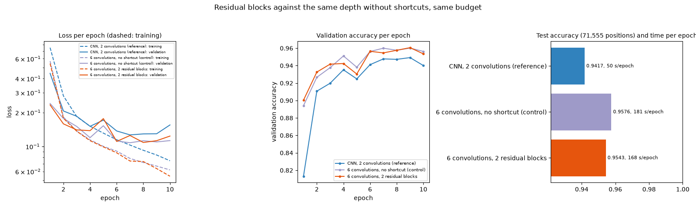

# Residual blocks against the same depth without shortcuts

Measurement for issue #31: do residual blocks (`Residual`, ADR-0046) help a deeper CNN train on our
data, at the same budget? Decision: [ADR-0046](../adr/0046-residual-blocks.md).

## Method

- **Three networks** (`configs/residual/`), same input encoding, same optimizer, same seeds:
  - `cnn.conf`: the current CNN, 2 convolutions, 73,701 parameters (reference);
  - `cnn_deep.conf`: 6 convolutions, **no** shortcut, 118,053 parameters (control);
  - `cnn_residual.conf`: the **same** 6 convolutions, 4 of them inside 2 `residual layers=3` blocks,
    118,053 parameters. The only difference with the control is the two identity shortcuts.
- **Reduced budget**: the first 10 % of the training part of the split (ADR-0017, seed 42), 57,244
  positions, no augmentation; the whole validation part (71,558 positions) as `validation_tail`;
  10 epochs, batch 64, no early stopping (`patience=0`), seed 42. The networks are therefore far
  from the pushed CNN (98.07 %, full data): this report compares the three architectures with each
  other, not with that number.
- **Test part, read once**: 71,555 positions, `my_torch_analyzer --predict` (time and peak memory by
  GNU time), scored by `scripts/score.cpp`. The residual network is compared with the control on the
  same positions by an exact McNemar test (`scripts/mcnemar.py`).
- **Machine**: Intel Core i7-1355U, 12 threads, g++ 15.2.0; 2026-11-05
  ([`run.txt`](data/residual/run.txt)).
- **Reproduce**: `sh scripts/bench_residual.sh` (needs the split of `scripts/bench_baselines.sh`).

## Results

Test part ([`residual.csv`](data/residual/residual.csv), scores and confusion matrices per
network in [`data/residual/`](data/residual/)):

| Network | Accuracy | Macro F1 | F1 Check W | F1 Check B | F1 Mate W | F1 Mate B | Final train loss | Best validation accuracy | Training | Per epoch | Peak memory (training) | Prediction | File |
| --- | --- | --- | --- | --- | --- | --- | --- | --- | --- | --- | --- | --- | --- |
| 2 convolutions (reference) | 0.9417 | 0.9178 | 0.9147 | 0.9186 | 0.8594 | 0.8971 | 0.0746 | 0.9492 | 503 s | 50 s | 430 MB | 10.6 s | 594 kB |
| 6 convolutions, no shortcut (control) | **0.9576** | **0.9402** | 0.9422 | 0.9316 | 0.9149 | 0.9123 | 0.0619 | 0.9601 | 1,807 s | 181 s | 1,048 MB | 59.0 s | 950 kB |
| 6 convolutions, 2 residual blocks | 0.9543 | 0.9355 | 0.9340 | 0.9334 | 0.8976 | 0.9128 | **0.0544** | **0.9606** | 1,679 s | 168 s | 1,112 MB | 60.6 s | 950 kB |

Residual against control, same test positions ([`mcnemar.txt`](data/residual/mcnemar.txt)): the
residual network fixes 1,287 positions the control gets wrong and breaks 1,521 the control gets
right, **p = 1.1e-5**. The control is better on the test part, and the difference is significant.

## Reading

- **Depth helps**: both 6-convolution networks beat the 2-convolution reference by 1.3 to 1.6
  points of accuracy and 1.8 to 2.2 points of macro F1, at 3.3 to 3.6 times the time per epoch.
- **The shortcuts do not**, at this depth: the residual network reaches the lowest training loss
  (0.0544 against 0.0619) and the same best validation accuracy (0.9606 against 0.9601), but ends
  0.33 point below the control on the test part. Its validation loss is also higher at the last
  epoch (0.1235 against 0.1126): it fits the training data a little better and generalizes a little
  worse.
- This is consistent with what residual connections are for: they fix the degradation of **very**
  deep networks (tens of layers), where gradients fade. Six convolutions train fine without them
  here; the control's loss falls as fast as the residual one from the first epoch.
- The time per epoch of the residual network is 7 % lower than the control's although it does the
  same computation plus two additions: this is run-to-run noise on a laptop processor, not a
  speed-up.

## Limits

- **One seed, one run per network.** The McNemar test says the two trained networks differ on the
  test positions; it does not say how much of that difference a different seed would change. Both
  validation curves cross several times (graph, middle).
- **10 % of the data and 10 epochs**: chosen so the three runs fit in about an hour. With the full
  data or more epochs, the ranking may change; the measurement does not cover it.
- **One depth**: 6 convolutions. Deeper networks, where shortcuts usually matter, cost more than
  3 minutes per epoch on this machine and were not measured.
- No normalization layer inside the blocks; the usual residual block (convolution, batch
  normalization, activation) was not tried.

## Consequence

The containers stay in the library: they are tested (finite differences on `Residual`, `Concat` and
nested blocks), saved and loaded, and they are what attention (#32) builds on. The pushed network
does not change: on this data, the measured gain comes from depth, not from the shortcuts.
