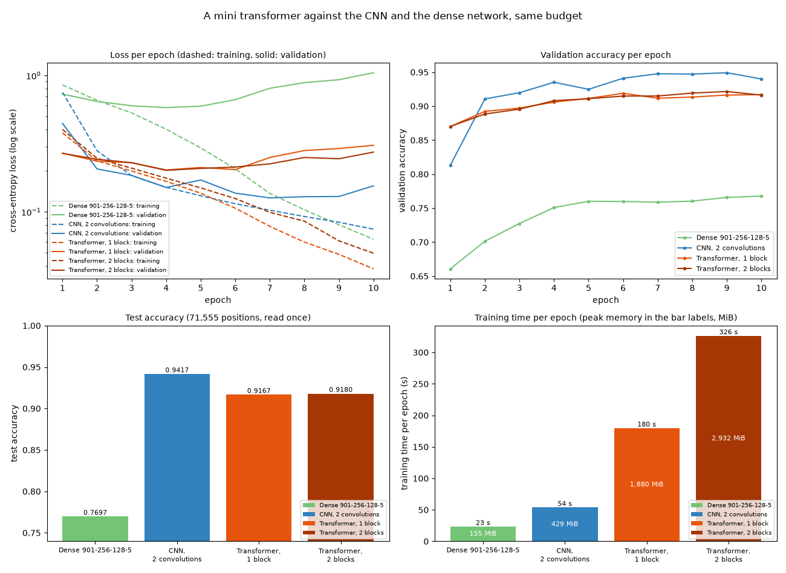

# A mini transformer against the CNN and the dense network

Measurement for issue #32: does self-attention over the 64 squares (`self_attention`, `token_norm`,
`token_dense`, `positional`; ADR-0047) beat the CNN on our data, at the same budget? Decision:
[ADR-0047](../adr/0047-attention-layers.md).

## Method

- **Four networks** (`configs/attention/`), same encoding `fen-attacks-901` (64 tokens of 19
  features for the transformers, the flat 901 vector for the dense network and the CNN), same
  optimizer (Adam, lr 0.001), same seeds:
  - `dense.conf`: dense 901-256-128-5 (reference);
  - `cnn.conf`: the CNN with 2 convolutions (reference, the same one as report 28);
  - `transformer1.conf`: embedding to 32 dimensions plus a learned position per square, **1**
    pre-norm block (4-head self-attention, then a 32-128-32 MLP, each inside a `residual`), then
    flatten (2048), dense 128, dense 5;
  - `transformer2.conf`: the same with **2** blocks.
- **Reduced budget**, the one of [report 28](28-residual.md): the first 10 % of the training part
  of the split (ADR-0017, seed 42), 57,244 positions, no augmentation; the whole validation part
  (71,558 positions) as `validation_tail`; 10 epochs, batch 64, no early stopping
  (`patience=0`), seed 42. The networks are therefore far from the published CNN in `bonus/networks/` (98.07 %, full
  data): this report compares architectures with each other, not with that number.
- **Test part, read once**: 71,555 positions, `my_torch_analyzer --predict` (time and peak memory
  by GNU time), scored by `scripts/score.cpp`. The last epoch is the network that is scored: no
  epoch and no hyper-parameter was chosen on the test part. Each transformer is compared with the
  CNN on the same positions by an exact McNemar test (`scripts/mcnemar.py`).
- **Machine**: Intel Core i5-12450H, 12 threads, 15,655 MB RAM, g++ 13.3.0, Linux 6.8.0-90
  ([`run.txt`](data/attention/run.txt)). This is **not** the machine of report 28 (i7-1355U,
  g++ 15.2.0): the accuracies of the CNN are identical (0.9417, same seed and data), its times are
  not (53.7 s per epoch here, 50 s there).
- **Load**: the machine was shared and not idle. The 1-minute load average at the start of
  training is 7.6 (dense), 8.4 (CNN), 0.59 (`transformer1`) and 4.4 (`transformer2`); at the end
  8.7, 6.1, 3.2 and 4.9 (`loadavg_before.txt` and `loadavg_after.txt` in each network directory). Times
  are therefore indicative; the ratios between networks are the reading, not the seconds.
- **Interrupted run**: the machine rebooted while `transformer1` was training. The dense network
  and the CNN had finished and were kept; `transformer1` was trained again from scratch, then
  `transformer2`. A one-epoch timing pilot of `transformer1` ([`pilot.txt`](data/attention/pilot.txt),
  251 s, load 5 to 9) only served to choose the budget; it is not a result.
- **Reproduce**: `sh scripts/bench_attention.sh` (needs the split of `scripts/bench_baselines.sh`);
  `scripts/plot_attention.py` draws the graph from the files in `data/attention/`.

## Results

Test part ([`attention.csv`](data/attention/attention.csv), scores and confusion matrices per
network in [`data/attention/`](data/attention/)):

| Network | Accuracy | Macro F1 | F1 Check W | F1 Check B | F1 Mate W | F1 Mate B | Final train loss | Final validation loss | Best validation accuracy | Training | Per epoch | Peak memory (training) | Prediction | File |
| --- | --- | --- | --- | --- | --- | --- | --- | --- | --- | --- | --- | --- | --- | --- |
| Dense 901-256-128-5 | 0.7697 | 0.7419 | 0.7155 | 0.6750 | 0.7303 | 0.7360 | 0.0629 | 1.0457 | 0.7678 | 234 s | 23 s | 155 MiB | 4.9 s | 2.03 MiB |
| CNN, 2 convolutions | **0.9417** | **0.9178** | 0.9147 | 0.9186 | 0.8594 | 0.8971 | 0.0746 | **0.1550** | **0.9492** | 537 s | 54 s | 429 MiB | 16.8 s | 0.57 MiB |
| Transformer, 1 block | 0.9167 | 0.8811 | 0.8825 | 0.8786 | 0.8280 | 0.8162 | **0.0382** | 0.3073 | 0.9190 | 1,797 s | 180 s | 1,880 MiB | 70.4 s | 2.14 MiB |
| Transformer, 2 blocks | 0.9180 | 0.8818 | 0.8846 | 0.8877 | 0.8067 | 0.8300 | 0.0497 | 0.2740 | 0.9216 | 3,262 s | 326 s | 2,932 MiB | 134.2 s | 2.24 MiB |

The F1 of the class `Nothing` is 0.999 (CNN), 1.000 and 1.000 (transformers), 0.853 (dense): not
a discriminating column, hence left out of the table.

Each transformer against the CNN, same test positions
([`mcnemar_transformer1.txt`](data/attention/mcnemar_transformer1.txt),
[`mcnemar_transformer2.txt`](data/attention/mcnemar_transformer2.txt)):

| Comparison | Fixes (CNN wrong, network right) | Breaks (CNN right, network wrong) | p |
| --- | --- | --- | --- |
| Transformer 1 block | 2,362 | 4,153 | 2.4e-110 |
| Transformer 2 blocks | 2,154 | 3,847 | 3.6e-107 |
| Dense | 1,915 | 14,225 | below the smallest double (printed as 0) |

## Reading

- **The transformers do not beat the CNN here**: 91.67 % and 91.80 % against 94.17 %, 2.4 to 2.5
  points of accuracy and 3.6 to 3.7 points of macro F1 below, and the difference is significant (they
  break about 1.8 times as many positions as they fix). Both are far above the dense network
  (76.97 %): looking at the board as 64 squares that talk to each other is a much better start
  than a flat vector, but a 2-convolution CNN already does it better.
- **Overfitting is visible**: the final training loss of the transformers (0.038 and 0.050) is
  five to eight times below their validation loss (0.307 and 0.274); the validation loss is lowest
  at epoch 4 (0.203 and 0.202) and rises afterwards while the validation accuracy gains only
  about one point (0.906 to 0.917 and 0.908 to 0.916; graph, top). The CNN's
  validation loss is the lowest of the four (0.155). With 57,244 positions, the larger networks
  memorize.
- **A second block adds 0.13 point of accuracy** (91.80 % against 91.67 %) for 1.8 times the time
  per epoch and 1.6 times the memory. No test compares the two transformers with each other, and
  a gap this small is within what a different seed could change; it is not evidence that depth
  helps. The best validation accuracy is 0.9216 against 0.9190, the same order.
- **The mate classes are the weak ones** for the CNN and the transformers, the transformers more
  than the CNN (F1 on `Checkmate Black`: 0.816 and 0.830 against 0.897); for the dense network the
  check classes are lower (`Check Black` 0.675). A possible explanation, not measured here: mate
  means "every reply fails", a precise count over attack maps rather than a soft pattern.
- **Cost**: per epoch, 3.3 times (one block) and 6.1 times (two blocks) the CNN; training memory
  4.4 and 6.8 times; prediction 4.2 and 8.0 times (70 s and 134 s for 71,555 positions). The
  network files are about 4 times larger (2.1 and 2.2 MiB against 0.57 MiB).
- **Why**: the following are hypotheses, **not measured here**. Convolutions bring locality and
  weight sharing, which suit "a piece attacks a square next to it", and attention has to learn
  them from 57,244 positions in 10 epochs. Our attention layers have no sliding structure beyond
  the learned position per square. A run on the full data, or with augmentation, could close part
  of the gap; this one cannot say.

## Limits

- **One seed, one run per network.** The McNemar test says the trained networks differ on the test
  positions; it does not say how much a different seed would change. The validation curves of the
  two transformers overlap throughout.
- **10 % of the data and 10 epochs**: chosen so four networks fit in a few hours. With the full
  data or more epochs, the ranking may change; the measurement does not cover it. In particular
  attention is known to need more data than convolutions; this report is evidence about this
  budget only.
- **One width and one head count**: 32 dimensions, 4 heads, MLP 128. Nothing was tuned; only the
  number of blocks (1 and 2) varies.
- **Times are noisy**: shared machine, different load per network (see Method). The ratio between
  the CNN and a transformer is large enough (3 to 6 times) to survive that; the second decimal of
  a ratio does not.
- **No regularization** (no dropout, no weight decay): the library has neither. The overfitting
  above might be reduced by them; they were not tried.
- **Not the pushed network**: the published CNN in `bonus/networks/` (98.07 %) was trained on all the data and is not
  compared here.

## Consequence

The attention layers stay in the library: they are tested (finite differences on every layer,
including the head split and the softmax), saved and loaded in both formats, and documented. The
pushed network does not change: on this data and at this budget, the CNN is better, faster and
smaller. ADR-0047 stays Proposed; its follow-up (this report) is done, and the question "does
attention win with the full data" remains open.
