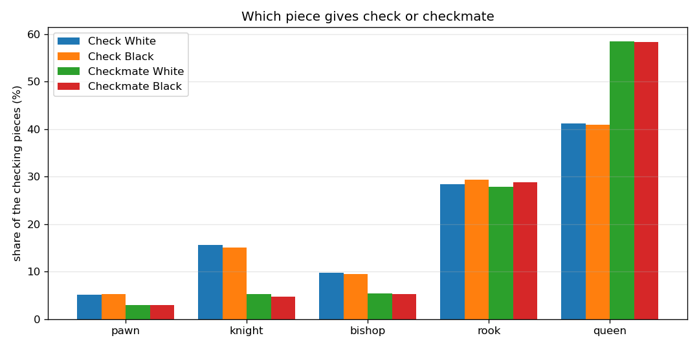
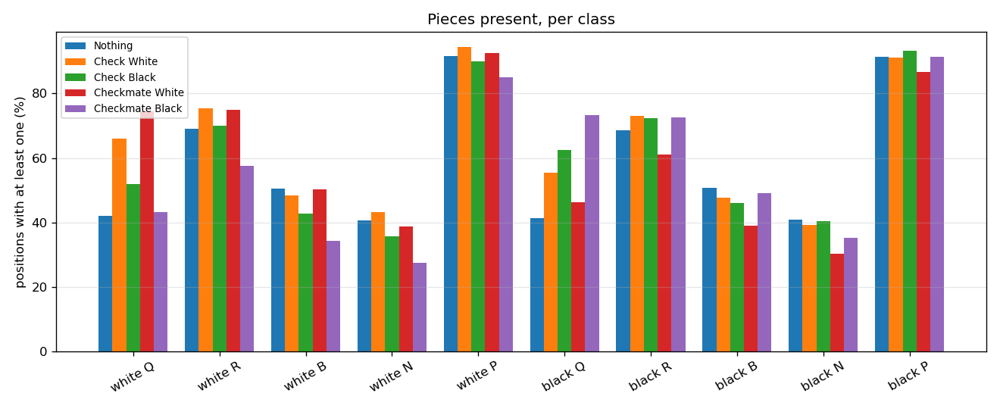
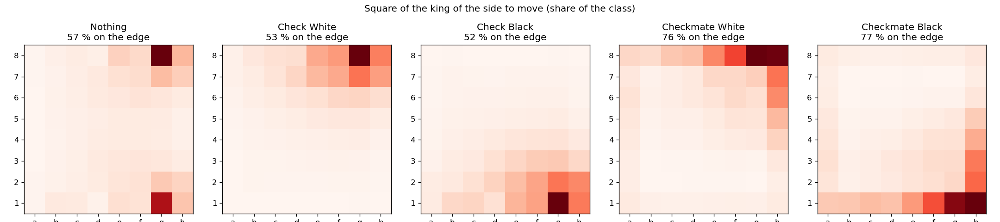
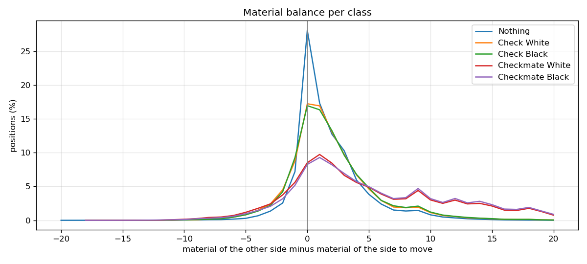

# Exploratory data analysis: what the network has to learn, and the shortcuts it could take

Complements [dataset.md](dataset.md) (classes, duplicates, contradictions, imbalance, side to move,
pieces per board, split), which this page does not repeat. Here: which piece gives check, which
pieces are present, where the attacked king stands, the material balance, the FEN fields that are
almost always empty, and the source files. The aim is practical: know which simple clues
("shortcuts") a network could latch on to instead of the rule, so that its errors can be explained.

## Method

- **Data**: every line of the dataset (723,019 positions, `dataset/*/*.txt`), before any split.
- **Tool**: `bonus/my_torch_eda` reads every position once with the FEN parser and uses the
  rule-based oracle (ADR-0006) to list the pieces attacking the king of the side to move
  (`oracle::attackers`). It lives in `bonus/` because it uses the oracle; the main code does not
  depend on it.
- **"Attacker"** is the side that gives check (the side not to move), **"defender"** the side to move.
  For `Nothing`, the same convention is kept so that the classes can be compared.
- **Material** uses the usual values: pawn 1, knight 3, bishop 3, rook 5, queen 9 (kings excluded).
- **Machine**: Intel Core i7-1355U, 14 GB RAM, Linux 7.0, g++ 15.2.0 `-O2`; the whole analysis
  takes under one second.
- **Reproduce**: `sh bonus/scripts/eda.sh` (graphs with matplotlib 3.10.7, Python 3.14.4). Raw data:
  [`eda_checkers.csv`](data/eda_checkers.csv), [`eda_pieces.csv`](data/eda_pieces.csv),
  [`eda_kings.csv`](data/eda_kings.csv), [`eda_material.csv`](data/eda_material.csv),
  [`eda_fen.csv`](data/eda_fen.csv), [`eda_files.csv`](data/eda_files.csv).

**Consistency check**: every one of the 423,019 `Check` and `Checkmate` positions has at least one
attacker of the king of the side to move (`no_attacker` is 0 in every class), which agrees with the
oracle's 100 % agreement on the labels ([verification-dataset.md](../verification-dataset.md)).

## Results (2026-10-26)

### 1. Which piece gives check

| Class | Pawn | Knight | Bishop | Rook | Queen | Double checks |
| --- | --- | --- | --- | --- | --- | --- |
| Check White | 5.2 % | 15.5 % | 9.8 % | 28.4 % | 41.1 % | 0.53 % |
| Check Black | 5.2 % | 15.1 % | 9.4 % | 29.3 % | 40.9 % | 0.48 % |
| Checkmate White | 3.0 % | 5.3 % | 5.3 % | 27.9 % | 58.5 % | 0.52 % |
| Checkmate Black | 3.0 % | 4.7 % | 5.2 % | 28.8 % | 58.3 % | 0.45 % |

- **The queen gives 41 % of the checks and 58 % of the checkmates**, the rook about 28 % of both.
- **Knights give 15 % of the checks but only 5 % of the checkmates.** A knight check is the only one
  that does not follow a line, so it cannot be blocked; the network has to learn its L-shaped
  pattern from relatively few mates.
- Double checks are rare (about 0.5 %), the same in every class.

### 2. Pieces present

- **A queen of the attacking side is much more frequent in checks and mates**: a white queen is on
  the board in 66 % of `Check White` and 74 % of `Checkmate White` positions, against 42 % of
  `Nothing`; symmetrically for black (62 % and 73 % against 41 %).
- Pawns are present almost everywhere (85 % to 94 %) and tell little.

### 3. Where the attacked king stands

| Class | King on the edge of the board | King in a corner |
| --- | --- | --- |
| Nothing | 57.1 % | 7.7 % |
| Check White / Black | 53.0 % / 51.6 % | 7.9 % / 7.8 % |
| Checkmate White / Black | **76.3 % / 77.0 %** | **16.3 % / 16.7 %** |

- **Mates happen on the edge**: three kings out of four, and twice as often in a corner as in the
  other classes. A king in the middle of the board has more escape squares.
- In `Nothing` and `Check`, the king often stands on g1 or g8, the square of a castled king.

### 4. Material balance

| Class | Mean balance (attacker − defender) | Attacker ahead |
| --- | --- | --- |
| Nothing | +1.68 | 59.2 % |
| Check White / Black | +1.92 / +2.01 | 63.7 % / 64.1 % |
| Checkmate White / Black | **+5.21 / +5.65** | **74.6 % / 77.0 %** |

The side giving checkmate is usually ahead in material, by more than five pawns on average; checks
are much closer to the balance of ordinary positions.

### 5. FEN fields

| Class | Castling rights | En passant square | Mean halfmove clock | Mean move number |
| --- | --- | --- | --- | --- |
| Nothing | 3.7 % | 0.05 % | 3.5 | 43.5 |
| Check White / Black | 3.7 % / 2.9 % | 0.01 % / 0.03 % | 4.2 / 4.6 | 43.2 / 46.2 |
| Checkmate White / Black | 2.7 % / 2.0 % | 0 / 0 | 3.9 / 4.2 | 44.4 / 46.9 |

Castling rights exist in under 4 % of the positions and an en passant square in under 0.06 %: the
dataset is made of middlegames and endgames. The castling inputs of `fen-onehot-773` and
`fen-attacks-901` are almost always zero; most of their gain over `fen-onehot-768`
([encodings.md](encodings.md)) must come from the side to move.

### 6. Source files

| File | Lines | Mean pieces | Share of checkmates in that size group |
| --- | --- | --- | --- |
| `*/10_pieces.txt` | 220,285 | 6.3 to 6.9 | 20.5 % |
| `*/20_pieces.txt` | 300,000 | 14.5 to 14.7 | 33.3 % |
| `*/many_pieces.txt` | 202,734 | 22.2 to 23.6 | 14.1 % |

This **confirms** the hypothesis of [dataset.md](dataset.md): the three files of each class come from
three generators with about 6.5, 14.6 and 23 pieces, which explains the peaks of its piece-count
chart. The mix of classes differs between the groups: checkmates are a third of the 20-piece
positions but a seventh of the crowded ones.

## Shortcuts a network could take

None of these clues decides the class on its own, but each is correlated with it, so a network can
reach a decent score by leaning on them instead of on the attack rule:

| Clue | Correlated with | Where it would fail |
| --- | --- | --- |
| A queen of the side not to move is on the board | Check and checkmate | The 34 % of `Check White` positions without a white queen, and every knight or pawn check |
| The king of the side to move is on the edge or in a corner | Checkmate | Edge kings in `Nothing` (57 %), mates in the middle (24 %) |
| The side not to move is ahead in material | Checkmate | The quarter of mates where the side giving mate is not ahead (level or behind) |
| Number of pieces | Checkmate share (33 % at 20 pieces, 14 % with many) | Any position from another distribution |

The attack maps of `fen-attacks-901` give the network the rule itself (which squares are attacked),
which is one reason to prefer it over clues it would otherwise have to rediscover.

## Limits

- Correlations, not causes: the table above says what a network *could* use, not what ours does.
  Checking it needs the errors of the final network per checking piece, king square and material
  balance (#18), with the same tool.
- The dataset is generated (three piece-count groups per class); positions from real games may have
  other proportions, so these clues may not hold outside the dataset.
- Material values are the usual conventions, not a measure of who is winning.
