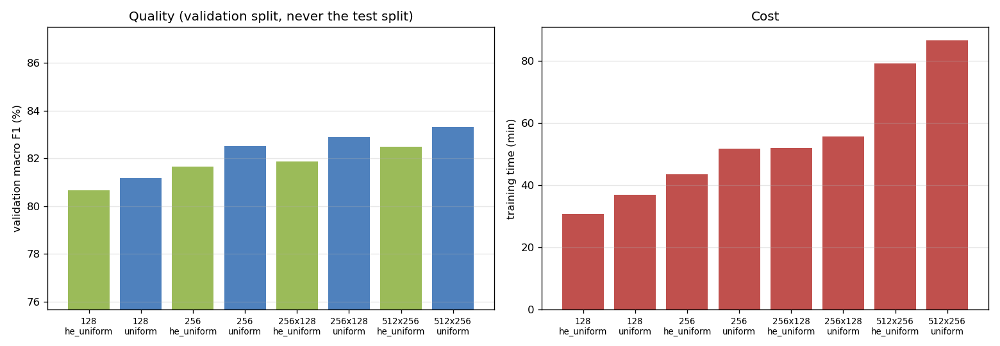
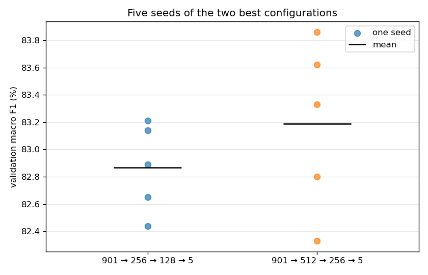

# Trial runs: choosing the architecture and initialisation of the final network

Measurement for step 3 of issue #17: which hidden layers and which initialisation should the final
network use? Related decision: [ADR-0023](../adr/0023-final-architecture.md).

## Method

- **Pipeline**: `scripts/train_final.sh` (ADR-0022) on **10 % of the dataset**: the dataset split
  (seed 42), its training part augmented four times (about 229,000 positions), the untouched
  validation part (7,155 positions) appended for early stopping.
- **Scored on the validation split, never on the test split** (`EVAL=validation`): the test split is
  kept for the final network, so that its score is not biased by the choice.
- **Fixed settings** (`configs/final_network.conf`): encoding `fen-attacks-901` (ADR-0016),
  cross-entropy with the natural class distribution (ADR-0018), Adam 0.001, batches of 64, at most
  30 epochs with early stopping (patience 3, best weights restored).
- **First series**: 4 architectures × 2 initialisations, one seed each (`configs/trials/`): hidden
  layers 128, 256, 256 → 128 and 512 → 256; default initialisation (`uniform`) or `he_uniform` on the
  hidden layers (ADR-0020).
- **Second-seed check**: the two best configurations again with seeds 2 to 5
  (`configs/trials-seeds/`), so five seeds each. A seed sets the initial weights (`init seed`) and
  the batch order (`seed`); the data split and the validation set stay the same.
- **Machine**: a shared VPS, AMD EPYC, 8 cores, 23 GB RAM, Ubuntu 24.04, g++ 13.3.0; 8 runs at a time.
  Other users' processes were running, so **training times are indicative only**; the scores are
  deterministic (a run on the VPS gave the same network byte for byte as on the development laptop).
- **Reproduce**: `FRACTION=0.1 sh scripts/trial_runs.sh` then
  `FRACTION=0.1 TRIALS=configs/trials-seeds RUNS=runs/trials-seeds sh scripts/trial_runs.sh
  docs/performance/data/trials-seeds` and `python3 scripts/plot_seed_check.py`. First series: 88 min;
  second-seed check: 103 min. Raw data: [`data/trials.csv`](data/trials.csv),
  [`data/trials-seeds/trials.csv`](data/trials-seeds/trials.csv),
  [`data/seed_check.csv`](data/seed_check.csv).

## Results (2026-10-26)

### First series (one seed each)

| Hidden layers | Initialisation | Parameters | Validation accuracy | Validation macro F1 | Epochs |
| --- | --- | --- | --- | --- | --- |
| 512 → 256 | default | 594,437 | 86.6 % | **0.833** | 8 |
| 256 → 128 | default | 264,453 | 85.9 % | 0.829 | 9 |
| 256 | default | 232,197 | 85.2 % | 0.825 | 9 |
| 512 → 256 | he_uniform | 594,437 | 85.4 % | 0.825 | 7 |
| 256 → 128 | he_uniform | 264,453 | 84.9 % | 0.819 | 8 |
| 256 | he_uniform | 232,197 | 84.2 % | 0.817 | 7 |
| 128 | default | 116,101 | 83.9 % | 0.812 | 11 |
| 128 | he_uniform | 116,101 | 83.1 % | 0.807 | 9 |

(Left graph: blue = default initialisation, green = `he_uniform`.)

- **The default initialisation beats `he_uniform` for all four architectures**, by 0.5 to 1 point of
  macro F1. Meric's spiral benchmark found the same with ReLU ([initialisation.md](initialisation.md)).
- **More capacity helps, with diminishing returns**: +1.3 points from 128 to 256, +0.4 from 256 to
  256 → 128, +0.4 from 256 → 128 to 512 → 256 for 2.2 times the parameters.
- **Every network overfits at 10 % of the data**: for 256 → 128, training accuracy reaches 95.7 %
  while validation stays near 85 %; early stopping stops after 7 to 11 epochs.

### Second-seed check (five seeds each)

| Hidden layers | Macro F1, seeds 1 to 5 | Mean | Standard deviation | Mean accuracy |
| --- | --- | --- | --- | --- |
| 256 → 128 | 0.829, 0.831, 0.827, 0.824, 0.832 | **0.829** | 0.3 point | 85.7 % |
| 512 → 256 | 0.833, 0.839, 0.836, 0.828, 0.823 | **0.832** | 0.6 point | 86.2 % |

- The seeds of one configuration spread over **0.8 point (256 → 128) and 1.5 points (512 → 256)**,
  more than the 0.4-point gap of the first series: one seed per trial was not enough to choose.
- **The difference of the means, 0.3 point, is not significant**: it is about one standard error
  (Welch's t ≈ 1.0, against about 2 for a 5 % level), and the five-seed ranges overlap.
- 512 → 256 is also less stable (twice the standard deviation): depending on the seed it is the best
  (0.839) or the worst (0.823) of the ten runs.

## Limits

- 10 % of the data: with ten times more, a larger network overfits less and could gain more. The
  final training (step 4) will show whether 256 → 128 is limited by its capacity (training accuracy
  close to validation accuracy) or by the data.
- Five seeds give a rough idea of the spread, not a precise interval.
- Only the hidden layers and the initialisation were varied; the learning rate, batch size and
  dropout are the subject of the hyperparameter search (#10).
- Times come from a shared machine and were affected by other users.
